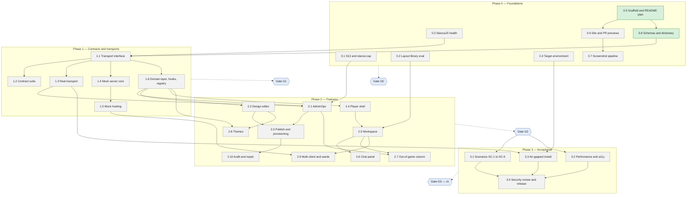

# War Rooms X2

Distributed wargame environment, focusing on command and control. This repo builds **War Rooms X1 (WRX1)** v1: admin-designed, chat-based wargames with an ejabberd XMPP server as the only backend.

## Plan

Work packages and their status: grey to do, amber active, green done. Every PR updates this chart (DOC-22); see [how PRs update the chart](WRX1-Dev-Plan.md#the-readme-plan-chart).



## Documents

- [Software requirements (SRD)](WRX1-SRD.md)
- [Development plan](WRX1-Dev-Plan.md) and [work package briefs](plan/briefs/)
- [Data dictionary](docs/data-dictionary.md), generated from the schemas

## Repo layout

| Path | What |
| --- | --- |
| `packages/schemas` | Runtime schemas (zod) for every PubSub document and message body, and the types inferred from them (WP 0.8) |
| `apps/web` | The web app. A shell for now; the player client and admin backend are built in Phase 2 |
| `tools` | CI checks and the local ESLint rules |
| `plan/briefs` | One brief per work package |

## Development

Needs Node 22 and pnpm 10 (`corepack enable`).

```sh
pnpm install
pnpm check            # type check, lint, format, unit tests, traceability, dictionary
pnpm e2e              # Playwright, against a production build
pnpm check:mermaid    # every Mermaid block in the repo's Markdown parses
pnpm dictionary       # regenerate docs/data-dictionary.md after a schema change
pnpm --filter @wrx/web dev
```
