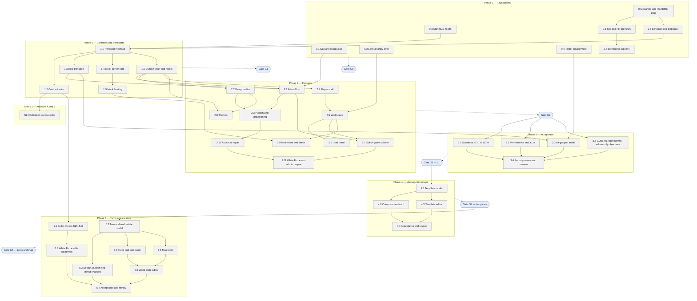

# War Rooms X1 — Development Plan

Oct 24, 2026 (revised the same day, see Plan changes) · @Ian Mayo

## Summary

WRX1 v1 is built by Claude Code in four phases, with up to five work packages running in parallel. Automated CI gates check every PR; people review only at four phase gates and on security-critical PRs.

- **Phase 0, foundations:** pre-development checks P1–P5, repo scaffold, CI, the GitHub Pages site with PR previews, and the schemas.
- **Phase 1, contracts and transports:** the transport interface, contract suite, real transport, mock server and domain layer.
- **Phase 2, features, in three lanes:** admin; player shell, workspace and chat; themes and multi-client.
- **Phase 3, acceptance:** end-to-end scenarios, performance, accessibility, the air-gapped install and release.

The repo README opens with a Mermaid flowchart of this plan's work packages, dependencies and status (section 4). The first scaffold PR creates it, and every PR afterwards updates it with progress or plan changes.

## Working model

Each work package (WP) is a written brief that one Claude Code session builds on its own branch, and the only shared ground between parallel sessions is interfaces that have been frozen.

1. **Brief.** Each WP has a brief at `plan/briefs/WP-x.y.md`. It lists the SRD ids the WP delivers, its acceptance tests, the folders it owns, and the interfaces it may only consume.
2. **Session.** One Claude Code session per WP, in its own git worktree, on a WP branch cut from its phase branch. Sessions don't edit folders owned by another active WP.
3. **One PR per phase.** Each phase has a long-lived branch (`phase-0` to `phase-3`) and a draft PR against `main`, opened when the phase starts. Its preview, screenshots and bot comment update on every push, so progress can be looked at any time. WP branches merge into the phase branch automatically when CI is green, with no human review. Doc reviews only the four phase PRs.
4. **Interfaces.** Shared contracts are set in designated WPs: 0.8 (schemas), 1.1 (transport interface), 1.6 (room-type registry) and 2.5 (workspace module). A later change to one of them may merge, but must be listed in the phase PR's gate summary, and dependent WP branches rebase onto it.
5. **Every WP merge includes:**
   - tests, with the contract suite run against both ejabberd and the mock where the transport is touched;
   - its site content: pages, posts and Mermaid diagram updates (DOC-4, DOC-18);
   - tagged Playwright scenarios for screenshots of new UI (DOC-20);
   - an update to the plan chart on the phase branch: the WP's status, and any change to scope or dependencies.
6. **Gate summary.** The phase PR's description is kept up to date as WPs merge. It lists:
   - what was delivered, by SRD id;
   - interface changes made after their designated WP;
   - differences from the baseline plan chart;
   - open risks;
   - links to the preview and the screenshots that matter for review.
7. **Progress.** The plan chart on the current phase branch is the live view. `main`, its README and the live demo update when each phase PR merges.

**Blog posts between gates.** When a WP delivers a notable feature or design decision, its session writes a post. The post goes to `main` in its own blog-only PR, which merges automatically when CI is green, with a frozen snapshot of the phase-branch build at `snapshots/<post-slug>/`. These are the only PRs to `main` besides the four phase PRs (DOC-23 to DOC-26).

## Phases and work packages

There are 40 work packages, including the spike S14 and the Phase 5 spike checks. Each is sized for one to three Claude Code PRs, and the order is set by dependencies, not dates.

| WP | Work package | SRD ids | Depends on |
| --- | --- | --- | --- |
| **Phase 0 — Foundations** |  |  |  |
| 0.1 | S13 offline voice revocation, and the WebSocket stanza cap (P1) | ADM-37, R15 | — |
| 0.2 | Layout library evaluation, FlexLayout vs dockview (P3) | PLY-4, PLY-5, PLY-40, PLY-42, ARC-9 | — |
| 0.3 | StanzaJS health check (P4) | ARC-1, ARC-12 | — |
| 0.4 | Target environment questions (P2), answered by Doc with the customer | D12, D17, NFR-23 | — |
| 0.5 | Repo scaffold: monorepo, TypeScript strict, lint rules, Vitest, Playwright, CI with ejabberd container, PR template, **README with the Mermaid plan chart** | D18, NFR-7, NFR-15–19, NFR-22, DOC-22 | — |
| 0.6 | Site and previews: generator, serialised `gh-pages` deploys, PR previews and bot comment, PR index, `demo/` on main, blog-only auto-merge with frozen snapshots, size check, deny-list check | NFR-1, DOC-1–2, 6–9, 11–16, 23–26 | 0.5 |
| 0.7 | Screenshot pipeline: tagged Playwright capture, images in the PR comment, before/after | DOC-19–21 | 0.6 |
| 0.8 | Runtime schemas (zod) for every PubSub document and message body, and the generated data dictionary (P5) | ARC-6, NFR-20, DOC-3 | 0.5 |
| **Phase 1 — Contracts and transports** |  |  |  |
| 1.1 | XMPP-level transport interface, frozen by interface PR | ARC-1, ARC-12–14 | 0.3, 0.8 |
| 1.2 | Contract suite, ported from the spike and extended: MUC, PubSub, MAM, presence, admin operations, anonymous access | NFR-16, NFR-21, ARC-10–11 | 1.1 |
| 1.3 | Real transport: StanzaJS plus the ejabberd server adapter | ARC-1, ARC-8 | 1.1 |
| 1.4 | Mock server core: affiliations, voice, PubSub access, MAM/RSM, presence, admin operations, errors, seed, clock, injected faults | ARC-7, D14, NFR-21 | 1.1 |
| 1.5 | Mock hosting: SharedWorker, Web Locks fallback, BroadcastChannel, IndexedDB, base-path isolation, migration | D17, ARC-7, DOC-10, DOC-17 | 1.4 |
| 1.6 | Domain layer, session store and hooks; StrictMode-safe cleanup; room-type registry with `chat` registered | ARC-2–5, ARC-13, NFR-5 | 1.1 |
| **Phase 2 — Features** |  |  |  |
| 2.1 | AdminOps: all admin operations and rules R-A to R-F | ADM-35–40, ADM-12, NFR-3 | 1.3, 1.6, 0.1 |
| 2.2 | Admin design editor and admin screen layout | ADM-1–9, 27–28 | 1.6 |
| 2.3 | Publish and provisioning: diff, progress, live changes, reset, export/import, credentials sheet | ADM-10–17, 25–26, NFR-4, NFR-6 | 2.1, 2.2 |
| 2.4 | Player shell: login, session, reconnect, forced logout, welcome page, empty states | PLY-1–3, 27–32, 46–48, 50–52, NFR-8–9 | 1.6 |
| 2.5 | Workspace: dockable layout, persistence, reconciliation, default layout, reset | PLY-4, 5, 8, 40, 42, ARC-9 | 0.2, 2.4 |
| 2.6 | Chat room panel: cards, composer, MAM history, unread counts, observer UI, unsent text; the composer collapses to a bar, remembered per room (added Nov 2, 2026) | PLY-9–14, 33, 43–45, 49, 53, 54 | 2.5 |
| 2.7 | Out-of-game column: announcements, force panel, objectives (including umpire editing) | PLY-15, 25, 35–39, ADM-23–24, 29 | 2.5, 2.1 |
| 2.8 | Themes: runtime theming and inheritance, assets and SVG sanitising, theme editor | D19, PLY-24, 26, ADM-18–22 | 1.6, 2.2 |
| 2.9 | Multi-client view, mock user controls, seed scenarios, admin preview-as-role | PLY-16–22, 34, ADM-30–31 | 1.5, 2.5 |
| 2.10 | Audit and repair; node-name warning | ADM-41–42 | 2.3 |
| 2.11 | White Force and the admin as umpire; White observers' room visibility | §3 rules 4, 14; D8, D21, ADM-4, PLY-15, PLY-35 | 2.7, 2.10 |
| **Phase 3 — Acceptance** |  |  |  |
| 3.1 | Playwright scenarios SC-1 to SC-9 on mock and ejabberd | NFR-17, §12 | Phase 2 |
| 3.2 | Performance and scale (NFR-11, NFR-12), accessibility audit (NFR-14) | NFR-11–14 | Phase 2 |
| 3.3 | Reference deployment and air-gapped install on real hardware | NFR-2, NFR-4, NFR-10, NFR-22–23 | 0.4, 1.3 |
| 3.4 | Security review, release notes, v1 milestone blog post | DOC-2, DOC-5 | 3.1–3.3, 3.5 |
| 3.5 | GUID entity ids, readable login names, deleted-entity records, the reserved `templates` name; objectives edited by the admin only; migration of design files, the seed and tests (the product owner's revision, SRD §14) | §3 rules 1, 6, 14; D21, ADM-5, ADM-14, ADM-16, ADM-26, ADM-42, PLY-1, PLY-35 | Phase 2 |
| **Phase 4 — Message templates (SRD Annex A)** |  |  |  |
| 4.1 | Template model: schemas and the WRX template profile, room config v2, the CSP-safe validator, the `templates` node in publish, audit, reset and the mock, store hooks, seed | TD1, TD2, TD6, TPL-1, TPL-2, TPL-4, TPL-6, TPL-8, TPL-9 | G3 |
| 4.2 | Composer and card: RJSF theme on our tokens, special fields, send, card, TPL-6 checks | TD3, TD7, TPL-3, TPL-5, TPL-6 | 4.1 |
| 4.3 | Template editor: builder, raw editor, live preview, room template config, lock and copy | TD4, TD5, TPL-2, TPL-4, TPL-7 | 4.1 |
| 4.4 | Acceptance: scenario SC-10, performance, accessibility, security review, docs and gate post | Annex A, T-R1, T-R2 | 4.2, 4.3 |
| **Phase 5 — Turns and the map (the product owner's Nov 3, 2026 revision, part of v1)** |  |  |  |
| 5.1 | Spike checks S15 (PubSub item timestamps) and S16 (WebSocket byte shapers) on ejabberd 26.09; record outcomes and adopt shapers if they work | R15, P7 | 1.2 |
| 5.2 | Turn and world-state model: zod schemas for `game-state` and world-state messages (fixed asset fields, `sidc`), JSON Schema export (P8, D26), `map` room type in the registry with its config, one map room per game with participants fixed to every role, the 500 KB map-room cap, `game-state` provisioning, mock and contract tests | §3 rules 16–18, D25, D26, ARC-5, PLY-53 | G4 |
| 5.3 | Design and publishing changes: `designVersion` only on structural changes, layout reset with a notice (retiring the in-place room reconciliation), `rooms:*` and `game-state` readable by every role, room discovery by `directory` subscription, room-name visibility warning, access matrix highlights for the rule 4 consequences | §3 rules 4, 8, 15; D6, PLY-5, PLY-30, PLY-60, ADM-9, R24 | 5.2 |
| 5.4 | Turns: the admin advances phases, the turn panel in the out-of-game column, composers disabled for non-White Force roles during adjudication (advisory) | D7, ADM-43, PLY-55, PLY-56, R27 | 5.2 |
| 5.5 | Map room for players: Leaflet with a runtime tile URL, milsymbol symbols bundled, asset details, the newest valid world state from MAM, admin-only acceptance, 600 assets under 1 s | PLY-57–59, NFR-7, NFR-9, NFR-11, R23, R30 | 5.2 |
| 5.6 | World-state editor for the admin: add, move, edit and delete assets on the map; browser-only draft with an unpublished-edits indicator; change summary and publish at a phase change or at any time from a "Publish world state" action; the world state in design export and import | ADM-16, ADM-44–46, R25, R26 | 5.4, 5.5 |
| 5.8 | Objectives edited by the White Force: one item per author, newest by server timestamp, publisher affiliations for White Force non-observers, cleanup when a role leaves the White Force or is deleted, umpire editing in the player client for those roles | D21, §3 rule 14, PLY-35, R10 | 5.1 |
| 5.7 | Acceptance: scenario SC-11 on both backends, SC-6 updated for the layout reset, performance, accessibility of the map, security review, docs, release notes and the gate post | SC-11, NFR-11, NFR-14, R28, R29 | 5.3, 5.6, 5.8 |
| **After v1 — Annexes A and B** |  |  |  |
| S14 | Spike: collection-level access control on ejabberd, which decides the force-asset node layout (SRD Annex B) | Annex B, TPL-10 | 1.2 |

**Traceability.** Every live SRD requirement id is assigned to at least one WP above, except four that apply to every PR: ARC-15 (team's choice), DOC-4 and DOC-18 (working model item 5) and DOC-5 (blog posts). CI checks this on every PR (`pnpm check:trace`), so a requirement added to the SRD without a WP fails the build.

Documentation is not a separate phase. Each PR carries its own pages and diagrams (DOC-18), and a blog post closes each phase (DOC-5).

## Future tasks

Raised during the build, not yet given a work package.

| Id | Task | SRD ids | Raised |
| --- | --- | --- | --- |
| FT-1 | **(Brief: `plan/briefs/WP-FT-1.md`.) Done:** the breakpoint is 45rem (720 px at default size), not 400 px, see the SRD §14 note. **Out-of-game column as a tab when narrow.** Below a breakpoint (about 400 px, to be tuned), the out-of-game column becomes a workspace tab like the rooms, with its own tab styling that marks it as special (for example the game's accent colour and an icon), and it cannot be closed. Above the breakpoint it returns to the fixed column. Measure the width of the client itself (a container query), not the screen, so each multi-client pane switches on its own width. Its announcements must stay noticeable while the tab is hidden, for example with an unread badge | PLY-36, PLY-8, PLY-16 | Product owner, Phase 2 review of the multi-client view: the column takes too much space in narrow panes |
| FT-2 | **Message templates (SRD Annex A), after v1. A1 to A4 became Phase 4 (WPs 4.1 to 4.4); A5, the image and asset pickers, stays here.** Proposed WPs A1 to A5 (template model, composer and card, template editor, acceptance, image and asset pickers) in `plan/decisions/annex-a-b-implementation.md`; numbered when the product owner approves and answers its open questions | Annex A | Product owner's revision, Nov 1, 2026 |
| FT-3 | **Superseded (Nov 3, 2026).** Force assets in their own store (SRD Annex B) are replaced by the map room's world state (D25), built in Phase 5. Spike S14's result (no collection nodes on ejabberd 26.09) still stands and shapes room discovery (PLY-60). | Annex B | Oct 2026 |

## The README plan chart

The README opens with a Mermaid flowchart of the work packages and their dependencies, coloured by status: grey for to do, amber for active, green for done. WP 0.5 copies the chart below to the top of `README.md`; from then on it is the live plan.

**How PRs update the chart**

- A PR that starts a WP moves its id from the `todo` class line to an `active` line; the PR that finishes it moves the id to `done`.
- A PR that adds, splits or removes a WP, or changes its dependencies, edits the nodes and arrows, and says why in the PR description.
- New work gets a new node with the next free WP id, never a reused one.
- Node ids (`wp05` and so on) never change, because the arrows and class lines refer to them.
- CI renders the chart on every PR and fails if the Mermaid doesn't parse. The PR checklist asks whether the chart reflects the PR.
- At each gate, the chart is compared with this baseline, and the differences are recorded in the gate's blog post.
| Phase 4 added: WPs 4.1 to 4.4 for message templates (Annex A A1 to A4), one phase PR, gate G4 | The product owner started Annex A on Nov 1, 2026 and deferred its open questions; Phase 4 builds on the recommended answers (`plan/decisions/annex-a-b-implementation.md`, "Provisional answers") |
| Phase 5 added: WPs 5.1 to 5.8 for turns, the map and White Force objective editing (the product owner's Nov 3, 2026 revision), one phase PR, gate G5; FT-3 superseded; PLY-6 and PLY-41 retired from WPs 0.2 and 2.5 | The owner moved a turn model and a map room with an admin-edited world state into v1. v1's release now waits for G5 as well as the WP 3.3 hardware check |
| WP 5.7 also narrows the structural change (§3 rule 8): only rooms added or removed, or a role's effective access to a room changing, move `designVersion` and reset layouts | The product owner's decision of Nov 4, 2026, made during WP 5.7; it changes `designStructure` in the publish planner (WP 5.3) |

## CI gates and human checkpoints

CI decides whether a work package merges into its phase branch. People review only the four phase PRs, each of which is a gate, plus a tech-lead security review of the admin work before the Phase 2 PR merges.

**Automated checks on every WP merge and every phase PR push (all must pass)**

| Check | What it enforces | SRD |
| --- | --- | --- |
| Type check and lint | TypeScript strict; no `any` or unchecked casts of network data; no module-level mutable state | NFR-19, ARC-2 |
| Unit tests | Store, hooks and mock against the in-memory transport | NFR-15 |
| Contract suite on ejabberd and mock | Same results on both, failing (not skipping) if the server is down | NFR-16, ARC-10–11 |
| R1 tests | Observer read-only still enforced (S01, S01b, C01) | NFR-22 |
| Playwright end-to-end | Multi-client send and receive; tagged screenshot capture | NFR-17, DOC-20 |
| Preview deploy | Whole site to `pr/<n>/`, one updated bot comment with screenshots | DOC-6–7, DOC-19 |
| Site checks | Mermaid parses (including the README plan chart), deny-list scan, size below 70% of the limit | DOC-2, DOC-14 |
| Bundle check | No secrets or real-server endpoints in preview builds | NFR-1, DOC-12 |

**Human checkpoints**

| Checkpoint | When | Who | Decides |
| --- | --- | --- | --- |
| Gate G0: Phase 0 PR | Phase 0 complete | Doc | Foundations fit; previews and screenshots usable for review |
| Gate G1: Phase 1 PR | Phase 1 complete | Doc and tech leads | Contract suite green on both backends; transport interface and schemas acceptable |
| Security review | Before the Phase 2 PR merges | A tech lead | AdminOps (2.1, 2.3, 2.10) applies rules R-A to R-F correctly; nothing security-sensitive on the site |
| Gate G2: Phase 2 PR | Phase 2 complete | Doc, with a stakeholder demo of the preview | Features complete against the SRD |
| Gate G3: Phase 3 PR | v1 release | Doc and tech leads | Scenarios, performance, accessibility and the air-gapped install pass |

Phase 2 lanes start as soon as their dependencies merge, without waiting for G1. Gate G1 can stop them if the contract suite reveals a transport problem.

## Risks to the plan

The biggest risk is not speed but correctness without close human review: the same agent writes the code and the tests that judge it.

| Risk | Impact | Mitigation |
| --- | --- | --- |
| **Self-graded tests.** A session can write tests that pass its own mistakes | Defects merge through green CI | The contract suite against real ejabberd is an independent judge; scenario tests (3.1) are written from the SRD in a separate session, not by the feature's author |
| **Security with light review.** AdminOps decides who can read and post | A missed rule leaks objectives or gives an observer a voice | 2.1, 2.3 and 2.10 always get a tech-lead review; R1 tests run on every PR |
| **Interface churn.** Three lanes build on the transport interface and schemas at once | Rework across lanes; merge conflicts | Interfaces are set in designated WPs, and later changes are listed in the gate summary; folder ownership per brief; dependent branches rebase after each change |
| **Mock fidelity at XMPP level** is a large piece of work | Phase 1 takes longer, and the lanes that need the mock wait | The mock implements only what the contract suite covers (ARC-10) |
| **Plan chart and diagram drift.** Updates rely on a PR checklist | The README shows a plan that isn't real | CI checks the chart parses; each gate compares it with the baseline |
| **CI cost and time.** ejabberd, Playwright and screenshots run on every PR from up to five sessions | Queues slow merges; GitHub Actions minutes grow | Cache builds; run screenshots only on PRs touching UI or site; one deploy queue (DOC-13) |
| **Customer answers arrive late** (WP 0.4) | A browser or approval constraint lands mid-build | Ask at the start; 3.3 doesn't depend on them until Phase 3 |
| **Plans for an unproven way of working.** Briefs, worktrees and gates haven't been run at this scale here | Early work packages need more iteration | Phase 0 is the trial; adjust the working model at G0 |

## Plan changes

Changes from the baseline above are listed here and in the phase PR's gate summary.

| Change | Why |
| --- | --- |
| The room-type registry (ARC-5) moves from 2.2 to 1.6, with `chat` registered there | 2.2 (admin) and 2.6 (chat panel) both need the registry, but 2.6 did not depend on 2.2. Both already depend on 1.6 |
| SRD ids assigned that no WP covered: ADM-17 → 2.3; NFR-1 → 0.6; NFR-3 → 2.1; NFR-4 → 2.3 and 3.3; NFR-5 → 1.6; NFR-6 → 2.3; NFR-7 → 0.5; NFR-8–9 → 2.4; NFR-10 → 3.3; NFR-21 → 1.2 and 1.4 | Found by the traceability check |
| 0.5 leaves two items to later WPs: the ejabberd CI job moves to 1.2, and Storybook (NFR-18) to 2.4 | No contract suite exists for the ejabberd job to run until 1.2, and no presentational component for Storybook to show until 2.4. CI gets both when they have something to check |
| Phase 0 work is built on the session branch `claude/gracious-thompson-aowbqs`, and its PR stands in for the `phase-0` PR | This session can push only to that branch. Later phases use phase branches as planned |
| 2.1 grows: it builds the encrypted observer-password vault (ADM-37) | WP 0.1 found no documented way to make an offline observer read-only (`plan/decisions/S13.md`) |
| 1.2 and 1.4: the contract suite covers the errors for a role change on an absent occupant (`not-allowed`, `not-acceptable`), and the mock matches them | Found by WP 0.1; the earlier spike had recorded a different error |
| 1.3 uses StanzaJS 12.22.1; 2.5 uses FlexLayout; the site uses VitePress 1.6.4 | Decisions from WP 0.3, 0.2 and 0.6 (`plan/decisions/`, `site/README.md`) |
| 0.7's screenshots run in the site build rather than their own workflow, and compare with `main`'s published set | Images deploy with their preview, and `main` needs no second build per PR |
| 0.8's objectives schema gains `updatedAt`; each author publishes its own item (§3 rule 14) | Found by 1.2: a PubSub publisher cannot overwrite another publisher's item, which blocked umpire edits (PLY-35) |
| 1.1 interface clarified in comments only: subscriptions are per full JID, and document nodes use item id `current` | Found by 1.6; several sessions share a role (D22) |
| 2.1 must create every node before publishing, give objectives nodes room for one item per author, and revoke subscriptions per full JID | Found by 1.2: ejabberd auto-creates a missing node with an open config when the admin publishes to it |
| 1.4's mock leaves out the raw-stanza contract tests, which run against ejabberd only, and lists every behaviour the contract does not cover | ARC-10; raw stanzas are not part of the 1.1 interface |
| 1.5's mock controls return promises, and the mock saves to IndexedDB after every change rather than debounced | The server runs in another tab or worker; a debounce lost the last messages when the leader tab closed |
| 2.1 checks that a room exists by listing rooms before any owner request, and the vault covers every read-only role, not only observers | On ejabberd 26.09, asking for a missing room's config creates the room; per-room read-only entries need voice revoked like observers |
| `AdminApi` gains `registeredUsers()` before 2.10 (XEP-0133 get-registered-users-list), in transport, mock and the contract suite | 2.10 must find accounts with no role. This changes the 1.1 interface, so it is listed for gate G2 |
| 1.3's private storage holds all keys in one element; a contract test now covers two keys | Found by 2.3: StanzaJS resolved every key's element to the last one defined, so only one key worked per session |
| 2.11 added at gate G2: the umpire force becomes the White Force, the admin login is the umpire, and White observers are read only, seeing assigned rooms or all rooms | Product-owner clarification of security review finding F5 (an umpire-force observer could edit objectives) |
| The default web build is mock only; `build:server` makes the real-server build, which loads the XMPP transport lazily | Found by 2.4: previews and the site must hold no real-server code (DOC-12), and StanzaJS's own text trips the bundle scan |
| `@wrx/ui`'s `ThemeScope` delegates to `@wrx/theme`'s: it keeps partial tokens that inherit from the enclosing scope, and takes the default theme, fonts and derived colours from `@wrx/theme`, as does `ui.css`'s page default | 2.4 and 2.8 were built in parallel, each with its own `ThemeScope` and defaults |
| PR titles must avoid deny-listed terms | The site's PR index publishes every PR title, and the deny-list check (DOC-2) fails the build on a match |
| 3.5 added, and 3.4 now waits for it: GUID ids, login names, deleted-entity records, the reserved `templates` name, objectives by the admin only, and the migration of designs, the seed and tests | The product owner's SRD revision of Nov 1, 2026 (SRD §14; `plan/reviews/srd-merge-2026-11-01.md`). It changes ids and objectives access, so it lands before the security review |
| Spike S14 added, after v1, with its own node in the chart; the deny-list gains S14 | SRD Annex B: the force-asset node layout depends on it. It touches access control, so its record stays off the site like S13's |
| Future tasks FT-2 and FT-3 added for Annexes A and B | Planned in `plan/decisions/annex-a-b-implementation.md`; WPs are numbered once the owner answers its open questions |
| NFR-13 narrowed to Chrome and Edge as the SHALL, Firefox and Safari as a SHOULD; the Firefox CI job becomes advisory, like WebKit's | WP 0.4: the customer's analysts use Chrome and Edge only (`plan/decisions/target-environment.md`). Firefox and WebKit failures are recorded in `plan/reviews/phase-3-browsers.md` |
| 2.6 gains PLY-54, the collapsible composer: free text and templated, remembered per room in the saved layout, collapsed by default for read-only roles | Product-owner request of Nov 2, 2026: some users only read a room and want the space for messages |
