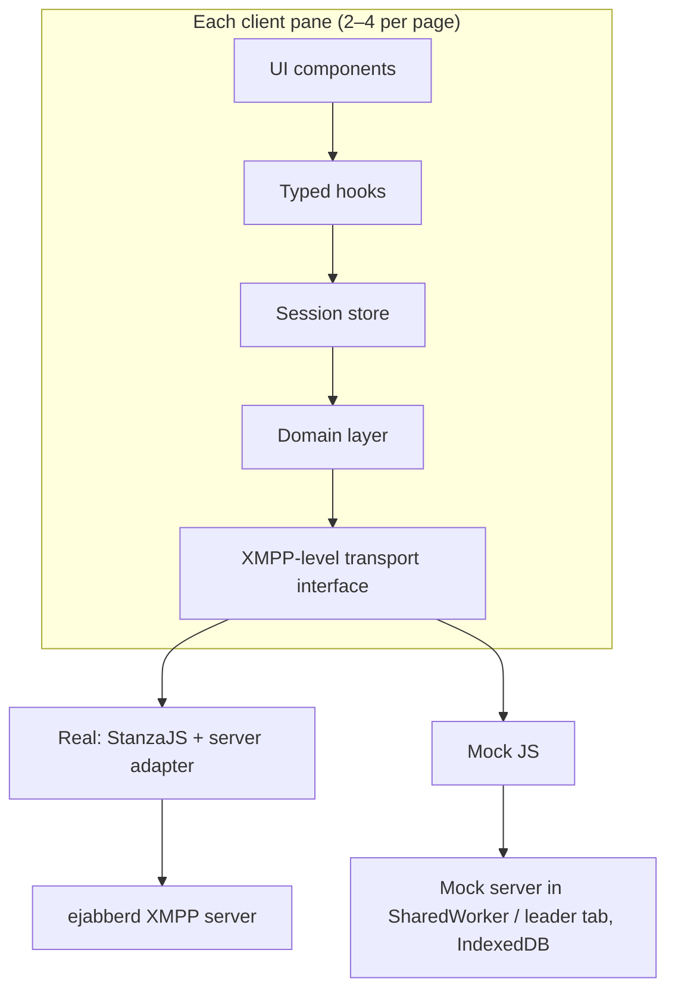

# War Rooms X1 — Software Requirements Document

Last revised 24 October 2026 · Ian Mayo

## 1. Introduction

War Rooms X1 (WRX1) is a browser-based wargaming tool. Version 1 delivers admin-designed, chat-based wargames, with an ejabberd XMPP server as its only backend service. It combines Serge's domain model with War Rooms X's XMPP transport, and fixes the defects both reviews identified.

**Scope (v1).** Version 1 has an admin backend and a player client:

- The admin backend designs and provisions one wargame: forces, roles, chat rooms, themes and objectives.
- The player client has a themed welcome page, a dockable chat workspace and a fixed out-of-game column.

A browser-only mock backend and a multi-client view of 2–4 panes support review and demos. Other room types, turns and exports are deferred, but adding them must not need re-architecture (section 8).

**Sources.** Serge v3.0.0 (`serge-web/serge`), War Rooms X (`serge-web/war-rooms-x`), and the technical summary of both.

**Requirement language.**

- SHALL means mandatory for v1.
- SHOULD means expected unless there is a justified reason not to.
- MAY means optional.

Requirements are numbered by area: ADM (admin backend), PLY (player client), ARC (architecture) and NFR (non-functional). Retired ids are not reused: ADM-32–34 were merged into ADM-18–20, PLY-7 into PLY-42, and PLY-23 into PLY-46.

**Definitions**

| Term | Meaning |
| --- | --- |
| Admin | The XMPP server's `admin` account; also the sole game designer and controller |
| Force | A side in the game: a PubSub document plus its roles' room and node affiliations |
| Role | A player position; one XMPP user account |
| Umpire force | A force whose roles are members of every room |
| Observer | A role that can read, but not post in, its rooms |
| Room | A channel: an XMPP MUC room plus a PubSub config document |
| Room type | A plug-in kind of room (v1: `chat` only) |

## 2. Key decisions and constraints

Twenty-four decisions frame v1. The requirements below depend on each decision's consequence.

| # | Decision | Consequence |
| --- | --- | --- |
| D1 | The XMPP server (ejabberd, D16) is the sole production backend; all data lives in XMPP | No app server or database. Game metadata is held in PubSub, and messages in MUC plus MAM |
| D2 | Rules are enforced by standard XMPP ACLs only; client trust is accepted beyond that | No custom server module or bot. Anything ACLs cannot express is advisory (section 9) |
| D3 | The server's `admin` account is the game admin | Admin rights come from server-side authorisation, not a UI username check |
| D4 | v1 room type: chat only; others are anticipated | A room-type registry is mandatory from v1 (ARC-5) |
| D5 | One XMPP account per role | Several people may log in to one role, and the server cannot tell them apart |
| D6 | Dockable workspace; the layout is saved in the browser only | The layout is lost on a new browser or device, and must survive room changes |
| D7 | No turn model in v1 | No phase-dependent permissions, so D2 covers all v1 rules |
| D8 | An umpire force (all rooms) and observers (read-only) | Umpire = MUC member of every room. Observer = MUC `visitor` in moderated rooms, enforced by ejabberd's stored role (ADM-37) |
| D9 | Participants are set per room, by force or role, mixed | Force entries expand to roles at provisioning, and re-sync when they change |
| D10 | Provisioning over XMPP only, with the admin's own credentials | Spike result: ejabberd needs no REST; all provisioning uses XMPP and the admin's own session credentials (§10 outcome) |
| D11 | One wargame per server | No namespacing of nodes, rooms or users |
| D12 | Deployable air-gapped, on an internal network or in the cloud | No runtime CDN or internet dependency |
| D13 | History is live MAM scrollback only | No export or replay in v1 |
| D14 | A browser-only JavaScript mock backend replaces the XMPP server for review and stakeholder demos; mock data is stored only in the browser | One transport interface with two implementations. The mock SHALL enforce the same ACL rules as the server, verified by one contract-test suite run against both; otherwise demos will misrepresent behaviour |
| D15 | A multi-client view shows 2, 3 or 4 independently logged-in client UIs on one page, against the mock or the real backend | No global singletons: each pane owns its session, store and React provider. The mock runs as one in-page "server" serving several sessions |
| D16 | Server: **ejabberd 26.09**, chosen by the §10 spike over OpenFire and Prosody | No REST: every admin operation runs over XMPP with the admin's own credentials (XEP-0133, MUC owner, PubSub owner). The server adapter stays, so a later change of server remains possible |

**D17 — The mock is shared across browser tabs.** The mock "server" SHALL be shared by every tab of the same origin, so separate windows can act as separate players. Consequence: the server must run outside any one page's React tree. Where SharedWorker is supported, it runs there. Otherwise one tab is elected leader using the Web Locks API, events are relayed over BroadcastChannel, and a new leader is elected when the leader closes.

**D18 — TypeScript.** All client, mock and test code SHALL be TypeScript in strict mode. Consequence: one set of shared types for domain documents, derived from the runtime schemas (ARC-6), so types and validation cannot drift apart.

**D19 — Themes for the game, each room and each force, edited by the admin and stored in PubSub.**

- The game theme styles the welcome page and sets the app default.
- A room theme styles that room's panel.
- A force theme styles only the force/role/objectives panel.

Themes hold design tokens plus logo and icon images. Consequence: image size and SVG safety must be controlled (§3, R11), and the pre-login welcome page needs anonymous read access (D20).

**D20 — The themed welcome page is shown before login, using anonymous read-only access.** Consequences:

- SASL ANONYMOUS is enabled.
- Anonymous sessions may read only `game-setup` and the game theme's assets, so those must hold nothing sensitive.
- Every other node must use a non-open access model.
- The mock emulates anonymous login, and spike check S10 verifies the server.

**D21 — The admin writes objectives for each force. The force reads them, and umpires may read and edit every force's objectives during play.** Consequences:

- There is one `objectives:<forceId>` node per force.
- Read access is whitelisted to that force's roles, umpires and the admin.
- The admin and umpire-force roles publish (publisher affiliation).
- Whitelists re-sync when a role moves to another force.

**D22 — Several people may log in to the same role at once, silently.** Consequence: multiple sessions of one account must join rooms under the same nickname (spike check S11), and each session keeps its own browser layout.

**D23 — The admin may make any change to a published game while players are online; changes apply live.** Consequence: the client must handle every kind of change in place (PLY-28–31), and publishing must grant new access before revoking old, to avoid players being briefly locked out.

**D24 — The dev team chooses the UI component kit.** The kit must support:

- per-panel theming through CSS custom properties (PLY-26);
- fully offline bundling (NFR-7);
- WCAG 2.2 AA (NFR-14);
- first-class TypeScript types (D18).

## 3. Domain model and XMPP mapping

Each domain entity maps to one native XMPP construct for enforcement. Where it needs configuration, it also has one JSON PubSub document. Nothing is stored in MUC description fields, which fixes a War Rooms X defect.

| Entity | Enforcement construct | Config / metadata | Access model |
| --- | --- | --- | --- |
| Wargame | — | PubSub leaf `game-setup` (name, description, theme, room-type defaults) | Read: anyone, including anonymous (D20); publish: admin |
| Force | Room and node affiliations of its roles (no server group) | PubSub leaf `forces:<forceId>` (name, colour, icon, `isUmpire`) | Read: all game users; publish: admin |
| Role | XMPP user `<roleId>@<domain>` | PubSub leaf `roles:<roleId>` (name, `forceId`, `isObserver`) | Read: all game users; publish: admin |
| Room | MUC room `<roomId>@<mucService>` | PubSub leaf `rooms:<roomId>` (name, `roomType`, participants, type-specific config) | Read: room participants SHOULD; all users MAY; publish: admin |
| Message | MUC groupchat stanza | Body = JSON `{type, schemaVersion, content}` | MUC membership |
| History | MAM (XEP-0313); join history not relied on (PLY-49) | — | MUC membership |
| Reserved | — | PubSub leaf `game-state` (created empty in v1 for the future turn model) | Publish: admin |

**Rules**

1. Entity ids SHALL be stable, URL-safe slugs, generated at creation and never reused. Display names are separate fields.
2. Each PubSub document SHALL carry `schemaVersion` and be validated at runtime when read (ARC-6).
3. Sender identity SHALL come from the MUC occupant JID (the stanza `from`, mapped to the real JID because rooms are members-only and non-anonymous), never from the message body.
4. Room participants SHALL be stored as a list of `{kind: force|role, id, access: write|read}` entries. The effective set is the union of the expanded force entries, the role entries and all umpire-force roles.
5. Observer status SHALL apply per role, across all its rooms. A per-room read-only entry (`access: read`) SHOULD also be supported, since MUC `visitor` provides it at no extra cost.
6. Display data for message authors (role name, force colour) SHALL be resolved from the `roles:*` and `forces:*` documents, kept live by subscription.

**Themes and assets**

Each theme is a `theme` object inside its owner's document. Images live in separate asset nodes, so theme documents stay small and images can be reused.

| Theme | Stored in | Styles |
| --- | --- | --- |
| Game theme | `game-setup.theme` | Welcome page; app-wide default |
| Room theme | `rooms:<roomId>.theme` | That room's panel and tab (inherits the game theme for unset tokens) |
| Force theme | `forces:<forceId>.theme` | The force/role/objectives panel only (inherits the game theme) |
| Asset | PubSub leaf `assets:<assetId>` (base64, MIME type, size, hash) | Referenced by id from themes |

7. A theme SHALL contain tokens (primary, secondary, background, surface and text colours; a font family from the bundled set) and optional `logoAssetId` and `iconAssetId`.
8. Unset tokens SHALL inherit from the game theme, then from the built-in default.
9. Assets SHALL be PNG, WebP or SVG, within a configurable size limit (default 100 KB) that is checked against the server's PubSub item limit (ejabberd: 250,000 bytes). SVG SHALL be sanitised on upload and rendered only through ``, never inlined.
10. Force colour, used for message authors, remains a separate force field, not a theme token.
11. Objectives SHALL be stored per force in `objectives:<forceId>` (Markdown text, `schemaVersion`):
    - read access is whitelisted to that force's roles, umpire-force roles and the admin;
    - the admin and umpire-force roles publish.
12. `game-setup` and the game theme's assets SHALL be anonymously readable and SHALL contain nothing sensitive. Every other node SHALL use whitelist access, never open. The announcements node SHALL be readable by every role and publishable only by the admin (PLY-37).

## 4. Functional requirements — admin backend

The admin backend lets the `admin` account design the wargame as a draft, then publish it. Publishing provisions users, rooms and PubSub documents in one idempotent operation.

**Access**

- ADM-1 The admin backend SHALL be reachable only after XMPP login as `admin`. Authorisation SHALL rest on server-side rights (PubSub owner, MUC owner, XEP-0133 admin commands), not a client check.
- ADM-2 The admin backend SHALL be a separate route of the same web app, sharing the transport layer and room-type registry with the player client.

**Game design**

- ADM-3 The admin SHALL edit game properties: name, description and theme colour.
- ADM-4 The admin SHALL create, edit, reorder and delete forces (name, colour, icon, umpire flag). At most one force SHOULD be the umpire force.
- ADM-5 The admin SHALL create, edit, reorder and delete roles within a force (display name, login id, password, observer flag), and move a role between forces.
- ADM-6 The admin SHALL create, edit, reorder and delete rooms: name, room type (v1: chat), and participants as mixed force/role entries, each with read or write access (§3 rule 4).
- ADM-7 Room-type-specific settings SHALL be edited through the editor supplied by that type's registry entry (ARC-5).
- ADM-8 Forces, roles and rooms SHALL be reordered by drag and drop, with keyboard alternatives.
- ADM-9 Before publishing, the admin SHALL see a live effective-access matrix of rooms × roles, showing write, read or none.

**Themes**

- ADM-18 The admin SHALL edit the game theme, each room's theme and each force's theme: colour tokens (a colour picker per token), bundled font, and logo and icon upload.
- ADM-19 Theme editing SHALL show a live preview of the styled surface (welcome page, room panel, force panel) beside the pickers, updating as tokens change.
- ADM-20 The admin SHALL be warned when text/background token pairs fail WCAG 2.2 AA contrast, but SHALL still be able to save.
- ADM-21 The admin SHOULD be able to copy a theme from another force or room, and reset any theme to inherit.
- ADM-22 Theme changes SHALL publish live; connected clients SHALL restyle without logging in again.

**Objectives and live editing**

- ADM-23 The admin SHALL write objectives for each force in Markdown, with a preview; players see them read-only (PLY-25).
- ADM-24 Publishing SHALL store objectives as §3 rule 11 requires, and re-sync the whitelist when roles join, leave or change force.
- ADM-25 Any design change MAY be published while players are online. Publishing SHALL grant new access before revoking old, and SHALL show which online roles a change affects before it is applied.

**Provisioning**

- ADM-10 Publishing SHALL be idempotent and convergent: compute the difference between the design and the server state, then create, update or remove only what changed.
- ADM-11 Publishing SHALL show progress per item and report failures without leaving silent partial state; re-running SHALL complete a partial publish.
- ADM-12 Provisioning SHALL use XMPP only (MUC owner config, affiliations, PubSub owner operations, XEP-0133 user commands), with the admin's own credentials and no REST or shared secret (§10 outcome).
- ADM-13 Changing a role's force or a room's participants SHALL re-sync the affected MUC affiliations and roles on publish.
- ADM-14 Deleting a role SHALL warn that its message history remains attributed to the old JID.
- ADM-15 The admin SHALL be able to reset the game, deleting all provisioned users, rooms and documents, after typing a confirmation.

**Design portability**

- ADM-16 The admin SHALL export and import the game design as a versioned JSON file, so designs can move between the mock and real backends and between servers. Passwords SHALL be excluded or replaced on export.

**Monitoring**

- ADM-17 The admin SHOULD see which roles are online (presence), and MAY join any room as owner to read it.

**Admin screen layout**

- ADM-27 The admin backend SHALL use a left-hand menu of sections (game, forces, roles, rooms, themes), each opening a list with an edit form.
- ADM-28 A header toggle SHALL switch the admin between the admin backend and the game view.
- ADM-29 During play the admin SHALL use the game view, with a text box at the bottom of the admin panel for posting out-of-game announcements.
- ADM-30 The game view SHALL offer a preview selector: the admin, or any role, seeing exactly that role's rooms, layout, themes and objectives.
- ADM-31 While previewing as a role, the admin MAY post in that role's rooms. Such posts SHALL be sent from the admin account and labelled as from the admin, never impersonating the role.

**Admin rules from the server spike**

- ADM-35 Every admin operation SHALL go through a single admin-operations module that applies rules ADM-36–40 (the spike's `AdminOps`, rules R-A to R-F).
- ADM-36 Revoking a role's read access to a node SHALL remove both its whitelist affiliation and its subscriptions (R-A).
- ADM-37 Observer read-only:
  - Game rooms SHALL always be moderated, and the admin UI SHALL NOT offer an unmoderated game room (R-C).
  - Observer voice revocation SHALL be re-applied after any change to an observer's room affiliation (R-B).
  - Re-applying SHALL NOT require resetting the observer's password, which would lock out everyone sharing the role (D22).
  - Preferred method: revoke voice for the offline observer account directly as admin, without logging in as it, if follow-up spike S13 confirms ejabberd supports this.
  - Fallback: an encrypted observer-password vault. It is encrypted in the admin's browser under a vault passphrase and kept in the admin account's private storage, so the server holds only ciphertext. If the passphrase is lost, the passwords are reset (ADM-26).
- ADM-38 Moving a role between forces SHALL grant the new access before revoking the old (R-D).
- ADM-39 Deleting a role SHALL remove its room and node affiliations and subscriptions, then the account. `item-not-found` on account deletion SHALL be treated as already deleted (R-E).
- ADM-40 Destroying a room deletes its history (R-F). The admin UI SHALL warn, show the message count and require confirmation.
- ADM-41 The admin UI SHOULD offer an "Audit and repair" action. It checks the live server against the game design (room moderation, observer voice, orphaned affiliations and subscriptions) and fixes any differences.
- ADM-42 The admin UI SHALL warn that anonymous users can list node names, and MAY offer opaque node ids.

## 5. Functional requirements — player client and demo views

A player logs in as a role, sees only the rooms that role participates in, and arranges them in a dockable workspace. For demos, the same client can run 2–4 times on one page.

**Login and session**

- PLY-1 The player SHALL log in with role id and password. The client SHALL always show which backend is in use: the real server's address, or "MOCK".
- PLY-2 On connection loss the client SHALL show its status, reconnect with back-off, rejoin rooms, and fetch missed messages through MAM without duplicates.
- PLY-3 Logout SHALL leave rooms, release subscriptions and clear in-memory game data.

**Pre-login and live changes**

- PLY-27 Before login, the client SHALL fetch `game-setup` and the game theme anonymously (D20) and show the themed welcome page. If that fails, it SHALL show the default theme and still allow login.
- PLY-28 Changes to game, force, role, room, objective and theme documents SHALL apply live, without logging in again.
- PLY-29 If the logged-in role is deleted, the client SHALL notify the user and log out.
- PLY-30 If the role moves to another force, the force panel, objectives, theme and room list SHALL refresh in place. Rooms the role loses access to close with a notice; new rooms appear as PLY-6 describes.
- PLY-31 A password change SHALL NOT end current sessions; it applies at the next login.

**Workspace**

- PLY-4 Each room the role can see SHALL appear as a tab in a dockable workspace (FlexLayout or dockview) that the user can drag, split, resize and pop out.
- PLY-5 The layout SHALL be saved to browser storage, keyed by server, role and game design version, and restored at login.
- PLY-6 Rooms added or removed while the user is logged in SHALL be reconciled into the current layout through the layout library's public API, without resetting it.
- PLY-7 Retired: merged into PLY-42.
- PLY-8 Other non-room panels (game info, online roles) SHOULD be dockable; the out-of-game column (PLY-36) is fixed.

**Themes**

- PLY-23 Retired: merged into PLY-46.
- PLY-24 Each room panel SHALL apply its room theme; each pane in the multi-client view SHALL be themed independently.
- PLY-25 The force/role/objectives panel SHALL apply the role's force theme and show the force logo, role name and force objectives. It SHALL sit at the bottom of the out-of-game column (PLY-36).
- PLY-26 Themes SHALL be applied through CSS custom properties scoped to each panel, so one panel's theme cannot leak into another.

**Chat rooms**

- PLY-9 A chat room SHALL show messages in server-timestamp order, with the author's role name, force colour and time. History loads from MAM on join and pages back on scroll (PLY-49).
- PLY-10 Messages SHALL be de-duplicated by stanza or archive id across MAM and live delivery (PLY-49).
- PLY-11 Tabs SHALL show unread counts through the layout library's tab-render callback, never through DOM manipulation.
- PLY-12 Observers and read-only participants SHALL see the composer disabled, with an explanation. The server SHALL also reject their posts (ADM-37; MUC `visitor`).
- PLY-13 A room SHOULD show which participants are online.
- PLY-14 Message text SHALL be rendered as plain text (no HTML); links MAY be auto-linked.

**Umpire**

- PLY-15 Umpire-force roles SHALL see and post in every room. A combined cross-room view is deferred to the backlog (§8).
- PLY-35 Umpire-force roles SHALL view and edit every force's objectives from the player client, with a Markdown preview. Edits SHALL publish live to that force's force panel.

**Out-of-game column**

- PLY-36 The player screen SHALL have a permanently visible, fixed-width out-of-game column on the right, outside the dockable workspace. From top to bottom it holds:
  - an area reserved for game time and turn (empty in v1, D7);
  - the admin panel;
  - the force panel (PLY-25).
- PLY-37 The admin panel SHALL show announcements from the `announcements` PubSub node. The node is readable by every role, and the server restricts publishing to the admin (`publish_model: publishers`). It carries out-of-game announcements (breaks, delays, reminders) and SHALL NOT appear as a workspace tab.
- PLY-38 Admin messages SHALL be ordered oldest to newest, with the newest at the bottom like a chat. A newly arrived message SHALL be briefly highlighted.
- PLY-39 Write control SHALL be enforced by the server. Observer read-only uses ejabberd's stored visitor role in moderated rooms (spike S1, ADM-37); no client-only fallback is needed.

**Default workspace layout**

- PLY-40 On first login (no saved layout), rooms SHALL be spread evenly across up to three side-by-side tabset columns. Only as many columns as there are rooms SHALL be shown (one room, one column).
- PLY-41 A room added during play SHALL appear in the tabset with the fewest tabs, without disturbing the rest of the layout.
- PLY-42 The player SHALL have a "Reset layout" control that restores the three-column default for their current rooms.

**Chat room panel**

- PLY-43 Messages SHALL display as cards, with a header row (sender role, force colour, time) above the text. Consecutive messages from the same sender SHALL share one header.
- PLY-44 The composer SHALL sit at the bottom of the panel and grow as text is entered. Enter sends; Shift+Enter inserts a new line.
- PLY-45 Message times SHALL show local wall-clock time only, with a date divider line between messages from different days.

**Welcome page**

- PLY-46 The welcome page SHALL be styled by the game theme. It SHALL show the game logo, name and short description, then an admin-written briefing in Markdown, then the login form below it.
- PLY-47 The briefing SHALL sit in a fixed-height scrolling box, so the login form stays visible.
- PLY-48 The briefing is readable anonymously (D20), so the admin editor SHALL warn that it is public and must contain nothing confidential.

**Server behaviour handling (from the spike)**

- PLY-49 Room history SHALL be loaded from MAM, paging backwards from the latest message. MUC join history is not persisted across server restarts and SHALL NOT be relied on. Messages SHALL be de-duplicated by `stanza-id`.
- PLY-50 The stream errors `policy-violation` (session ended) and `conflict` (account removed) SHALL be treated as a forced logout, with an explanation.
- PLY-51 Unavailable self-presence with status codes 110 and 321 (removed by an affiliation change) SHALL close the room panel with a notice (PLY-30).
- PLY-52 Access changes are not notified, so `<not-allowed/>` and `<forbidden/>` from MUC or PubSub SHALL be handled gracefully. The panel shows that access was withdrawn, and the client does not crash or retry endlessly.
- PLY-53 The client SHALL cap outgoing message size, keep PubSub items well under the 250 KB server limit, and reject oversized content with a message (R15).

**Multi-client view**

- PLY-16 A multi-client view SHALL show 2, 3 or 4 client panes side by side or in a grid. Each pane is logged in independently as a different role, against either backend.
- PLY-17 Each pane SHALL be a full player client (or the admin backend) with its own session, store and layout. Panes share no in-memory state except the mock server.
- PLY-18 Each pane SHALL show a header with its role, force colour and backend. It SHALL offer quick login from the game's role list (mock), or a login form (real server).
- PLY-19 The pane count and pane logins SHOULD be saveable and restorable as a named demo preset.

**Mock backend for users**

- PLY-20 The login screen SHALL let the user choose the real server or the mock backend. The mock SHALL be selectable without any network access.
- PLY-21 The mock SHALL load seed scenarios (at least one demo wargame), and SHALL offer reset to seed and export/import of the mock database.
- PLY-22 With the mock, separate browser tabs and windows of the same origin SHALL share one game (D17), so multiple windows behave as separate players.

## 6. Client architecture requirements

The client is layered so that every pane in the multi-client view is fully independent. Swapping the real XMPP server for the in-browser mock changes only the transport implementation.

The same code above the transport interface runs against both backends; that is what makes the mock a fair demo.

- ARC-1 A single TypeScript transport interface SHALL cover connection, MUC, PubSub, MAM, presence and admin provisioning. It SHALL have two implementations: real (StanzaJS plus server adapter) and mock. Each pane SHALL choose one at login.
- ARC-2 Each pane SHALL own a framework-agnostic session store with:
  - an explicit ready state, resolved after service discovery;
  - reference-counted subscriptions (`acquire(node) → release()`).

  Client code SHALL contain no module-level mutable state, and a lint rule SHALL enforce this.
- ARC-3 Hooks SHALL be thin wrappers (`useSyncExternalStore` and/or TanStack Query) returning `{data, status, error}`, with cleanup verified under React StrictMode.
- ARC-4 Messages SHALL be normalised per room, keyed by stable id and ordered by server timestamp. They SHALL be merged idempotently from MAM pages and live stanzas, and MAM paging SHALL use RSM ids correctly.
- ARC-5 A room-type registry SHALL map `type → {player component, icon, config schema, admin editor, message schema}`, shared by admin and player. v1 registers `chat` only.
- ARC-6 PubSub documents, room configs and message bodies SHALL be validated at runtime (for example with zod), and migrated by `schemaVersion`.
- ARC-7 The mock server SHALL:
  - run in a SharedWorker where available, or else in a leader tab elected with Web Locks, relaying over BroadcastChannel;
  - persist to IndexedDB;
  - implement MUC affiliations and roles, PubSub access and publish models, MAM paging, presence and admin operations, with the same error behaviour as the real server;
  - support seed scenarios and a controllable clock for tests.
- ARC-8 A server adapter SHALL isolate server-specific behaviour (for example ejabberd error conditions and stored-role behaviour). The XMPP core SHALL use standard extensions only (XEP-0045, 0060, 0313, 0059, 0133), and SHOULD use XEP-0198 (stream management) for resilient reconnects.
- ARC-9 The layout library SHALL be wrapped in a workspace module. Persistence and room reconciliation SHALL use only its public API.

**Transport interface**

- ARC-12 The transport SHALL have two layers: a domain layer (for example sendMessage, getHistory, publishObjectives, watchRoom) over an XMPP-level interface (MUC join/leave/send, PubSub get/publish/subscribe, MAM query, presence, admin provisioning). The mock SHALL implement the XMPP-level interface, so the domain layer runs unchanged and is exercised in mock mode. This costs more than a domain-level mock (revisit the 3–5 week estimate) and raises the fidelity required of the mock (R2); both are accepted for the test coverage.
- ARC-13 Live events SHOULD be delivered by callbacks that return an unsubscribe function, for direct use with useSyncExternalStore. This is a recommendation; the team may change it.
- ARC-14 The error-reporting convention (exceptions or typed results) is left to the development team, but SHALL be consistent across both layers and identical in the mock and real implementations.
- ARC-15 Package structure, state management and caching are left to the development team, within ARC-1–14 and NFR-18–20.

## 7. Non-functional requirements

Security rests on XMPP server configuration, not client code. Deployment must work with no internet access.

**Security**

- NFR-1 No secret (REST key, admin password, role password) SHALL be in the client bundle or source repository.
- NFR-2 Production connections SHALL use TLS only (`wss://`, `https://`). Certificates from an internal CA SHALL be supported for air-gapped use.
- NFR-3 Rooms SHALL be members-only, moderated, non-anonymous, persistent and not publicly listed. PubSub nodes SHALL use `publish_model: publishers` and the narrowest workable `access_model` (whitelist).
- NFR-4 The setup guide SHALL list the server settings WRX1 relies on, and the admin backend SHOULD verify them at publish (for example room config, MAM enabled).
- NFR-5 Payloads from the network SHALL be schema-validated. Invalid items are logged and ignored, and never crash the UI.
- NFR-6 Generated role passwords SHALL be random by default. The mock MAY use known demo passwords, clearly labelled.
- NFR-21 Anonymous login SHALL be limited to reading `game-setup` and the game theme's assets. Anonymous sessions SHALL NOT join rooms or read any other node. This is verified by S10 and enforced identically in the mock.

**Deployment**

- NFR-7 The client SHALL be a static build with all assets (fonts, icons, libraries) bundled; no runtime CDN calls.
- NFR-8 The build SHALL support three hosting modes:
  - served by a reverse proxy on the same origin as the XMPP WebSocket endpoint;
  - a separate static host with a configured proxy;
  - file or static hosting, with the mock only.
- NFR-9 Backend endpoints (WebSocket URL, XMPP domain) SHALL be runtime configuration, not build-time constants.
- NFR-10 A container image (ejabberd + client + config, per NFR-22) SHOULD be provided for one-command deployment.
- NFR-22 The reference deployment SHALL be `spike/docker/ejabberd/` from the spike repo, with:
  - the image pinned by digest;
  - `wss://` only;
  - SCRAM-SHA-256;
  - no REST `/api` and no web admin;
  - in-band registration off;
  - a per-player rate limit.

  CI SHALL run the contract suite on every push. An ejabberd upgrade SHALL NOT be adopted until the R1 tests (S01, S01b, C01) pass.
- NFR-23 The air-gapped host install SHALL be verified on real hardware before first deployment (open; `ops/offline-install.sh`).

**Performance and scale**

- NFR-11 v1 SHALL support at least 50 roles, 30 rooms and 10,000 messages per room on one server, with a room tab rendering in under 1 s (virtualised list).
- NFR-12 With 4 panes, the multi-client view SHALL deliver a sent message to all four panes within 1 s, with no visible typing lag, on a standard 8 GB laptop.

**Browsers and accessibility**

- NFR-13 Current Chrome, Edge and Firefox SHALL be supported; Safari SHOULD be.
- NFR-14 The UI SHOULD meet WCAG 2.2 AA, including keyboard alternatives to drag and drop.

**Testing and quality**

- NFR-15 Unit tests SHALL cover the store, hooks and mock, against the in-memory transport.
- NFR-16 One transport contract-test suite SHALL run in CI against both the mock and a containerised XMPP server. CI SHALL fail, not skip, when the server is unavailable.
- NFR-17 Playwright end-to-end tests SHALL run in CI, using the multi-client view to check that messages sent by one role are received by another.
- NFR-18 Presentational components SHALL be split from data hooks (the War Rooms X `*Core` pattern) and catalogued in Storybook.

**Language and tooling**

- NFR-19 All code SHALL be TypeScript with `strict` enabled. Lint SHALL disallow `any` and unchecked casts of network data.
- NFR-20 Domain types SHALL be inferred from the runtime schemas, and shared by admin, player, mock and tests.

## 8. Out of scope for v1

These features are deferred, but the v1 architecture SHALL accommodate each one without restructuring.

| Deferred feature | v1 provision that keeps it cheap |
| --- | --- |
| Structured form rooms (JSON Schema templates, per-participant template permissions) | Room-type registry; message body `{type, schemaVersion, content}`; `templates` PubSub collection name reserved |
| Collab / RFI workflow rooms | Registry; message `type` discriminator; Serge's model as reference |
| Mapping rooms (Leaflet, GeoJSON deltas) | Registry; locally hosted tiles required by D12 |
| Turns, phases, game clock | Reserved `game-state` node with admin-only publish; reserved space in the out-of-game column |
| Phase-based permissions | Would need a server module or bot, which D2 currently excludes |
| Admin-defined default layouts per role | The layout model is plain JSON, storable in PubSub later |
| Server-side layout persistence | Same; XEP-0049 private storage is a candidate |
| Message export and replay | MAM retains everything; export is a query-and-serialise feature |
| Multiple wargames per server | Entity ids are slugs; a namespace prefix can be added |
| Per-person accounts within a role | Role = account in v1; a resource or nickname could identify individuals later |

**Backlog:** an umpire combined view. This is one merged, filterable timeline of all rooms, with each message labelled with its room and replies going into the source room. It needs no new XMPP mechanism, because it reads the rooms umpires already join.

## 9. Risks, critical analysis and open issues

The largest remaining risks are a mock that drifts from real server behaviour (R2), and enforcement that depends on correct admin tooling (R14). The server spike closed the ACL questions (R1, R3, R10).

| # | Risk / finding | Impact | Mitigation |
| --- | --- | --- | --- |
| R1 | **Read-only members may not be enforceable by standard MUC.** XEP-0045 gives members voice by default in moderated rooms; voice revocation is per session and needs an online moderator, which D2 excludes | High: PLY-12 and D8 might be client-enforced only | **Closed by spike:** ejabberd keeps a moderator's voice revocation per account in moderated rooms, across reconnects and restarts. Relies on ADM-37 and R13 |
| R2 | **Mock drift.** A demo mock that permits what the server forbids misleads stakeholders | High | Contract suite (NFR-16) as the single definition of behaviour; mock ACL logic written from that suite |
| R3 | **Per-force PubSub confidentiality.** A whitelist per node needs its affiliations maintained | Medium, rising to High with R10 | **Closed by spike:** whitelist plus publishers per node; revocation must also remove subscriptions (ADM-36) |
| R4 | **Shared role accounts.** No individual attribution of who said what | Medium for post-exercise analysis | Accepted for v1 (D5); per-person accounts listed in §8 |
| R5 | **REST authentication.** OpenFire's REST plugin is designed around a shared secret | Medium: blocks NFR-1 | **Closed by spike:** ejabberd needs no REST and no shared secret |
| R6 | **Server groups may be unnecessary.** Forces are already expressed by PubSub documents and MUC affiliations | Low/positive | **Closed by spike:** groups not needed; per-user room and node affiliations suffice |
| R7 | **Cross-tab mock complexity.** Leader election, re-election and IndexedDB schema migration add failure modes | Medium | SharedWorker first; leader fallback covered by Playwright multi-tab tests |
| R8 | **Browser-only layouts.** Demo laptops lose arrangements | Low | Layout export/import MAY be added cheaply |
| R9 | **Message `type` is client-asserted.** A modified client can send arbitrary body JSON | Low in v1 (chat only) | Validate, and render as plain text; never trust the body for identity or permissions |
| R10 | **Force objectives are confidential but would sit in readable PubSub.** War Rooms X's open nodes let any player read every force's objectives | High | **Closed by spike:** `objectives:<forceId>` with whitelist read (force, umpires, admin) and publishers (admin, umpires) is enforced; revocation per ADM-36 |
| R11 | **Theme images vs PubSub limits and SVG scripting.** Large images can exceed item limits, and SVG can carry script | Medium | **Closed by spike:** ejabberd caps items at 250,000 bytes (operator-configurable), and 100 KB assets work. SVG is sanitised and rendered through `` only (§3 rule 9) |
| R12 | **The welcome page precedes login,** but PubSub requires an authenticated session | Medium | Decided (D20): anonymous read access limited to `game-setup` and its theme assets (NFR-21), verified by S10 |

**Risks added by the spike**

| # | Risk | Severity | Mitigation |
| --- | --- | --- | --- |
| R13 | **R1 depends on ejabberd's stored-role behaviour**, which is deliberate but not an XMPP standard | Medium | R1 contract tests gate every ejabberd upgrade (NFR-22). The fallback is Prosody with a small module, which would relax D2 |
| R14 | **Enforcement depends on correct admin tooling.** A missed step (subscription left in place, observer voice not re-applied, room left unmoderated) silently leaks access or voice | Medium–High | ADM-35 and ADM-41; contract test C01 |
| R15 | **No WebSocket stanza size cap.** Room messages over ~885 KB drop the sender's connection | Medium | PLY-53 and the rate limit. Check whether ejabberd's `max_stanza_size` applies to the WebSocket listener |
| R16 | **Destroying a room destroys its history** | Medium, given live editing (D23) | ADM-40 |
| R17 | **Anonymous users can list PubSub node names** (but not their contents) | Low, accepted | ADM-42 |

**Open issues**

- [x] Read-only member enforcement: ejabberd stored visitor role (R1, S1)
- [x] Admin provisioning without a bundled secret: XMPP only, no REST (R5, S4)
- [x] Server groups: dropped, not needed (R6, S7)
- [x] Server choice: ejabberd 26.09 (D16, §10)
- [ ] Air-gapped host install verified on real hardware (S8, NFR-23)
- [ ] Follow-up spike S13: can the admin revoke an offline observer's voice without its password? This decides ADM-37 (direct revocation, or else the encrypted vault)
- [x] Welcome page: before login, using anonymous read access (D20)
- [x] Objectives: written by the admin per force; force read-only; umpires may edit (D21)
- [x] Concurrent logins per role: allowed silently (D22)
- [x] Live editing: any change, applied live (D23)
- [x] UI component kit: the dev team decides, within constraints (D24)

**Pre-development checks**

The server question is settled. The remaining checks are short, and most run alongside sprint 1.

| # | Check | When | Owner | Decides |
| --- | --- | --- | --- | --- |
| P1 | S13 offline voice revocation, plus whether `max_stanza_size` applies to the WebSocket listener (~½ day) | Before start | Claude Code / dev | ADM-37, R15 |
| P2 | Target environment: analyst browsers and versions (SharedWorker, IndexedDB, Web Locks); approval to run ejabberd/Erlang on internal and air-gapped hosts; who verifies NFR-23 | Before start | Doc, with customer | D12, D17, NFR-23 |
| P3 | Layout library, FlexLayout vs dockview (1–2 days): four independent workspaces with pop-outs on one page (D15); adding to the tabset with the fewest tabs through the public API only (PLY-41); save/restore across room changes (D6) | Sprint 1 | Claude Code / dev | ARC-9, PLY-40–42 |
| P4 | StanzaJS health (~½ day): maintenance status; typing of ad-hoc commands, MAM and RSM; a fallback library if needed | Sprint 1 | Claude Code / dev | ARC-12 |
| P5 | JSON schemas for every PubSub document in §3 | Sprint 1, first | Dev team | Mock, contract suite, design import/export |
| P6 | Re-estimate the mock now that it sits at the XMPP level (ARC-12) | After P5 | Dev team | Plan |

## 10. Server selection spike

OpenFire, ejabberd and Prosody were each evaluated against the same pass/fail criteria before the mock's ACL rules were written, and the server was chosen on evidence (see Outcome). The spike also ran S0 (browser connectivity) and S12 (live changes).

**Method.** For each server:

1. Install it offline from a container image.
2. Configure it by file or admin API only, with no custom plugins (D2).
3. Run the transport contract suite plus the targeted checks below.
4. Record the configuration, results and effort.

Budget: about 3 days per server.

| # | Check | Pass criterion | Linked risk |
| --- | --- | --- | --- |
| S1 | Read-only room members | A member observer cannot post. This is enforced by the server, across reconnects, with no moderator online | R1 |
| S2 | Per-node confidentiality | Roles outside a whitelist PubSub node's list cannot read it | R10 |
| S3 | PubSub item size | A 100 KB item publishes and can be retrieved; the limit is configurable | R11 |
| S4 | Admin without a bundled secret | Users and room affiliations are provisioned using only the admin's login credentials | R5 |
| S5 | MUC history | MAM paging with RSM over 10,000 messages returns complete, ordered results | ARC-4 |
| S6 | Publisher notifications | Behaviour on the publisher's own publishes is documented, and the transport can normalise it | ARC-1 |
| S7 | Need for groups | Whether forces need server groups at all | R6 |
| S8 | Operations | Air-gapped install, TLS with an internal CA, backup and restore, admin console usability | NFR-2, NFR-10 |
| S9 | Escape hatch | Effort to add a small server module if D2 is later relaxed (for example, for turns) | §8 |
| S10 | Anonymous read | An anonymous session can read `game-setup` and its theme assets, and cannot join rooms or read any other node | D20, NFR-21 |
| S11 | Same-role multi-session | Two sessions of one account join a room under the same nickname, and both receive all messages | D22 |

**Decision rule.** S1–S5 and S10 are mandatory: a server that fails any of them is rejected, unless D2 is relaxed for that server. Among the servers that pass, prefer the fewest REST dependencies, then operational simplicity (S8), then extensibility (S9).

**Output.** A short decision record per server. The chosen server's configuration is checked in as the reference deployment and the CI integration target (NFR-16).

**Outcome (24 October 2026).** **ejabberd 26.09 is selected.** It was the only server to pass every mandatory check using standard controls:

- Prosody failed S1 unless a ~45-line custom module is added, which D2 rules out.
- OpenFire failed S1, S2, S5 and S10.

ejabberd needs no REST and no server groups. Its indicative capacity is 200 players at p95 678 ms. Evidence: [serge-web/xmpp-spike, results/architect-findings.md](https://github.com/serge-web/xmpp-spike/blob/main/results/architect-findings.md).

The choice rests on D2: if D2 is ever relaxed, Prosody with a small module is the alternative (R13). Requirements arising: ADM-35–42, PLY-49–53, NFR-22–23 and R13–R17.

**Follow-up check S13 (about half a day).** Can the admin give an offline observer account the stored visitor role without logging in as it? Possible routes are ejabberd's MUC admin commands over XMPP (XEP-0133), or the room's stored state.

- Pass: the observer's next join is as a visitor, it cannot post, and no password or REST was used. A pass selects direct revocation for ADM-37.
- Fail: the encrypted vault is used instead.

## 11. Mock development process

Every interaction the mock supports SHALL be specified from the XMPP standards, verified against the chosen server, and only then reproduced in the mock. This way, reviews and demos on the mock behave as the real backend will.

1. **Specify from the standards.** Define the interaction from the relevant XEP (0045, 0060, 0313, 0059, 0133), noting every point the spec leaves to the server (MAY/SHOULD).
2. **Establish and test server behaviour.** Implement the interaction in the real transport against the chosen server, and record how the server actually behaves, especially at the points the spec leaves open. Capture this as contract tests that reference the XEP section.
3. **Reproduce in the mock.** Implement the interaction in the mock JavaScript until it passes the same contract tests.
4. **Keep it matched.** Run the contract suite against both the mock and the server in CI; a divergence SHALL fail the build. A server upgrade or config change SHALL re-run the suite before release.

- ARC-10 No interaction SHALL be added to the mock unless a contract test covers it and passes against the real server.
- ARC-11 For every tested interaction, the mock SHALL return the same error conditions and event ordering as the server.

**Limits of the guarantee.** The match is only as complete as the contract suite. Timing, concurrency, network failure and scale are not reproduced by default. So the mock SHALL support injected latency, reordering and disconnects, and final acceptance SHALL still be run against the real server.

## 12. User scenarios

Nine end-to-end scenarios walk each actor through v1. Each traces to the requirements it exercises and is the basis for a Playwright test (NFR-17). Walking through them exposed four gaps, now covered by ADM-26 and PLY-32–34 at the end of this section.

### SC-1 Admin designs and publishes a game

**Actor:** admin. **Start:** an empty server, or the mock.

1. Opens the app, chooses the mock backend and logs in as `admin`.
2. Sets the game name, description and game theme with logo.
3. Creates forces Blue, Red and Umpire (umpire flag set), each with a theme and colour, and writes Blue's and Red's objectives.
4. Creates roles in each force with generated passwords, and marks one Blue role as an observer.
5. Creates rooms (Blue HQ, Red HQ, Blue–Red negotiation) with mixed force/role participants.
6. Reviews the access matrix, publishes, and watches the per-item progress complete.
7. Exports the design JSON, logs in to the real server as `admin`, imports it and publishes again.
8. Exports the credentials sheet and distributes it.

**Outcome:** the same game exists on the mock and the server. **Traces to:** ADM-1–16, ADM-18–24, ADM-26.

### SC-2 Player arrives and gets oriented

**Actor:** Blue role. **Start:** a published game; the player is not logged in.

1. Opens the app and sees the welcome page in the game theme, loaded anonymously.
2. Logs in with role id and password.
3. Sees one tab per permitted room, plus the force panel at the bottom of the out-of-game column. The panel shows Blue's logo, the role name and the objectives, in the Blue theme.
4. Drags the negotiation room into a second tabset and resizes it.
5. Reloads the page and finds the layout restored.

**Outcome:** the player sees exactly their rooms and objectives. **Traces to:** PLY-1, PLY-4–5, PLY-24–27, D20.

### SC-3 Cross-force chat, including a dropped connection

**Actors:** Blue and Red roles. **Start:** both logged in.

1. Blue posts in the negotiation room. Red sees it at once, with Blue's role name and colour, and an unread badge if the tab is hidden.
2. Red's network drops for two minutes while Blue posts three more messages.
3. Red's client shows that it is reconnecting, then rejoins and shows all three messages once each, in order.
4. Red scrolls back, and older history pages in.

**Outcome:** no lost, duplicated or misordered messages. **Traces to:** PLY-2, PLY-9–11, ARC-4, §3 rule 3.

### SC-4 Observer reads but cannot post

**Actor:** Blue observer role.

1. Logs in and sees Blue's rooms and their history.
2. Finds the composer disabled, with an explanation.
3. A modified client attempts to post. The server rejects it, and no other participant sees it.

**Outcome:** read-only is enforced by the server, not just the UI. **Traces to:** PLY-12, D8, S1 (R1).

### SC-5 Umpire monitors the game

**Actor:** Umpire role.

1. Logs in and sees every room.
2. Places Red HQ and the negotiation room side by side in the workspace.
3. Posts a clarification in Red HQ, which Red sees attributed to the umpire.
4. Opens Red's objectives and amends one; Red's force panel updates live.

**Outcome:** umpires see all play and can adjust any force's objectives. **Traces to:** PLY-15, PLY-25, PLY-35, D8, D21, §3 rule 11.

### SC-6 Admin changes the game during play

**Actors:** the admin, and a Blue role who is online.

1. The admin moves the Blue role to Red and adds a new room for Red.
2. Before the change is applied, the publish view lists the online roles affected.
3. On publish, Red access is granted before Blue access is revoked.
4. The player's force panel, objectives and theme switch to Red. Blue rooms close with a notice. Red rooms and the new room appear without disturbing the rest of the layout.
5. The admin then deletes another online role; that player is notified and logged out.

**Outcome:** live changes apply cleanly, and no player is briefly locked out. **Traces to:** ADM-13, ADM-25, PLY-6, PLY-28–30, D23.

### SC-7 Stakeholder demo on the mock, offline

**Actor:** a presenter on a laptop with no network.

1. Opens the app from a static host and chooses the mock. The seed scenario loads, including message history.
2. Opens the multi-client view with three panes, and quick-logs in as Blue, Red and Umpire.
3. Sends a message from Blue and shows it arriving in Red's and the Umpire's panes.
4. Opens a second browser window as a fourth role, to show that the mock is shared across windows.
5. After the demo, resets the mock to the seed.

**Outcome:** a convincing multi-player demo with no server. **Traces to:** PLY-16–22, PLY-34, D14–17, NFR-7.

### SC-8 Two people share one role

**Actors:** two people, both logged in as Blue CO.

1. Both join the same rooms, and both receive every message.
2. A message from either one appears as Blue CO in every client.

**Outcome:** works as decided, with no individual attribution. **Traces to:** D22, S11, R4.

### SC-9 Developer adds a new interaction to the mock

**Actor:** a developer.

1. Specifies the interaction from the relevant XEP and notes the points the spec leaves to the server.
2. Writes a contract test, runs it against the chosen server and records the actual behaviour.
3. Implements it in the mock until the same test passes.
4. CI runs the test against both on every build.

**Outcome:** the mock stays faithful to the server. **Traces to:** §11, ARC-10–11, NFR-16.

### Gaps found and requirements added

- ADM-26 (from SC-1) Generated passwords need a route to players. The admin SHALL export a printable credentials sheet (role, force, login id, password), and SHALL be able to reset any role's password. The sheet SHALL be generated on demand and never stored in PubSub.
- PLY-32 (from SC-2) The client SHALL show clear empty states for when no game is published (the welcome page falls back to the default) and for a role with no rooms.
- PLY-33 (from SC-4 and SC-6) When the server rejects a post, or access is revoked mid-composition, the client SHALL show why and keep the unsent text so it can be copied.
- PLY-34 (from SC-7) Seed scenarios SHALL include message history, and SHALL be creatable by exporting a mock database after a rehearsal run (PLY-21).
