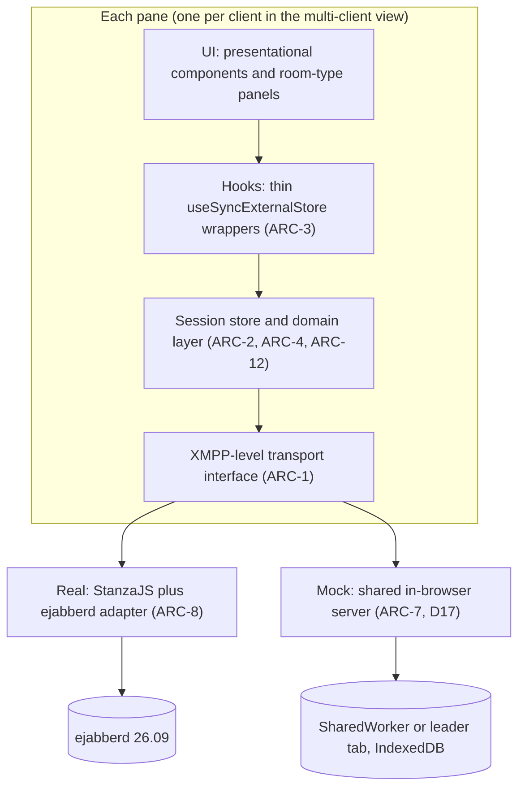

# War Rooms X1 — Software Requirements Document

Oct 20, 2026 (revised to Nov 3, 2026, see §14) · @Ian Mayo

## 1. Introduction

War Rooms X1 (WRX1) is a browser-based wargaming tool whose v1 delivers admin-designed, turn-based wargames with chat rooms and a shared map, using an ejabberd XMPP server as its only backend service. It combines Serge's domain model with War Rooms X's XMPP transport, and fixes the defects both reviews identified.

**Scope (v1).** An admin backend to design and provision one wargame (forces, roles, chat and map rooms, message templates, themes, objectives) and to run it turn by turn, and a player client with a themed welcome page, a dockable workspace of chat and map rooms and an out-of-game column (a workspace tab when the client is narrow). A turn model (turns, planning and adjudication phases) advances under admin control, and a map room shows a world state of assets that the admin edits. A browser-only mock backend and a 2–4 pane multi-client view support review and demos, and a public GitHub Pages site documents the project and hosts a live demo of every PR (section 13). Orders, automated adjudication (reconciliation), fog of war, other room types and exports are deferred but must not need re-architecture (section 8). Message templates are specified in Annex A and were built in Phase 4; Annex B, force assets in their own store, is superseded by the map room's world state (D25).

**Sources.** Serge v3.0.0 (`serge-web/serge`), War Rooms X (`serge-web/war-rooms-x`), and the technical summary of both.

**Requirement language.** SHALL = mandatory for v1; SHOULD = expected unless justified; MAY = optional. Requirements are numbered by area (ADM, PLY, ARC, NFR, DOC). Retired ids are not reused: ADM-32–34 (merged into ADM-18–20), PLY-7 (merged into PLY-42), PLY-23 (merged into PLY-46), and PLY-6 and PLY-41 (dropped Nov 3, 2026: structural changes reset layouts, PLY-5). Annexes A and B specify features built after v1; their ids (TD, TPL, AD) are not v1 requirements, and only the provisions they name are built in v1.

**Definitions**

| Term | Meaning |
| --- | --- |
| Admin | The XMPP server's `admin` account: the sole game designer and controller, and in play the umpire, a member of the White Force |
| Force | A side in the game; a PubSub document plus its roles' room and node affiliations |
| Role | A player position; one XMPP user account |
| White Force | The force with the umpire flag: the admin (the umpire) and other control roles. Its non-observer roles write in every room; its observers are read only (§3 rule 4). Every White Force role reads every force's objectives; the admin and its non-observer roles edit them during play (D21) |
| GUID | A random, lowercase UUID: the id of every force, role, room and asset (§3 rule 1) |
| Login name | The readable name a player types to log in as a role; the role's XMPP account name, separate from its GUID (§3 rule 1) |
| Observer | A role that can read, but not post in, its rooms |
| Room | A channel; an XMPP MUC room plus a PubSub config document |
| Room type | A plug-in kind of room (v1: `chat` and `map`) |
| Map room | The game's single room whose messages each carry the full world state, posted only by the admin |
| World state | The set of all assets (units, platforms) with their positions and status; v1 holds one shared state with no fog of war |
| Turn / phase | A numbered game turn, each with a planning phase then an adjudication phase; the admin advances them |

## 2. Key decisions and constraints

Twenty-six decisions frame v1; each has a consequence the requirements below depend on.

| # | Decision | Consequence |
| --- | --- | --- |
| D1 | The XMPP server (ejabberd, D16) is the sole production backend; all data lives in XMPP | No app server or database. Game metadata in PubSub; messages in MUC + MAM |
| D2 | Rules enforced by standard XMPP ACLs only; client trust accepted beyond that | No custom server module or bot. Anything ACLs cannot express is advisory (section 9) |
| D3 | The server's `admin` account is the game admin | Admin rights come from server-side authorisation, not a UI username check |
| D4 | v1 room types: chat and map; others anticipated | A room-type registry is mandatory from v1 (ARC-5) |
| D5 | One XMPP account per role | Several people may log in to one role; they are indistinguishable to the server |
| D6 | Dockable workspace, layout saved in browser only | Layout is lost on a new browser or device. It survives theme and text edits, but structural design changes (forces, roles, rooms, participants) reset it to the default (PLY-5) |
| D7 | Full turn model in v1: numbered turns, each with planning then adjudication phases; only the admin advances them | State in the `game-state` node. Phase-dependent behaviour is advisory only (client-side), consistent with D2 |
| D8 | White Force (all rooms) and observers (read-only) | The admin is the umpire, in the White Force; White Force roles that are not observers are MUC members of every room; an observer is a MUC `visitor` in moderated rooms, enforced by ejabberd's stored role (ADM-37) |
| D9 | Participants per room by force or role, mixed | Force entries expand to roles at provisioning; re-sync on change |
| D10 | Provisioning over XMPP only, with the admin's own credentials | Spike result: ejabberd needs no REST; all provisioning is XMPP using the admin's own session credentials (§10 outcome) |
| D11 | One wargame per server | No namespacing of nodes, rooms or users |
| D12 | Deploy air-gapped, internal or cloud | No runtime CDN or internet dependency, except base-map tiles: in v1 the map room needs internet access (air-gapped mapping is post-v1, §8) |
| D13 | History: live MAM scrollback only | No export or replay in v1 |
| D14 | A browser-only JavaScript mock backend replaces the XMPP server for review and stakeholder demos; mock data is stored only in the browser | One transport interface with two implementations. The mock SHALL enforce the same ACL semantics as the server, verified by one contract-test suite run against both, or demos will misrepresent behaviour |
| D15 | A multi-client view shows 2, 3 or 4 independently logged-in client UIs on one page, against mock or real backend | No global singletons: each pane owns its own session, store and React provider. The mock runs as one in-page "server" serving several sessions |
| D16 | Server: **ejabberd 26.09**, chosen by the §10 spike over OpenFire and Prosody | No REST: every admin operation runs over XMPP with the admin's own credentials (XEP-0133, MUC owner, PubSub owner). The server adapter stays, so a later change of server remains possible |

**D17 — mock shared across browser tabs.** The mock "server" SHALL be shared by every tab of the same origin, so separate windows can act as separate players. Consequence: the server must run outside any one page's React tree — in a SharedWorker where supported, otherwise in one tab elected leader via the Web Locks API, with events relayed over BroadcastChannel and re-election when the leader closes.

**D18 — TypeScript.** All client, mock and test code SHALL be TypeScript in strict mode. Consequence: one set of shared types for domain documents, derived from the runtime schemas (ARC-6) so types and validation cannot drift.

**D19 — Themes for the game, each room and each force, edited by the admin and stored in PubSub.** The game theme styles the welcome page and app default; a room theme styles that room's panel; a force theme styles only the force/role/objectives panel. Themes hold design tokens plus logo and icon images. Consequence: image size and SVG safety must be controlled (§3 rule 12, R11), and the pre-login welcome page needs anonymous read access (D20).

**D20 — Themed welcome page before login, via anonymous read-only access.** Consequence: SASL ANONYMOUS is enabled, and anonymous sessions may read only `game-setup` and the game theme's assets. Those must hold nothing sensitive, and every other node must use a non-open access model. The mock emulates anonymous login; spike check S10 verifies the server.

**D21 — Objectives are written by the admin per force; the force reads them, and the White Force may read every force's objectives and, except its observers, edit them during play (product owner, Nov 3, 2026, reversing the WP 3.5 admin-only rule).** Consequence: one `objectives:<forceId>` node per force, whitelist read for that force's roles, the White Force's roles and the admin; publish by the admin and White Force roles that are not observers (publisher affiliation). Whitelists and publishers re-sync when roles move force or leave the White Force.

**D22 — Several people may log in to the same role at once, silently.** Consequence: multiple sessions of one account must join rooms under the same nickname (spike check S11), and each keeps its own browser layout.

**D23 — The admin may make any change to a published game while players are online; changes apply live.** Consequence: the client must handle every kind of change in place (PLY-28–31), and publishing must grant new access before revoking old to avoid transient lock-outs.

**D24 — UI component kit chosen by the dev team.** Constraints: per-panel theming via CSS custom properties (PLY-26), fully offline bundling (NFR-7), WCAG 2.2 AA (NFR-14) and first-class TypeScript types (D18).

**D25 — World state lives in one members-only map room; every message carries the full state; only the admin posts it.** Consequence: replay comes from MAM for free, and a joiner needs only the latest valid message. Because members of a members-only room always have voice (S13), "admin only" is enforced by clients, which accept world-state messages only from the admin's real JID (§3 rule 3) and ignore the rest. The admin edits a browser-only draft and publishes it at a phase change or whenever the admin chooses, for example to set up the starting state or fix a mistake during play. Map-room messages may be up to 500 KB (PLY-53). Snapshots plus deltas, compression and per-force views are post-v1.

**D26 — Automated reconciliation (post-v1) will run as external clients.** Game-specific reconcilers written in Python against a common SDK, running natively or in the browser via Pyodide, log in as ordinary XMPP accounts. They hold no special server rights, so they do not breach D1 or D2. v1 SHALL NOT preclude this: world-state, turn and room documents are schema-defined and exportable as JSON Schema (ARC-6).

## 3. Domain model and XMPP mapping

Every domain entity maps to one native XMPP construct for enforcement plus, where config is needed, one JSON PubSub document; nothing is stored in MUC description fields (fixing a WRX defect).

| Entity | Enforcement construct | Config / metadata | Access model |
| --- | --- | --- | --- |
| Wargame | — | PubSub leaf `game-setup` (name, description, briefing, theme, room-type defaults, `designVersion`) | Read: anyone, including anonymous (D20); publish: admin |
| Force | Room and node affiliations of its roles (no server group) | PubSub leaf `forces:<forceId>` (name, colour, icon, `isUmpire`) | Read: all game users; publish: admin |
| Role | XMPP user `<loginName>@<domain>` | PubSub leaf `roles:<roleId>` (name, `loginName`, `forceId`, `isObserver`) | Read: all game users; publish: admin |
| Room | MUC room `<roomId>@<mucService>` | PubSub leaf `rooms:<roomId>` (name, `roomType`, participants, type-specific config) | Read: all game users (needed for room discovery, PLY-60); publish: admin |
| Message | MUC groupchat stanza | Body = JSON `{type, schemaVersion, content}` | MUC membership |
| History | MAM (XEP-0313); join history not relied on (PLY-49) | — | MUC membership |
| Announcement | — | PubSub leaf `announcements`, one item per announcement (text, posted time) | Read: every role; publish: admin (PLY-37) |
| Deleted entity | — | PubSub leaf `retired`, one item per deleted force or role (id, kind, last name, login name, colour) (rule 1) | Read: all game users; publish: admin |
| Directory | — | PubSub leaf `directory`, one item listing every force, role and room GUID, with each role's login name (lets a client find its own role without node listing; a pointer only, the role document must carry the login name) | Read: all game users; publish: admin |
| Turn state | — | PubSub leaf `game-state` (turn number, phase: `planning` or `adjudication`) | Read: all game users; publish: admin |
| World state | Messages in the map room | Body `{type: "world-state", schemaVersion, content}`, content = full state (rules 16–18) | Room membership; accepted only from the admin (D25) |
| Templates | — | PubSub leaf `templates`, one item per message template (Annex A) | Read: all game users; publish: admin |

**Rules**

1. Entity ids (forces, roles, rooms, assets) SHALL be GUIDs, generated at creation, stable and never reused; display names are separate fields. A role's login name is a separate, readable field, distinct from its GUID: its XMPP account name, unique in the game, and not reused for another role while the game's history is kept. A deleted force or role SHALL keep a record of its last name in the `retired` node, so old messages can still show it, marked as deleted (ADM-14, Annex A). Room-type ids (`chat`) are registry names, not entity ids.
2. Each PubSub document SHALL carry `schemaVersion` and be validated at runtime on read (ARC-6).
3. Sender identity SHALL come from the MUC occupant JID (the stanza `from`, mapped to the real JID via members-only, non-anonymous rooms), never from the message body.
4. Room participants SHALL be stored as a list of `{kind: force|role, id, access: write|read}` entries. The effective set is the union of expanded force entries, role entries and the White Force's roles. Precedence, weakest to strongest: a force entry, then a role entry for a role in that force (which overrides it), then White Force membership (write access to every room), then observer status (read only, always). A White Force observer is read only; it sees only the rooms whose participant list names it in a role entry, or every room when none does. The admin, as umpire, writes in every room. An entry naming an unknown force or role grants nothing. Two consequences are kept deliberately and SHALL be highlighted in the access matrix (ADM-9): giving a White Force observer any role entry limits it to those rooms, and a per-room `access: read` entry does not apply to White Force roles that are not observers.
5. Observer status SHALL apply per role across all its rooms; a per-room read-only entry (`access: read`) SHOULD also be supported, since MUC `visitor` makes it free.
6. Display data for message authors (role name, force colour) SHALL be resolved from `roles:*` and `forces:*` documents by the author's login name, kept live by subscription; a deleted role's or force's name comes from its `retired` record (rule 1).
7. The admin-set order of forces, roles and rooms (ADM-4–6, ADM-8) SHALL be stored as an integer `order` field in each document; ties sort by id.
8. `game-setup.designVersion` SHALL be a positive integer that publishing increments only on structural design changes: adding, removing or moving forces, roles or rooms, or changing room participants. Theme, text, briefing, objectives and template changes SHALL NOT increment it. It keys saved layouts (PLY-5).
9. Role passwords SHALL NOT be stored in any PubSub document or design export (ADM-16, ADM-26, NFR-1).

**Themes and assets**

Each theme is a `theme` object inside its owner's document; images live in separate asset nodes so theme documents stay small and images can be reused.

| Theme | Stored in | Styles |
| --- | --- | --- |
| Game theme | `game-setup.theme` | Welcome page; app-wide default |
| Room theme | `rooms:<roomId>.theme` | That room's panel and tab (inherits game theme for unset tokens) |
| Force theme | `forces:<forceId>.theme` | The force/role/objectives panel only (inherits game theme) |
| Asset | PubSub leaf `assets:<assetId>` (base64, MIME type, size, hash) | Referenced by id from themes |

10. A theme SHALL contain tokens (primary, secondary, background, surface, text colours; font family from the bundled set) and optional `logoAssetId` and `iconAssetId`.
11. Unset tokens SHALL inherit from the game theme, then from the built-in default.
12. Assets SHALL be PNG, WebP or SVG, within a configurable size limit (default 100 KB) checked against the server's PubSub item limit (ejabberd: 250,000 bytes); SVG SHALL be sanitised on upload and rendered only via ``, never inlined.
13. Force colour (used for message authors) remains a separate force field, not a theme token.

14. Objectives SHALL be stored per force in `objectives:<forceId>` (Markdown text, `updatedAt`, `schemaVersion`), one item per author because a publisher cannot overwrite another publisher's item. Fetched items carry no server time and the server orders items by first publish (spike check S15), so each save SHALL publish a new item with a fresh id to a node that keeps one item per publisher (`max_items` 1), and readers SHALL show the newest by server order: the last item of a fetch, or a later live event, never the author's `updatedAt`. A role's items SHALL be deleted when it leaves the White Force or is deleted; whitelist read for that force's roles, the White Force's roles and the admin, and publish by the admin and White Force roles that are not observers.
15. `game-setup` and the game theme's assets SHALL be anonymously readable and SHALL contain nothing sensitive; every other node SHALL use whitelist access, never open. The announcements, `game-state`, `directory` and `rooms:*` nodes SHALL be readable by every role and publishable only by the admin (PLY-37, PLY-60); room names are therefore visible to every role (R24).

**World state**

16. The world state SHALL be a JSON object `{turn, assets}`, with `assets` keyed by asset id (a GUID, rule 1), not an array, so that later JSON Patch deltas (§8) have stable paths.
17. Each asset SHALL have a fixed set of fields in v1: `id`, `forceId`, `title`, `category`, `sidc` (MIL-STD-2525/APP-6 symbol code), `lat`, `lon`, `state`, `health` and `fuel`. An admin-defined asset schema is post-v1.
18. There SHALL be exactly one map room per game in v1. Its participants SHALL be every role in the game, fixed rather than edited by the admin (every force as a write entry, plus the White Force under rule 4), so every role sees the map (product owner, Nov 4, 2026); members keep voice, so the map room adds no role to the observer vault, and clients accept only the admin's messages as world state (D25, PLY-58).

## 4. Functional requirements — admin backend

The admin backend lets the `admin` account design the wargame as a draft, then publish it, which provisions users, rooms and PubSub documents in one idempotent operation.

**Access**

- ADM-1 The admin backend SHALL be reachable only after XMPP login as `admin`; authorisation SHALL rest on server-side rights (PubSub owner, MUC owner, XEP-0133 admin commands), not a client check.
- ADM-2 The admin backend SHALL be a separate route of the same web app, sharing the transport layer and room-type registry with the player client.

**Game design**

- ADM-3 The admin SHALL edit game properties: name, description, theme colour.
- ADM-4 The admin SHALL create, edit, reorder and delete forces: name, colour, icon, umpire flag. Exactly one force SHALL carry the umpire flag: the White Force, which the admin belongs to as umpire; the editor names it White by default.
- ADM-5 The admin SHALL create, edit, reorder and delete roles within a force: display name, login name, password, observer flag; and move a role between forces. The login name is the role's XMPP account name: editable until the role is first published, then fixed, since the server cannot rename an account; to change it, delete the role and add a new one.
- ADM-6 The admin SHALL create, edit, reorder and delete rooms: name, room type (v1: chat), participants as mixed force/role entries each with read or write access (§3 rule 4).
- ADM-7 Room-type-specific settings SHALL be edited through the editor supplied by that type's registry entry (ARC-5).
- ADM-8 Reordering of forces, roles and rooms SHALL use drag and drop with keyboard alternatives.
- ADM-9 The admin SHALL see a live effective-access matrix (rooms × roles: write / read / none) before publishing, highlighting the rule 4 consequences noted in §3.

**Themes**

- ADM-18 The admin SHALL edit the game theme, each room's theme and each force's theme: colour tokens (a colour picker per token), bundled font, logo and icon upload.
- ADM-19 Theme editing SHALL show a live preview of the styled surface (welcome page, room panel, force panel) beside the pickers, updating as tokens change.
- ADM-20 The admin SHALL be warned when text/background token pairs fail WCAG 2.2 AA contrast, but SHALL still be able to save.
- ADM-21 The admin SHOULD be able to copy a theme from another force or room, and reset any theme to inherit.
- ADM-22 Theme changes SHALL publish live; connected clients SHALL restyle without re-login.

**Objectives and live editing**

- ADM-23 The admin SHALL write objectives for each force as Markdown, with a preview; players see them read-only (PLY-25).
- ADM-24 Publishing SHALL store objectives per §3 rule 14 and re-sync the whitelist when roles join, leave or change force.
- ADM-25 Any design change MAY be published while players are online. Publishing SHALL grant new access before revoking old, and SHALL show which online roles a change affects before it is applied.

**Provisioning**

- ADM-10 Publishing SHALL be idempotent and convergent: compute the diff between design and server state, then create, update or remove only what changed.
- ADM-11 Publishing SHALL show progress per item and report failures without leaving silent partial state; re-running SHALL complete a partial publish.
- ADM-12 Provisioning SHALL use XMPP only (MUC owner config, affiliations, PubSub owner operations, XEP-0133 user commands) with the admin's own credentials; no REST or shared secret (§10 outcome).
- ADM-13 Changing a role's force or a room's participants SHALL re-sync affected MUC affiliations and roles on publish.
- ADM-14 Deleting a role SHALL warn that its message history remains attributed to the old JID, shown under the role's last name and marked as deleted (§3 rule 1).
- ADM-15 The admin SHALL be able to reset the game (delete all provisioned users, rooms and documents) with typed confirmation.

**Design portability**

- ADM-16 The admin SHALL export and import the game design as a versioned JSON file, so designs move between mock and real backends and between servers. Passwords SHALL be excluded or replaced on export. Import SHALL also accept design files from before GUID ids (§3 rule 1), giving each entity a new GUID and keeping each old role id as its login name. A game already published with the old ids is moved by export, import, reset (ADM-15) and publish; its room history is not kept. The export SHALL include a world state: the admin's draft if one is held in this browser, otherwise the latest published state; importing loads it as the admin's draft, which reaches the map room only when the admin publishes it (ADM-45), so a game can be set up again on another server with its map (product owner, Nov 4, 2026).

**Monitoring**

- ADM-17 The admin SHOULD see which roles are online (presence) and MAY join any room as owner to read it.

**Admin screen layout**

- ADM-27 The admin backend SHALL use a left-hand menu of sections (game, forces, roles, rooms, themes), each opening a list with an edit form.
- ADM-28 A header toggle SHALL switch the admin between the admin backend and the game view.
- ADM-29 During play the admin SHALL use the game view, with a text box at the bottom of the admin panel for posting out-of-game announcements.
- ADM-30 The game view SHALL offer a preview selector: the admin, or any role, seeing exactly that role's rooms, layout, themes and objectives.
- ADM-31 While previewing as a role, the admin MAY post in that role's rooms; such posts SHALL be sent from the admin account and labelled as from the admin, never impersonating the role.

**Admin rules from the server spike**

- ADM-35 Every admin operation SHALL go through a single admin-operations module that applies rules ADM-36–40 (the spike's `AdminOps`, rules R-A to R-F).
- ADM-36 Revoking a role's read access to a node SHALL remove both its whitelist affiliation and its subscriptions (R-A).
- ADM-37 Game rooms SHALL always be moderated, and the admin UI SHALL NOT offer an unmoderated game room (R-C). Observer voice revocation SHALL be re-applied after any change to an observer's room affiliation (R-B). Re-applying SHALL NOT require resetting the observer's password, which would lock out everyone sharing the role (D22). Because S13 failed (§10), voice SHALL be revoked by the admin tooling logging in as the observer, using an encrypted observer-password vault: encrypted in the admin's browser under a vault passphrase and kept in the admin account's private storage, so the server holds ciphertext only. The vault holds the password of every role that is read-only in some room: observers, and roles with a per-room `access: read` entry (§3 rule 5), since both need their voice revoked the same way. If the passphrase is lost, passwords are reset (ADM-26), which locks out everyone sharing those roles; this is accepted (R22). The vault SHALL be updated by password resets (ADM-26) and role deletion (ADM-39). Making an observer a room member and revoking its voice SHALL run back to back, before the room is published to the observer, so an online observer has no window in which to post.
- ADM-38 Moving a role between forces SHALL grant the new access before revoking the old (R-D).
- ADM-39 Deleting a role SHALL remove its room and node affiliations and subscriptions, then the account; `item-not-found` on account deletion SHALL be treated as already deleted (R-E).
- ADM-40 Destroying a room deletes its history (R-F). The admin UI SHALL warn, show the message count and require confirmation.
- ADM-41 The admin UI SHOULD offer an "Audit and repair" action that checks the live server against the game design (room moderation, observer voice, orphaned affiliations and subscriptions) and fixes differences.
- ADM-42 The admin UI SHALL warn that anonymous users can list node names. Node names carry only GUIDs (§3 rule 1), so they show how many forces, roles and rooms exist, but not their names.

**Turns and world state**

- ADM-43 Only the admin SHALL advance the game: from planning to adjudication within a turn, and from adjudication to the next turn's planning. Each change publishes `game-state`.
- ADM-44 The admin SHALL edit the world state on the map: add, move, edit and delete assets, with all fixed fields (§3 rule 17) editable in a form.
- ADM-45 World-state edits SHALL accumulate as a draft in the admin's browser storage and SHALL be published to the map room as one full-state message, either with a phase change or at any time from an explicit "Publish world state" action (to set up the starting state before play, or to fix a mistake during play), and only if the draft differs from the last published state. The UI SHALL show that unpublished edits exist and that the draft is held only in this browser (R25). (Publishing at any time: product owner, Nov 4, 2026.)
- ADM-46 Before any world-state publish, with a phase change or on its own, the admin SHALL see a summary of the world-state changes (assets added, removed and changed) and confirm.

## 5. Functional requirements — player client and demo views

A player logs in as a role, sees only the rooms that role participates in, and arranges them in a dockable workspace; the same client can run 2–4 times on one page for demos.

**Login and session**

- PLY-1 The player SHALL log in with login name and password; the client SHALL show the backend in use (real server address or "MOCK") at all times.
- PLY-2 On connection loss the client SHALL show status, reconnect with back-off, rejoin rooms and fetch missed messages via MAM without duplicates.
- PLY-3 Logout SHALL leave rooms, release subscriptions and clear in-memory game data.

**Pre-login and live changes**

- PLY-27 Before login, the client SHALL fetch `game-setup` and the game theme anonymously (D20) and show the themed welcome page; if that fails it SHALL show the default theme and still allow login.
- PLY-28 Changes to game, force, role, room, objective and theme documents SHALL apply live, without re-login.
- PLY-29 If the logged-in role is deleted, the client SHALL notify the user and log out.
- PLY-30 If the role moves force, the force panel, objectives, theme and room list SHALL refresh in place; rooms losing access close with a notice, and the layout resets to the default with any new rooms (PLY-5).
- PLY-31 A password change SHALL NOT end current sessions; it applies at next login.

**Workspace**

- PLY-4 Each room the role can see SHALL appear as a tab in a dockable workspace (FlexLayout or dockview) that the user can drag, split, resize and pop out.
- PLY-5 The layout SHALL be saved to browser storage keyed by server, role and `designVersion` (§3 rule 8), and restored at login. When `designVersion` changes during a session, the client SHALL reset the layout to the default (PLY-40) with a notice.
- PLY-6 Retired (Nov 3, 2026): structural changes reset the layout (PLY-5).
- PLY-7 Retired: merged into PLY-42.
- PLY-8 Other non-room panels (game info, online roles) SHOULD be dockable; the out-of-game column (PLY-36) is not one of them: it is fixed, and becomes a special tab only when the client is narrow.

**Themes**

- PLY-23 Retired: merged into PLY-46.
- PLY-24 Each room panel SHALL apply its room theme; each pane in the multi-client view SHALL theme independently.
- PLY-25 The force/role/objectives panel SHALL apply the role's force theme and show force logo, role name and force objectives. It SHALL sit at the bottom of the out-of-game column (PLY-36).
- PLY-26 Themes SHALL be applied via scoped CSS custom properties per panel, so one panel's theme cannot leak into another.

**Chat rooms**

- PLY-9 A chat room SHALL show messages in server-timestamp order with author role name, force colour and time; history loads from MAM on join and pages back on scroll (PLY-49).
- PLY-10 Messages SHALL be de-duplicated by stanza/archive id across MAM and live delivery (PLY-49).
- PLY-11 Tabs SHALL show unread counts via the layout library's tab-render callback, never DOM manipulation.
- PLY-12 Observers and read-only participants SHALL see the composer disabled with an explanation; the server SHALL also reject their posts (ADM-37) (MUC `visitor`).
- PLY-13 A room SHOULD show which participants are online.
- PLY-14 Message text SHALL be rendered as plain text (no HTML); links MAY be auto-linked.

**Umpire**

- PLY-15 The admin, as umpire, and White Force roles that are not observers SHALL see and post in every room; White Force observers SHALL see their assigned rooms, or every room when none is assigned, read only (§3 rule 4). A combined cross-room view is deferred to the backlog (§8).

- PLY-35 The admin and White Force roles that are not observers SHALL view and edit every force's objectives from the player client, with a Markdown preview; White Force observers SHALL view them read only; edits SHALL publish live to that force's force panel.

**Out-of-game column**

- PLY-36 The player screen SHALL have a fixed-width out-of-game column on the right, outside the dockable workspace, always visible while the client is at least 45rem wide. Top to bottom: the turn panel showing turn number and phase (PLY-55), the admin panel, then the force panel (PLY-25). Below that width, measured on the client itself so that each multi-client pane switches on its own width, the column SHALL become a workspace tab instead. The tab:
  - is styled as special (a bar in the game's primary colour and an icon) and cannot be closed or popped out;
  - keeps the column's content and state when it switches between column and tab;
  - is not saved in layouts (PLY-5), and adding or removing it leaves the room tabs where they were;
  - shows an unread badge for announcements that arrive while it is hidden (PLY-38).
- PLY-37 The admin panel SHALL show announcements from the `announcements` PubSub node, readable by every role and with publish restricted to the admin by the server (`publish_model: publishers`). It carries out-of-game announcements (breaks, delays, reminders) and SHALL NOT appear as a workspace tab of its own; in a narrow client it is inside the out-of-game tab (PLY-36).
- PLY-38 Admin messages SHALL be ordered oldest to newest, with newest at the bottom like a chat, and a newly arrived message SHALL be briefly highlighted.
- PLY-39 Write control SHALL be enforced by the server. Observer read-only uses ejabberd's stored visitor role in moderated rooms (spike S1, ADM-37); no client-only fallback is needed.

**Default workspace layout**

- PLY-40 On first login (no saved layout), rooms SHALL be distributed evenly across up to three side-by-side tabset columns; only as many columns as there are rooms SHALL be shown (one room, one column).
- PLY-41 Retired (Nov 3, 2026): structural changes reset the layout (PLY-5).
- PLY-42 The player SHALL have a "Reset layout" control that restores the three-column default for their current rooms.

**Chat room panel**

- PLY-43 Messages SHALL display as cards with a header row (sender role, force colour, time) above the text; consecutive messages from the same sender SHALL share one header.
- PLY-44 The composer SHALL sit at the bottom of the panel and grow as text is entered; Enter sends, Shift+Enter inserts a new line.
- PLY-45 Message times SHALL show local wall-clock time only, with a date divider line between messages from different days.
- PLY-54 The composer of every chat room, free text or templated, SHALL collapse to a slim bar at the foot of the panel and expand again, from a button that exposes its state; collapsed, the message list takes the space. Collapsing SHALL NOT lose a draft, form values or a refused post (PLY-33), and the bar SHALL say when one is waiting. Each room's state SHALL be kept in the saved layout (PLY-5); with none saved, and after Reset layout (PLY-42), the composer is expanded for a role that may post and collapsed for observers and read-only participants (PLY-12). (Product-owner request, Nov 2, 2026.)

**Turns and phases**

- PLY-55 The turn panel SHALL show the current turn number and phase, updating live from `game-state`.
- PLY-56 During adjudication, composers SHALL be disabled for roles outside the White Force, with an explanation. This is advisory only: the server does not enforce it (D7, R27).

**Map room**

- PLY-57 The map room SHALL show the latest world state on a web map (e.g. Leaflet) with base tiles from a runtime-configured URL (NFR-9), each asset drawn as a MIL-STD symbol from its `sidc` using milsymbol. Selecting an asset SHALL show its fields. Players see the map read-only.
- PLY-58 Clients SHALL accept world-state messages only from the admin's real JID and SHALL ignore and log any other message in the map room (D25).
- PLY-59 On joining the map room, the client SHALL page back through MAM to the newest valid world-state message and display it; later messages replace it live.
- PLY-60 The client SHALL discover rooms from the `directory` node, which lists every room GUID, reading each `rooms:<roomId>` node and filtering to the rooms its role participates in (§3 rule 4). Rooms created during a session SHALL appear without re-login, by subscription to `directory`. (The Nov 3 draft named a `rooms` collection; spike S14 found ejabberd 26.09 has no collection nodes, and `directory` is the index-node fallback the draft gave.)

**Welcome page**

- PLY-46 The welcome page SHALL be styled by the game theme and show the game logo, name and short description, then an admin-written briefing in Markdown, then the login form below it.
- PLY-47 The briefing SHALL sit in a fixed-height scrolling box so the login form stays visible.
- PLY-48 The briefing is readable anonymously (D20), so the admin editor SHALL warn that it is public and must contain nothing confidential.

**Server behaviour handling (from the spike)**

- PLY-49 Room history SHALL be loaded from MAM, paging backwards from the latest message; MUC join history is not persisted across server restarts and SHALL NOT be relied on. Messages SHALL be de-duplicated by `stanza-id`.
- PLY-50 The stream errors `policy-violation` (session ended) and `conflict` (account removed) SHALL be treated as forced logout, with an explanation.
- PLY-51 Unavailable self-presence with status codes 110 and 321 (removed by an affiliation change) SHALL close the room panel with a notice (PLY-30).
- PLY-52 Access changes are not notified, so `<not-allowed/>` and `<forbidden/>` from MUC or PubSub SHALL be handled gracefully: the panel shows that access was withdrawn, and the client does not crash or retry endlessly.
- PLY-53 The client SHALL cap each outgoing message stanza at 65,536 bytes (UTF-8, after XML escaping), except world-state messages in the map room, which SHALL be capped at 500 KB (about 2,500 assets in plain JSON). It SHALL keep PubSub items well under the 250 KB server limit, and reject oversized content with a message (R15).

**Multi-client view**

- PLY-16 A multi-client view SHALL show 2, 3 or 4 client panes side by side (or in a grid), each logged in independently as a different role, against either backend.
- PLY-17 Each pane SHALL be a full player client (or the admin backend) with its own session, store and layout, with no shared in-memory state except the mock server.
- PLY-18 Each pane SHALL show a header with role, force colour and backend, and SHALL offer quick login from the game's role list (mock), or a login form (real server).
- PLY-19 The pane count and pane logins SHOULD be saved and restorable as a named demo preset.

**Mock backend for users**

- PLY-20 The login screen SHALL let the user choose real server or mock backend; the mock SHALL be selectable without any network access.
- PLY-21 The mock SHALL load seed scenarios (at least one demo wargame) and SHALL offer reset to seed and export/import of the mock database.
- PLY-22 With the mock, separate browser tabs and windows of the same origin SHALL share one game (D17), so multiple windows behave as separate players.

## 6. Client architecture requirements

The client is layered so that every pane in the multi-client view is fully independent, and swapping real XMPP for the in-browser mock changes only the transport implementation.

The same code above the transport interface runs against both backends; that is what makes the mock a fair demo.

- ARC-1 A single TypeScript transport interface SHALL cover connection, MUC, PubSub, MAM, presence and admin provisioning, with two implementations: real (StanzaJS plus server adapter) and mock. Each pane SHALL choose one at login.
- ARC-2 Each pane SHALL own a framework-agnostic session store with an explicit ready state (resolved after service discovery) and reference-counted subscriptions (`acquire(node) → release()`). Client code SHALL contain no module-level mutable state; a lint rule SHALL enforce this.
- ARC-3 Hooks SHALL be thin wrappers (`useSyncExternalStore` and/or TanStack Query) returning `{data, status, error}`, with cleanup verified under React StrictMode.
- ARC-4 Messages SHALL be normalised per room, keyed by stable id, ordered by server timestamp, and merged idempotently from MAM pages and live stanzas; MAM paging SHALL use RSM ids correctly.
- ARC-5 A room-type registry SHALL map `type → {player component, icon, config schema, admin editor, message schema}` and be shared by admin and player. v1 registers `chat` and `map`.
- ARC-6 PubSub documents, room configs and message bodies SHALL be validated at runtime (e.g. zod), with migration by `schemaVersion`.
- ARC-7 The mock server SHALL run in a SharedWorker where available, else in a Web Locks–elected leader tab with BroadcastChannel relay; persist to IndexedDB; implement MUC affiliations and roles, PubSub access and publish models, MAM paging, presence and admin operations with the same error semantics as the real server; and support seed scenarios and a controllable clock for tests.
- ARC-8 A server adapter SHALL isolate server-specific behaviour (e.g. ejabberd error conditions and stored-role behaviour). The XMPP core SHALL use standard extensions only: XEP-0045, 0060, 0313, 0059, 0133, and SHOULD use 0198 (stream management) for resilient reconnects.
- ARC-9 The layout library SHALL be wrapped in a workspace module; persistence and room reconciliation SHALL use its public API only.

**Transport interface**

- ARC-12 The transport SHALL be layered: a domain layer (e.g. sendMessage, getHistory, publishObjectives, watchRoom) over an XMPP-level interface (MUC join/leave/send, PubSub get/publish/subscribe, MAM query, presence, admin provisioning). The mock SHALL implement the XMPP-level interface, so the domain layer runs unchanged and is exercised in mock mode. This costs more than a domain-level mock and raises mock fidelity demands (R2), accepted for test coverage.
- ARC-13 Live events SHOULD be delivered by callbacks that return an unsubscribe function, for direct use with useSyncExternalStore (recommendation; team may change).
- ARC-14 The error-reporting convention (exceptions or typed results) is left to the development team, but SHALL be consistent across both layers and identical in mock and real implementations.

- ARC-15 Package structure, state management and caching are left to the development team, within ARC-1–14 and NFR-18–20.

## 7. Non-functional requirements

Security rests on XMPP server configuration, not client code; deployment must work with no internet access.

**Security**

- NFR-1 No secret (REST key, admin password, role password) SHALL be in the client bundle or source repository.
- NFR-2 Production connections SHALL use TLS only (`wss://`, `https://`); certificates from an internal CA SHALL be supported for air-gapped use.
- NFR-3 Rooms SHALL be members-only, moderated, non-anonymous, persistent and not publicly listed; PubSub nodes SHALL use `publish_model: publishers` and the narrowest workable `access_model` (whitelist).
- NFR-4 The setup guide SHALL list the server settings WRX1 relies on, and the admin backend SHOULD verify them at publish (e.g. room config, MAM enabled).
- NFR-5 Payloads from the network SHALL be schema-validated; invalid items are logged and ignored, never crash the UI.
- NFR-6 Generated role passwords SHALL be random by default; the mock MAY use known demo passwords, clearly labelled.

- NFR-21 Anonymous login SHALL be limited to reading `game-setup` and the game theme's assets; anonymous sessions SHALL NOT join rooms or read any other node (verified by S10, and enforced identically in the mock).

**Deployment**

- NFR-7 The client SHALL be a static build with all assets (fonts, icons, libraries, milsymbol) bundled; no runtime CDN calls. The only exception in v1 is base-map tiles (D12).
- NFR-8 The build SHALL support three hosting modes: served by a reverse proxy on the same origin as the XMPP WebSocket endpoint, a separate static host with a configured proxy, and file/static hosting with mock only.
- NFR-9 Backend endpoints (WebSocket URL, XMPP domain) and the base-map tile URL SHALL be runtime configuration, not build-time constants.
- NFR-10 A container image (ejabberd + client + config, per NFR-22) SHOULD be provided for one-command deployment.

- NFR-22 The reference deployment SHALL be `spike/docker/ejabberd/` from the spike repo: image pinned by digest, `wss://` only, SCRAM-SHA-256, no REST `/api`, web admin or `mod_adhoc_api`, in-band registration off, per-player rate limit. CI SHALL run the contract suite on every push, and an ejabberd upgrade SHALL NOT be adopted until the R1 tests (S01, S01b, C01) pass.
- NFR-23 The air-gapped host install SHALL be verified on real hardware before first deployment (open; `ops/offline-install.sh`).

**Performance and scale**

- NFR-11 v1 SHALL support at least 50 roles, 30 rooms and 10,000 messages per room on one server, with a room tab rendering in under 1 s (virtualised list), and a world state of at least 600 assets rendering on the map in under 1 s.
- NFR-12 The multi-client view with 4 panes SHALL deliver a sent message to all four panes within 1 s, with no visible typing lag, on a standard 8 GB laptop.

**Browsers and accessibility**

- NFR-13 Current Chrome and Edge SHALL be supported; Safari SHOULD be. Firefox is not supported (product owner, Nov 3, 2026).
- NFR-14 The UI SHOULD meet WCAG 2.2 AA, including keyboard alternatives to drag and drop.

**Testing and quality**

- NFR-15 Unit tests SHALL cover the store, hooks and mock against the in-memory transport.
- NFR-16 One transport contract-test suite SHALL run against the mock and against a containerised XMPP server in CI; CI SHALL fail, not skip, when the server is unavailable.
- NFR-17 Playwright end-to-end tests SHALL run in CI, using the multi-client view to assert cross-role send and receive.
- NFR-18 Presentational components SHALL be split from data hooks (WRX `*Core` pattern) and catalogued in Storybook.

**Language and tooling**

- NFR-19 All code SHALL be TypeScript with `strict` enabled; `any` and unchecked casts of network data SHALL be disallowed by lint.
- NFR-20 Domain types SHALL be inferred from the runtime schemas, shared by admin, player, mock and tests.

## 8. Out of scope for v1

These are deferred, but the v1 architecture SHALL accommodate each without restructuring.

| Deferred feature | v1 provision that keeps it cheap |
| --- | --- |
| Structured form rooms and message templates, specified in Annex A | Room-type registry; message body `{type, schemaVersion, content}`; `templates` PubSub collection name reserved; GUID ids, login names and deleted-entity records (§3 rule 1) |
| Collab / RFI workflow rooms | Registry; message `type` discriminator; Serge's model as reference |
| Air-gapped mapping | Tile URL is runtime config (NFR-9); point it at a local tile server |
| World-state snapshots plus JSON Patch deltas, and gzip compression | Assets keyed by id (§3 rule 16); message `type` discriminator |
| Fog of war: per-force world-state views | One map room per force, each showing that force's view; the main map room then becomes visible only to the White Force and observers (§3 rule 18 fixes v1's main map room to every role); members-only, admin-sender check already in place (D25) |
| Orders | Form rooms and templates (Annex A); `game-state` phases already exist |
| Automated reconciliation: Python SDK, per-game reconcilers, automatic / review / interactive modes, plug-in umpire UI, Pyodide | External clients (D26); schemas exportable as JSON Schema; registry for umpire panels |
| In-app reconciler editor with live preview | Fast follow-up after the SDK; reconciler code storable in PubSub |
| Server-side world-state draft, several umpires editing | Draft format = world-state schema |
| Admin-defined asset schema | Fixed fields in v1 (§3 rule 17) |
| Game clock, planning countdown | `game-state` node can gain fields |
| Server-enforced phase permissions | v1 is advisory (PLY-56); enforcement would need a server plugin or an external client toggling voice |
| Admin-defined default layouts per role | Layout model is plain JSON, storable in PubSub later |
| Server-side layout persistence | Same; XEP-0049 private storage is a candidate |
| Message export and replay | MAM retains everything; export is a query-and-serialise feature |
| Multiple wargames per server | Entity ids are GUIDs (§3 rule 1), so they cannot collide; singleton node names and login names would take a namespace prefix |
| Per-person accounts within a role | Role = account in v1; resource or nickname could identify individuals later |

**Backlog:** umpire combined view — one merged, filterable timeline of all rooms, each message labelled with its room, with reply into the source room. Needs no new XMPP mechanism; it reads the rooms umpires already join.

## 9. Risks, critical analysis and open issues

The largest remaining risks are a mock that drifts from real server behaviour (R2) and enforcement that depends on correct admin tooling (R14); the server spike closed the ACL questions (R1, R3, R10).

| # | Risk / finding | Impact | Mitigation |
| --- | --- | --- | --- |
| R1 | **Read-only members may not be enforceable by standard MUC.** XEP-0045 gives members voice by default in moderated rooms; voice revocation is per-session and needs an online moderator, which D2 excludes | High: PLY-12 and D8 may be client-enforced only | **Closed by spike:** ejabberd keeps a moderator's voice revocation per account in moderated rooms, across reconnects and restarts. Relies on ADM-37 and R13 |
| R2 | **Mock drift.** A demo mock that permits what the server forbids misleads stakeholders | High | Contract suite (NFR-16) as the single definition of behaviour; mock ACL logic written from that suite |
| R3 | **Per-force PubSub confidentiality.** Whitelist per node needs affiliation maintenance; `roster` access depends on server group/roster support | Medium, rising to High with R10 | **Closed by spike:** whitelist plus publishers per node; revocation must also remove subscriptions (ADM-36) |
| R4 | **Shared role accounts.** No individual attribution of who said what | Medium for post-exercise analysis | Accepted for v1 (D5); per-person accounts listed in §8 |
| R5 | **REST authentication.** OpenFire's REST plugin is designed around a shared secret; basic auth with admin credentials must be confirmed | Medium: blocks NFR-1 | **Closed by spike:** ejabberd needs no REST and no shared secret |
| R6 | **Server groups may be unnecessary.** Forces are already expressed by PubSub docs and MUC affiliations; groups add the main REST dependency | Low/positive | **Closed by spike:** groups not needed; per-user room and node affiliations suffice |
| R7 | **Cross-tab mock complexity.** Leader election, re-election and IndexedDB schema migration add failure modes | Medium | SharedWorker first; leader fallback covered by Playwright multi-tab tests |
| R8 | **Browser-only layouts.** Demo laptops lose arrangements | Low | Layout export/import MAY be added cheaply |
| R9 | **Message `type` is client-asserted.** A modified client can send arbitrary body JSON | Low in v1 (chat only) | Validate and render as plain text; never trust body for identity or permissions |
| R10 | **Force objectives are confidential but would sit in readable PubSub.** The force panel shows objectives; WRX's open nodes let any player read every force's objectives | High | **Closed by spike:** `objectives:<forceId>` with whitelist read (force, White Force, admin) and publishers (admin, White Force non-observers) is enforced; revocation per ADM-36 |
| R11 | **Theme images vs PubSub limits and SVG scripting.** Large images can exceed item limits; SVG can carry script | Medium | **Closed by spike:** ejabberd caps items at 250,000 bytes (operator-configurable); 100 KB assets work. SVG sanitised and rendered via `` only (§3 rule 12) |
| R12 | **Welcome page precedes login,** but PubSub requires an authenticated session | Medium | Decided (D20): anonymous read access limited to `game-setup` and its theme assets (NFR-21), verified by S10 |

**Risks added by the spike**

- R13 **R1 depends on ejabberd's stored-role behaviour**, which is deliberate but not an XMPP standard. Medium. Mitigation: R1 contract tests gate every ejabberd upgrade (NFR-22); fallback is Prosody with a small module, which would relax D2.
- R14 **Enforcement depends on correct admin tooling.** A missed step (subscription left in place, observer voice not re-applied, room left unmoderated) silently leaks access or voice. Medium–High. Mitigation: ADM-35 and ADM-41, contract test C01.
- R15 **No WebSocket stanza size cap.** WP 0.1 found no size limit on the WebSocket listener: room messages up to 64 MiB were delivered, `max_stanza_size` does not apply to it, and the \~885 KB connection drop seen earlier did not reproduce. Medium. Mitigation: the client caps (PLY-53) and the per-player rate limit, a byte-rate shaper. Spike check S16 (WP 5.1) confirmed that it applies to WebSocket sessions: a player's sending is held to about 50 kB/s after a 300 kB burst, per connection (so about 500 kB/s for an account's ten sessions), and the admin is not limited, so 500 KB world states go through at once. The shaper slows large messages but never refuses them, so a modified client can still post large messages slowly; accepted for v1.
- R16 **Destroying a room destroys its history.** Medium, given live editing (D23). Mitigation: ADM-40.
- R17 **Anonymous users can list PubSub node names** (not contents). Low, accepted. Mitigation: ADM-42.

**Risks added by the publishing strategy**

- R18 **Public repos already expose security detail.** The xmpp-spike findings, this SRD and the `AdminOps` code describe the admin rules and the accepted weaknesses that DOC-2 keeps off the site. Medium. **Accepted (Nov 3, 2026):** repos stay public; DOC-2 still applies to the site.
- R19 **Preview storage growth.** Keeping every merged preview approaches the Pages size limit after about 200–300 PRs. Low–Medium. Mitigation: DOC-14.
- R20 **Diagram updates rely on a review checklist** while human review is light, so diagrams may drift from the code. Medium. Mitigation: milestone posts include a diagram review.

- R21 **Unreviewed public posts.** Intermediate posts go public with no human review, so one could be inaccurate or reveal something sensitive. Medium. Mitigation: the deny-list check blocks auto-merge (DOC-25); posts are labelled as work in progress (DOC-26); a post can be withdrawn by reverting its PR.

**Risks added by the Nov 3, 2026 revision**

- R22 **Lost vault passphrase.** Recovery resets the passwords of read-only roles, locking out everyone sharing them. Medium. Accepted, with no mitigation.
- R23 **World-state authority is client-enforced.** Map-room members can post; clients ignore non-admin senders (PLY-58), and sender identity comes from the server, so posts cannot be spoofed. Low.
- R24 **Room names visible to every role,** because `rooms:*` must be readable for discovery (PLY-60). Low–Medium: names can reveal plans. Mitigation: the admin editor SHOULD warn that room names are visible to all roles.
- R25 **Admin's world-state draft is browser-only.** Clearing storage or switching device loses unpublished edits. Medium during adjudication. Mitigation: ADM-45 indicator; server-side drafts post-v1.
- R26 **Archive growth from full-state messages.** About 100 KB per publish at 600 assets; small at v1 scale. Low. Mitigation: snapshots plus deltas post-v1.
- R27 **Phase rules are advisory.** A modified client can post during adjudication. Low in v1, since no orders exist.
- R28 **Layout resets during play.** Any structural change resets every online player's layout. Low–Medium. Mitigation: notice to the user (PLY-5); admins batch structural changes.
- R29 **No session eviction.** A leaked password stays usable by sessions already open; the only remedy is deleting and recreating the role, which loses attribution of its history (ADM-14). Medium. Accepted.
- R30 **Map needs internet in v1.** Air-gapped deployments have no base map. Medium for some customers. Accepted for v1 (D12).

**Open issues**

- [x] Read-only member enforcement: ejabberd stored visitor role (R1, S1)
- [x] Admin provisioning without a bundled secret: XMPP only, no REST (R5, S4)
- [x] Server groups: dropped, not needed (R6, S7)
- [x] Server choice: ejabberd 26.09 (D16, §10)
- [ ] Air-gapped host install verified on real hardware (S8, NFR-23)
- [x] Follow-up spike S13: failed, so ADM-37 uses the encrypted vault (§10)
- [x] Repo visibility: repos stay public; exposure accepted (R18)
- [x] Server certificates: chosen per install, the organisation's CA or a small internal one, so each site keeps its own security model; the scripts support both (Nov 4, 2026)
- [x] Spike checks S15 (PubSub item timestamps) and S16 (WebSocket byte shapers), §10: S15 failed, so objectives use a new item per edit, ordered by the server (§3 rule 14); S16 passed, and the reference shaper is kept as it is (R15)
- [x] Welcome page: before login, via anonymous read access (D20)
- [x] Objectives: admin-written per force, force read-only, the White Force reads all and, except its observers, may edit (D21, Nov 3, 2026)
- [x] Spike S14: collection-level access on ejabberd failed (collections need the `dag` plugin, which no longer starts on 26.09), so force assets use two flat whitelist nodes per force (Annex B, `plan/decisions/S14.md`)
- [ ] Message templates: image storage, inline or a separate asset (Annex A)
- [x] Concurrent logins per role: allowed silently (D22)
- [x] Live editing: any change, applied live (D23)
- [x] UI component kit: dev team decides, within constraints (D24)

**Pre-development checks**

The server question is settled. These remaining checks come first in the development plan (Phase 0).

| # | Check | When | Owner | Decides |
| --- | --- | --- | --- | --- |
| P1 | S13 offline voice revocation, plus whether `max_stanza_size` applies to the WebSocket listener. **Done:** S13 failed (vault); no WebSocket size limit (64 KiB client cap) | Before start | Claude Code / dev | ADM-37, R15 |
| P2 | Target environment: analyst browsers and versions (SharedWorker, IndexedDB, Web Locks), approval to run ejabberd/Erlang on internal and air-gapped hosts, who verifies NFR-23. **Done** (WP 0.4): Chrome and Edge only; see `plan/decisions/target-environment.md` | Before start | Doc, with customer | D12, D17, NFR-23 |
| P3 | Layout library, FlexLayout vs dockview: four independent workspaces with pop-outs on one page (D15), add to the fewest-tab tabset via public API only (PLY-41), save/restore across room changes (D6) | Sprint 1 | Claude Code / dev | ARC, PLY-40–42 |
| P4 | StanzaJS health: maintenance status, typing of ad-hoc commands, MAM and RSM, and a fallback library if needed | Sprint 1 | Claude Code / dev | ARC-12 |
| P5 | JSON schemas for every PubSub document in §3 | Sprint 1, first | Dev team | Mock, contract suite, design import/export |
| P6 | Retired: the plan keeps no time estimates | After P5 | Dev team | Plan |
| P7 | Spike checks S15–S16 (§10). **Done** (WP 5.1): S15 failed (a new item per edit, server order); S16 passed (shaper kept) | Before map and objectives work | Claude Code / dev | §3 rule 14, R15 |
| P8 | JSON schemas for world state and `game-state` (§3 rules 16–17) | With the map work | Dev team | Mock, contract suite, map room |

## 10. Server selection spike

OpenFire, ejabberd and Prosody were each evaluated against the same pass/fail criteria before the mock's ACL rules were written, and the server was chosen on evidence (see Outcome). The spike also ran S0 (browser connectivity) and S12 (live changes).

**Method.** For each server: install from a container image offline, configure by file or admin API only (no custom plugins, per D2), and run the transport contract suite plus the targeted checks below. Record configuration, results and effort. Budget: about 3 days per server.

| # | Check | Pass criterion | Linked risk |
| --- | --- | --- | --- |
| S1 | Read-only room members | A member observer cannot post, enforced by server, across reconnects, with no online moderator | R1 |
| S2 | Per-node confidentiality | A whitelist PubSub node is unreadable by roles outside the list | R10 |
| S3 | PubSub item size | A 100 KB item publishes and retrieves; limit is configurable | R11 |
| S4 | Admin without bundled secret | Users and room affiliations provisioned using only the admin's login credentials | R5 |
| S5 | MUC history | MAM paging with RSM over 10,000 messages returns complete, ordered results | ARC-4 |
| S6 | Publisher notifications | Behaviour on own publishes documented; transport can normalise it | ARC-1 |
| S7 | Groups need | Whether forces need server groups at all | R6 |
| S8 | Operations | Air-gapped install, TLS with internal CA, backup and restore, admin console usability | NFR-2, NFR-10 |
| S9 | Escape hatch | Effort to add a small server module if D2 is later relaxed (e.g. for turns) | §8 |
| S10 | Anonymous read | An anonymous session reads `game-setup` and its theme assets, and cannot join rooms or read any other node | D20, NFR-21 |
| S11 | Same-role multi-session | Two sessions of one account join a room under the same nickname and both receive all messages | D22 |

**Decision rule.** S1–S5 and S10 are mandatory: a server failing any of them is rejected unless D2 is relaxed for that server. Among passing servers, prefer fewest REST dependencies, then operational simplicity (S8), then extensibility (S9).

**Output.** A short decision record per server, and the chosen server's configuration checked in as the reference deployment and the CI integration target (NFR-16).

**Outcome (24 October 2026).** **ejabberd 26.09 is selected.** It was the only server to pass every mandatory check using standard controls. Prosody failed S1 unless a \~45-line custom module is added, which D2 rules out; OpenFire failed S1, S2, S5 and S10. ejabberd needs no REST and no server groups, and its indicative capacity is 200 players at p95 678 ms. Evidence: [serge-web/xmpp-spike, results/architect-findings.md](https://github.com/serge-web/xmpp-spike/blob/main/results/architect-findings.md). The choice rests on D2: if D2 is ever relaxed, Prosody with a small module is the alternative (R13). Requirements arising: ADM-35–42, PLY-49–53, NFR-22–23, R13–R17.

**Follow-up check S13.** Can the admin set the stored visitor role for an observer account that is offline, without logging in as it: via ejabberd's MUC admin commands over XMPP (XEP-0133), or the room's stored state? Pass: the observer's next join is as a visitor, it cannot post, and no password or REST was used. Pass selects direct revocation for ADM-37; fail selects the encrypted vault.

**S13 outcome (24 October 2026): fail.** Run by WP 0.1 against ejabberd 26.09. No documented admin feature over XMPP makes a member observer a visitor before it first joins: a MUC role change for an absent occupant is refused (`not-allowed` or `not-acceptable`); `members_by_default=false` affects only unaffiliated users, whom members-only rooms refuse; and ejabberd's admin commands over ad-hoc have no role operation. An open room with unaffiliated observers does make them visitors, but lets other forces and anonymous users read, so breaks NFR-3 and NFR-21. ADM-37 therefore uses the encrypted vault. The full record is internal (`plan/decisions/S13.md`).

**Spike S14 (done, Nov 1, 2026).** Collection nodes are unavailable on ejabberd 26.09 (its `dag` plugin is gone). Annex B's force assets were to use two flat nodes per force; the Nov 3 world-state design (D25) supersedes them. Room discovery uses the `directory` index node instead of a `rooms` collection (PLY-60).

**Follow-up checks from the Nov 3 revision**

| # | Check | Pass criterion | If it fails | Outcome (WP 5.1, Nov 4, 2026) |
| --- | --- | --- | --- | --- |
| S15 | Item timestamps | Fetched PubSub items (not only live events) carry a server timestamp usable for ordering | Order by server item order; else fall back to `updatedAt` | **Fail.** Server item order, with a new item per edit |
| S16 | WebSocket byte shaping | An ejabberd byte-rate shaper throttles a client sending large stanzas over WebSocket | R15 stays accepted | **Pass.** The reference shaper already applies; no config change |

**S15 outcome: fail.** A fetched item holds only its id, its publisher and the payload: no delay stamp or other time, by any kind of items request, and the service offers no MAM for nodes and no entity time. ejabberd orders items by their first publish, not their last edit: a full fetch lists the oldest first, `max_items` returns the newest first, and re-publishing an item does not move it. The order held over 80 items, concurrent publishes and a restart. So the fallback applies, with a change that makes server order mean edit order: each save publishes a new item with a fresh id to a node with `max_items` 1, which ejabberd trims per publisher, leaving each author's newest edit; readers show the last item (§3 rule 14). The mock orders and trims differently and must follow the server (ARC-11, WP 5.8). The full record is internal (`plan/decisions/S15.md`).

**S16 outcome: pass.** The reference config's `player` shaper, set on the c2s listener, reaches every WebSocket session: a player's single 500 KB, 1 MB and 2 MB messages took 3.6, 13.3 and 33.1 s (about 50 kB/s after the 300 kB burst), the admin's 2 MB 0.5 s, and a lower shaper gave proportionally longer times. The limit is per connection and slows rather than refuses. A shaper cannot be set on the WebSocket listener itself (ejabberd refuses to start). The shaper is kept as it is, and the deployment checks already measure it (R15). The full record is internal (`plan/decisions/S16.md`).

## 11. Mock development process

Every interaction the mock supports SHALL be specified from the XMPP standards, verified against the chosen server, and only then reproduced in the mock, so that reviews and demos on the mock behave as the real backend will.

1. **Specify from the standards.** Define the interaction from the relevant XEP (0045, 0060, 0313, 0059, 0133), noting every point the spec leaves to the server (MAY/SHOULD).
2. **Establish and test server behaviour.** Implement the interaction in the real transport against the chosen server, and record its actual behaviour, especially at the discretionary points. Capture it as contract tests that reference the XEP section.
3. **Reproduce in the mock.** Implement the interaction in the mock JavaScript until it passes the same contract tests.
4. **Keep it matched.** Run the contract suite against both mock and server in CI; a divergence SHALL fail the build. A server upgrade or config change SHALL re-run the suite before release.

- ARC-10 No interaction SHALL be added to the mock unless it is covered by a contract test that passes against the real server.
- ARC-11 The mock SHALL return the same error conditions and event ordering as the server for every tested interaction.

**Limits of the guarantee.** The match is only as complete as the contract suite. Timing, concurrency, network failure and scale are not reproduced by default, so the mock SHALL support injected latency, reordering and disconnects, and final acceptance SHALL still be run against the real server.

## 12. User scenarios

Nine end-to-end scenarios walk each actor through v1, SC-10 through message templates (Annex A) and SC-11 through turns and the map; each traces to the requirements it exercises and doubles as the basis for a Playwright test (NFR-17). Walking them exposed four gaps, now covered by ADM-26 and PLY-32–34 at the end of this section.

### SC-1 Admin designs and publishes a game

**Actor:** admin. **Start:** empty server, or the mock.

1. Opens the app, chooses the mock backend and logs in as `admin`.
2. Sets game name, description and game theme with logo.
3. Creates forces Blue, Red and White (umpire flag set), each with a theme and colour, and writes Blue's and Red's objectives.
4. Creates roles in each force with generated passwords; marks one Blue role as observer.
5. Creates rooms (Blue HQ, Red HQ, Blue–Red negotiation) with mixed force/role participants.
6. Reviews the access matrix, publishes, and watches per-item progress complete.
7. Exports the design JSON, logs in to the real server as `admin`, imports it and publishes again.
8. Exports the credentials sheet and distributes it.

**Outcome:** the same game exists on mock and server. **Traces to:** ADM-1–16, ADM-18–24, ADM-26.

### SC-2 Player arrives and gets oriented

**Actor:** Blue role. **Start:** published game, player not logged in.

1. Opens the app and sees the welcome page in the game theme, loaded anonymously.
2. Logs in with login name and password.
3. Sees one tab per permitted room, plus the force panel at the bottom of the out-of-game column showing Blue's logo, role name and objectives in the Blue theme.
4. Drags the negotiation room into a second tabset and resizes it.
5. Reloads the page and finds the layout restored.

**Outcome:** player sees exactly their rooms and objectives. **Traces to:** PLY-1, PLY-4–5, PLY-24–27, D20.

### SC-3 Cross-force chat, including a dropped connection

**Actors:** Blue and Red roles. **Start:** both logged in.

1. Blue posts in the negotiation room; Red sees it at once with Blue's role name and colour, and an unread badge if the tab is hidden.
2. Red's network drops for two minutes while Blue posts three more messages.
3. Red's client shows reconnecting, then rejoins and shows all three messages once, in order.
4. Red scrolls back and older history pages in.

**Outcome:** no lost, duplicated or misordered messages. **Traces to:** PLY-2, PLY-9–11, ARC-4, §3 rule 3.

### SC-4 Observer reads but cannot post

**Actor:** Blue observer role.

1. Logs in and sees Blue's rooms and their history.
2. Finds the composer disabled, with an explanation.
3. A modified client attempts to post; the server rejects it and no other participant sees it.

**Outcome:** read-only is enforced by the server, not just the UI. **Traces to:** PLY-12, D8, S1 (R1).

### SC-5 Umpire monitors the game

**Actors:** The admin, as umpire; a White Force role that is not an observer.

1. Logs in to the game view and sees every room.
2. Places Red HQ and the negotiation room side by side in the workspace.
3. Posts a clarification in Red HQ, which Red sees attributed to the umpire.
4. Opens Red's objectives, amends one, and Red's force panel updates live.
5. The White Force role amends Red's objectives too; Red's force panel and the umpire's show its edit live, and Red still shows it after logging in again.

**Outcome:** the umpire, and the White Force roles that are not observers, see all play and can adjust any force's objectives; the newest edit is the one shown. **Traces to:** PLY-15, PLY-25, PLY-35, D8, D21, §3 rule 14.

### SC-6 Admin changes the game during play

**Actors:** admin; a Blue role who is online.

1. Admin moves the Blue role to Red and adds a new room for Red.
2. Before applying, the publish view lists the online roles affected.
3. On publish, Red access is granted before Blue access is revoked.
4. The player's force panel, objectives and theme switch to Red; Blue rooms close with a notice; the layout resets to the default with Red rooms and the new room, with a notice.
5. Admin then deletes another online role; that player is notified and logged out.

**Outcome:** live changes apply cleanly with no transient lock-out. **Traces to:** ADM-13, ADM-25, PLY-5, PLY-28–30, D23.

### SC-7 Stakeholder demo on the mock, offline

**Actor:** presenter on a laptop with no network.

1. Opens the app from a static host and chooses the mock; the seed scenario loads, including message history.
2. Opens the multi-client view with three panes and quick-logs in as Blue, Red and Umpire.
3. Sends a message from Blue and shows it arrive in Red's and the Umpire's panes.
4. Opens a second browser window as a fourth role, to show the shared mock across windows.
5. After the demo, resets the mock to the seed.

**Outcome:** a convincing multi-player demo with no server. **Traces to:** PLY-16–22, PLY-34, D14–17, NFR-7.

### SC-8 Two people share one role

**Actors:** two people, both logged in as Blue CO.

1. Both join the same rooms and both receive every message.
2. A message from either appears as Blue CO in every client.

**Outcome:** works as decided, with no individual attribution. **Traces to:** D22, S11, R4.

### SC-9 Developer adds a new interaction to the mock

**Actor:** developer.

1. Specifies the interaction from the relevant XEP and notes the server's discretionary points.
2. Writes a contract test, runs it against the chosen server and records actual behaviour.
3. Implements it in the mock until the same test passes.
4. CI runs the test against both on every build.

**Outcome:** the mock stays faithful to the server. **Traces to:** §11, ARC-10–11, NFR-16.

### SC-10 Templated room (Annex A)

**Actors:** admin, Blue CO, Red CO. **Start:** the demo game, published.

1. The admin adds a role, Blue Liaison, and builds a template in the builder: a required text and a role picker. The preview shows the form as players fill it.
2. In the Blue–Red negotiation the admin turns free text off and offers the template to the Blue force only, sees it in the access matrix, and publishes. The template locks.
3. Blue CO picks the template, names Blue Liaison in the picker and sends it. Red CO sees the card, but its composer says the room offers its role nothing to send.
4. The admin copies the locked template, changes the copy (a new label, a new yes/no field), offers the copy in its place, deletes Blue Liaison and publishes again.
5. The old message still shows with the old template's name and fields, its picker value "Blue Liaison (deleted)", and a warning that the room no longer offers that template. Blue CO sends the copy, which shows with the new fields.

**Outcome:** templated rooms work end to end on both backends, and a template change never rewrites history. **Traces to:** TD2–TD7, TPL-1–TPL-9, T-R1, ADM-9.

### SC-11 Admin runs a turn and updates the map

**Actors:** admin; Blue and Red roles, online.

1. In turn 1 planning, players chat and view the map room showing the initial world state.
2. The admin advances to adjudication; the turn panel updates for everyone, and Blue's and Red's composers are disabled with an explanation.
3. The admin moves two Blue assets, reduces a Red asset's health and adds a new Red asset. The map shows unpublished edits, held in this browser.
4. The admin advances to turn 2 planning, reviews the change summary, and confirms.
5. Blue's and Red's maps update to the new world state; composers re-enable.
6. A Red player reloads; the map room loads the latest world state from MAM.
7. During turn 2 planning, the admin sees a Blue asset in the wrong place, moves it and uses "Publish world state"; after the change summary, the corrected state appears for every player without a phase change.

**Outcome:** the world state is published with phase changes or whenever the admin chooses, and every player sees the latest one. **Traces to:** ADM-43–46, PLY-55–59, D7, D25.

### Gaps found and requirements added

- ADM-26 (from SC-1) Generated passwords need a route to players. The admin SHALL export a printable credentials sheet (role, force, login id, password), and SHALL be able to reset any role's password. The sheet SHALL be generated on demand and never stored in PubSub. Resetting a password does not end current sessions (PLY-31); to evict a compromised login, the admin deletes and recreates the role (R29).
- PLY-32 (from SC-2) The client SHALL show clear empty states: no published game (welcome page falls back to default), and a role with no rooms.
- PLY-33 (from SC-4 and SC-6) When the server rejects a post or access is revoked mid-composition, the client SHALL show why and keep the unsent text so it can be copied.
- PLY-34 (from SC-7) Seed scenarios SHALL include message history, and SHALL be creatable by exporting a mock database after a rehearsal run (PLY-21).

## 13. Documentation and publishing

The repo publishes a public static site on GitHub Pages (the `gh-pages` branch) that explains WRX1 and hosts an interactive mock-backend demo of every PR. Security-sensitive detail stays off the site.

**Site content**

- DOC-1 The site SHALL have these sections: background, architecture, technical details, data dictionary, blog, and PR index.
- DOC-2 The site SHALL NOT publish security-sensitive detail: access-control weaknesses and their mitigations (R13–R17), admin-tooling rules (ADM-35–42, rules R-A to R-F), or server hardening configuration. CI SHOULD flag any page that matches a deny-list of such terms, for human review.
- DOC-3 The data dictionary SHALL be generated at build time from the runtime schemas (ARC-6, NFR-20). It covers every PubSub document, room config and message body: fields, types, constraints and `schemaVersion`.
- DOC-4 The architecture section SHALL have a Mermaid overview of each sub-system (its components or classes). A PR that changes a sub-system SHALL update its diagram, enforced by the PR review checklist.
- DOC-5 Blog posts SHALL be written for each notable feature or design decision (Claude Code judges which), and at each phase gate. A post about a graphical feature SHALL embed the real implementation: a frozen snapshot (DOC-24) or a merged PR preview.

**Intermediate blog posts**

- DOC-23 Posts written between gates SHALL be published through blog-only PRs to `main`, which merge automatically when CI is green. CI SHALL refuse the auto-merge if the PR changes anything outside the blog folder.
- DOC-24 A post that shows the app SHALL embed a frozen snapshot: the build from the phase-branch commit the post describes, deployed to `snapshots/<post-slug>/` and kept permanently. Snapshots run on the mock only and isolate their state (DOC-10, DOC-12), and count towards the size check (DOC-14).
- DOC-25 A post that the deny-list check flags (DOC-2) SHALL NOT auto-merge; it waits for human review.
- DOC-26 An intermediate post SHALL state that it describes work in progress that hasn't yet passed its phase gate. The gate post for each phase SHALL link that phase's intermediate posts.

**PR previews**

- DOC-6 Every PR from the main repo SHALL deploy the whole site as it would be published (documentation plus a fully interactive app build using the mock backend) to `pr/<number>/` on `gh-pages`, redeployed on each push. PRs from forks get no preview.
- DOC-7 Each PR SHALL carry one bot comment linking to its preview, updated in place on each push.
- DOC-8 Previews of merged PRs SHALL be kept; previews of PRs closed without merging SHALL be removed.
- DOC-9 The site SHALL include an automatically generated, growing index of open and merged PRs: number, title, status, merge date and preview link, newest first.
- DOC-10 Each deployment SHALL isolate its mock state. IndexedDB, SharedWorker, BroadcastChannel, Web Lock and localStorage names SHALL be prefixed with the deployment's base path, so previews on the shared origin cannot read or corrupt each other (extends ARC-7, PLY-5).
- DOC-11 The client build SHALL run under any base path, using relative asset URLs (NFR-8, third mode).
- DOC-12 Preview builds SHALL run on the mock only and SHALL contain no secrets or real-server endpoints.

**Live demo**

- DOC-16 Every push to `main` SHALL deploy a fully interactive mock-backend build to `demo/` on `gh-pages`, linked from the site's home page and the PR index. It uses the same deploy queue (DOC-13) and state isolation (DOC-10) as the previews.
- DOC-17 The live demo's mock database persists in each visitor's browser across releases. On a mock schema change the demo SHALL migrate stored data, or else reset to the seed scenario with a notice, and never fail to load.

**Site content in PRs, and screenshots**

- DOC-18 The site's source (pages, posts, diagrams) SHALL live in the main repo beside the code. A PR that changes a feature SHALL include its site changes in the same PR, so code and documentation are reviewed and merged together.
- DOC-19 CI SHALL capture screenshots of new or changed UI features and new or changed site pages, and show them in the PR's bot comment (DOC-7). The images are stored with that PR's preview and kept or removed with it (DOC-8).
- DOC-20 UI screenshots SHALL come from Playwright scenarios tagged for capture, run on a seeded mock with a fixed clock (ARC-7), so images are repeatable. Page screenshots SHALL cover the site pages the PR adds or changes.
- DOC-21 Screenshots SHOULD show before and after, against `main`, for anything changed.

**Operation**

- DOC-13 Deploys to `gh-pages` SHALL be serialised (one at a time) and retried on conflict, so parallel PRs cannot overwrite each other.
- DOC-14 CI SHALL report the site's size and warn at 70% of the GitHub Pages limit (about 1 GB). The fallback is pruning the oldest merged previews while keeping their index entries.
- DOC-15 The site generator is the development team's choice, provided it builds statically and offline, renders Mermaid, and can embed live demos in posts.

- DOC-22 The repo README SHALL open with a Mermaid flowchart of the development plan's work packages and dependencies, coloured by status (to do, active, done). Every PR SHALL update it with progress or plan changes; the plan carries no dates or durations, and CI SHALL fail if it doesn't parse.

## 14. Revision notes

Changes made on Oct 24, 2026, while the schemas (P5, WP 0.8) were being written. None changes a decision.

- §3 rules 7–9 added: an `order` field for forces, roles and rooms; `designVersion` in `game-setup`, which PLY-5 already used but didn't define; and a rule that passwords are never stored in PubSub. The theme and asset rules are now numbered 10–15, and the references to them updated.
- §3 table: an `announcements` row (PLY-37 used the node but the table didn't list it), and `briefing` added to `game-setup` (PLY-46).
- §6: the client architecture diagram, missing from the exported text, redrawn in Mermaid.
- Requirement language now lists the DOC area. Bullet and numbering formatting made consistent.

Changes made later on Oct 24, 2026, from the Phase 0 checks (WP 0.1–0.3):

- ADM-37: S13 failed, so the encrypted observer-password vault is the route, not a fallback. Added that the vault follows password resets and role deletion, and that membership and voice revocation run back to back.
- §10: S13 outcome added; the open issue is closed.
- R15 rewritten: no WebSocket size limit up to 64 MiB, and the earlier ~885 KB drop did not reproduce. PLY-53 now states a 64 KiB cap.
- NFR-22: `mod_adhoc_api` added to what the reference deployment excludes.

Changes from Phase 1 (WP 1.2 and 1.3):

- §3 rule 4: access precedence stated (force entry, role entry, umpire, observer), as built in WP 1.6 and confirmed by Doc at gate G1.
- ADM-37: the vault also holds passwords of roles with a per-room read-only entry, found while building WP 2.1.
- §3 rule 14: objectives are kept as one item per author, with `updatedAt`, and readers show the newest. ejabberd refuses to let one publisher overwrite another's item, so umpires could not otherwise edit objectives the admin wrote (D21, PLY-35).

Changes from the Phase 2 gate (Oct 25, 2026), confirmed by the product owner:

- The umpire force is now the White Force, and the admin login is the umpire, a member of it; separate umpire role accounts are no longer needed (glossary, D8, ADM-4, SC-5).
- §3 rule 4: White Force observers are read only (security review F5); one with rooms assigned in role entries sees only those rooms, otherwise every room. White Force roles that are not observers write in every room.
- D21, §3 rule 14, PLY-15, PLY-35, R10: objectives may be edited by the admin and White Force non-observers; White Force observers read them.

Changes from Dev Plan FT-1 (Nov 1, 2026), raised by the product owner from the multi-client view:

- PLY-36 relaxed: the out-of-game column is always visible only while the client is at least 45rem wide; below that it is a special workspace tab. PLY-8 and PLY-37 say so, the scope line no longer calls the column fixed, and the §8 backlog line is removed.
- Why 45rem and not the 400 px first suggested: the column is 18rem wide (13rem in a pane), so at 400 px the workspace would keep under 7rem, and the case the product owner saw (three panes at 125% zoom, each about 500 to 680 CSS px wide, the column taking about 40%) would not switch at all. At 45rem the column takes at most 40% of a client and the workspace keeps about 27rem, one chat room. The width is the client's own, in rem, so zoom and font size count, and each pane switches on its own.
- Where the tab goes: first in the strip along the bottom of the workspace, next to the game info and online panels (PLY-8), unselected. In a tabset of a narrow pane the tab strip scrolls, and the new tab, badge included, was out of sight behind the overflow button; the bottom strip is as wide as the client and holds short tabs, so the tab and its badge stay in view. Opening it opens the strip's panel, which can be resized, and the tab can be dragged into a tabset like a room.

Changes from WP 0.4 (Nov 1, 2026), answered by the product owner (`plan/decisions/target-environment.md`):

- NFR-13: the customer's analysts use Chrome and Edge only, so those two are the SHALL and Firefox joins Safari as a SHOULD. It read "Current Chrome, Edge and Firefox SHALL be supported; Safari SHOULD be." P2 in §9 is marked done.

Changes from the product owner's revision (Nov 1, 2026), merged onto the text above. The owner's copy was based on the Oct 20 text; every decision since then is kept unless listed here (record: `plan/reviews/srd-merge-2026-11-01.md`).

- Objectives: only the admin edits them; every White Force role, observer or not, reads every force's objectives (D21, §3 rule 14, PLY-35, R10, glossary, open issues). SC-5 is unchanged: its umpire is the admin, who still amends Red's objectives. This reverses the Phase 2 change that let White Force non-observers edit.
- §3 rule 14 simplified: with one publisher, objectives are a single item that the admin replaces, so the one-item-per-author rule is gone. `updatedAt` stays, for display. Security review F11's ordering still holds: a live notification replaces the copy fetched at login, whatever the author's clock said.
- §3 rule 1: entity ids are GUIDs, not slugs. A role's login name is a separate readable field and its XMPP account name, and is not reused for another role. A deleted force or role keeps its last name in a new `retired` node (§3 table). Rule 6, ADM-5, ADM-14, ADM-16 (import of slug-id designs), ADM-26, PLY-1 and SC-2 say login name instead of role id or login id. ADM-42: node names now carry only GUIDs, so the "MAY offer opaque node ids" option is met by default. §8: the multiple-wargames row no longer says ids are slugs.
- §3 table: the `templates` node name is reserved (§8 already said so).
- New Annex A, message templates (TD1–TD7, TPL-1–TPL-10, T-R1–T-R3), and Annex B, force assets and the map channel (AD1–AD3, spike S14). Fixed on merging: TPL-10 cites §3 rule 14, not rule 11; TD2 says the other White Force roles, not the White Force, since the admin, a White Force member, edits; Annex B notes that force assets are not the theme image assets of §3. The owner's "full sight of every room" for the White Force (glossary, TD2) is left out: White Force observers see only their assigned rooms, if any (§3 rule 4); the merge record asks the owner to confirm.
- §8 rows for structured form rooms and mapping rooms point to the annexes; §9 open issues list S14 and template image storage; §10 points to S14. The scope line names the annexes. Requirement language: annex ids are not v1 requirements.
- Built by WP 3.5 (GUID ids, login names, deleted-entity records, objectives by the admin only, and migration of designs and the mock seed) before the v1 security review (WP 3.4); spike S14 can run at any time. The annexes are planned in `plan/decisions/annex-a-b-implementation.md`.

Changes from WP 3.4, the v1 security review (Nov 1, 2026):

- §3 table: new `directory` node, one item listing every force, role and room GUID with each role's login name, so a client finds its own role, force and rooms without node listing. It is a pointer only: a role is the user's own only if its document carries the user's login name.
- ADM-5 as built: publish and audit refuse a design that changes a published role's login name, or gives a published or deleted role's login name to another role, with the reason and the remedy.

Changes from Phase 4, message templates (WP 4.4, Nov 2, 2026):

- Annex A: built, except the image and asset pickers. Its heading and introduction say so, and an "As built" part records the six provisional answers it rests on (leaf node, lock on publish, card with a warning for a template no longer offered, role entries add, templates not confidential, no image picker) and what was built. The product owner confirmed the answers on Nov 2 and 3, 2026, and locks were widened to labels, order and name.
- §12: new user scenario SC-10, a templated room, on both backends.

Changes from the product owner's request of Nov 2, 2026:

- New PLY-54: the composer, free text or templated, collapses to a bar, remembered per room. Some users only read a room, and keep its message entry collapsed.

Changes from the product owner's interview of Nov 3, 2026 (turns and the map). These change decisions. The owner's draft was written on an earlier copy of this SRD, so it was merged in rather than copied: what Phases 3 and 4 built and the owner decided since (GUID ids and login names, the `directory` node, objectives edited by the admin only, the narrow-window tab FT-1, Annex A, PLY-54, NFR-13 per WP 0.4) is kept, and the draft's ids are renumbered where they clashed.

- **Scope.** v1 now includes a map room, a world state edited by the admin, and a full turn model (D4, D7, intro, §8). Orders and automated reconciliation are post-v1; D26 records the intended external-client approach. Annex B's separate asset store is superseded by D25.
- **World state (D25, §3 rules 16–18).** One members-only map room; every message is the full state; only the admin posts, enforced by clients ignoring other senders (PLY-58). Edits are a browser-only draft published at phase changes or, from Nov 4, whenever the admin chooses (ADM-45). Fixed asset fields with a `sidc`; milsymbol symbols. No fog of war, snapshots, deltas or compression in v1.
- **Turns (D7, ADM-43–46, PLY-55–56).** Turn number and phase only; the admin advances; composers are disabled for roles outside the White Force during adjudication, advisory. The draft's PLY-54 to PLY-59 became PLY-55 to PLY-60, since PLY-54 is the collapsible composer, and its SC-10 became SC-11.
- **Maps need internet in v1** (D12, NFR-7, NFR-9, R30).
- **Size cap.** Map-room messages may reach 500 KB (PLY-53).
- **Room discovery (PLY-60).** `rooms:*` readable by every role (§3 table, rule 15, R24). The draft's `rooms` collection is replaced by the existing `directory` index node, since collections do not exist on ejabberd 26.09 (S14); the draft's check S14 is therefore dropped and S15–S16 kept.
- **Layouts.** `designVersion` bumps only on structural changes, which reset the layout (§3 rule 8, PLY-5, D6); PLY-6 and PLY-41 retired.
- **Objectives (D21, §3 rule 14, PLY-35, R10).** The owner chose the draft's rule over WP 3.5's: White Force roles that are not observers edit objectives again, one item per author, newest by server timestamp (S15), with cleanup when a role leaves the White Force.
- **Kept as built:** rule 4 consequences, now highlighted in ADM-9; PLY-31, with delete-and-recreate as the eviction route (ADM-26, R29).
- **Accepted risks:** lost vault passphrase (R22), public repos (R18). New risks R23–R30.
- **New spike checks** S15–S16 (§10, P7).
- **Browsers (NFR-13).** The draft made Firefox a SHALL; the owner chose instead to drop Firefox support. Chrome and Edge stay SHALL, Safari SHOULD; CI no longer runs Firefox.

**Assumptions to confirm**

- Confirmed (Nov 4, 2026): White Force roles keep posting during adjudication (PLY-56).
- Decided (Nov 4, 2026): the admin publishes the world state whenever they choose, as well as with phase changes, so the starting state can be set up before play and mistakes fixed live (ADM-45, ADM-46).
- Decided (Nov 4, 2026): the map room's participants are fixed to every role, not edited like other rooms (§3 rule 18). Per-force map rooms for fog of war, hiding the main map room from roles that are not White Force or observers, are the planned post-v1 route (§8).
- Corrected (Nov 4, 2026, WP 5.2): §3 rule 18 said "every force as a read entry"; the forces are write entries, as D25 assumed (members keep voice, clients ignore non-admin senders, PLY-58), so the map room adds no role to the observer vault.
- Decided (Nov 4, 2026): the design export includes a world state, imported as the admin's draft (ADM-16).

Changes from WP 5.1, the follow-up checks S15 and S16 (Nov 4, 2026):

- §10: both outcomes added; the open issue and P7 are closed.
- §3 rule 14: S15 failed, so readers order objectives by the server's item order, not a delay stamp, and each save publishes a new item with a fresh id to a node keeping one item per publisher.
- R15: the per-player rate limit is a byte-rate shaper, and S16 confirmed it applies to WebSocket sessions; no config change.

Changes from WP 5.8, White Force edits objectives (Nov 4, 2026):

- SC-5: a fifth step, in which a White Force role that is not an observer amends Red's objectives too, and Red shows the newest edit; a second actor.
- Glossary, White Force: its non-observer roles edit objectives (D21), as decided on Nov 3; the line still said only the admin.

## Annex A. Message templates (built in Phase 4)

Some rooms let players send structured messages from templates the admin designs, in place of, or alongside, free text. This annex was specified so that v1 left room for it, and was built after v1 in Phase 4 (WPs 4.1 to 4.4), except the image and asset pickers. What was built, and the provisional answers it rests on, are under "As built" at the end of the annex.

**Decisions**

| # | Decision |
| --- | --- |
| TD1 | Templates are JSON Schema documents, rendered and filled with React JSON Schema Form (RJSF), as in War Rooms X |
| TD2 | Only the admin creates and edits templates |
| TD3 | Per room, the admin decides whether free text is allowed alongside templates |
| TD4 | Per room, the admin chooses which templates each force or role may use, so forces in the same room can have different templates |
| TD5 | The admin builds templates with a drag-and-drop form builder, and can also edit the JSON Schema directly |
| TD6 | A template that has been used in a message is locked; changing it means copying it to a new template |
| TD7 | A recipient sees a templated message as a card: the template name, then each field as label and value |

**Requirements**

- TPL-1 Templates SHALL be stored as PubSub items in the reserved `templates` collection, each with a GUID, name, JSON Schema, optional UI schema and `schemaVersion`. Read: game users; publish: admin.
- TPL-2 Room config SHALL record whether free text is allowed, and the templates available to each force or role in that room.
- TPL-3 When a room has templates, the composer SHALL offer a template drop-down. Choosing one shows its form; sending posts a message of type `template` carrying the template GUID and the field values.
- TPL-4 Once any message references a template, that template SHALL be read-only in the admin UI, with a "Copy to new template" action.
- TPL-5 Recipients SHALL render a templated message as a card with the template name and each field's label and value (TD7).
- TPL-6 The receiving client SHALL validate every templated message against its template, and SHALL check the sender may use that template in that room. An invalid message SHALL be shown as plain text with a warning. The server cannot enforce either check under D2 (risk T-R1).
- TPL-7 The admin's template editor SHALL offer a drag-and-drop builder and a raw JSON Schema editor on the same template, with a live preview.

**Special fields**

| Field | Behaviour |
| --- | --- |
| Force picker | A drop-down of forces, filled live from `forces:*`. Scope set per field: all forces in the game, or only forces with players in this room |
| Role picker | A drop-down of roles, filled live from `roles:*`. Scope set per field: all roles, or only players in this room; optionally filtered by force |
| Asset picker (after the map) | A drop-down of force assets: own force, other forces, or both, set per field. Other forces' assets SHALL include only those the sender's force is currently aware of |
| Date picker | Date, or date and time |
| Numeric slider | Minimum, maximum and step set in the schema |
| Drop-down list | A fixed list of options |
| Linked drop-downs | The choice in one list sets the options of the next (schema dependencies) |
| Image picker | Storage open: inline in the message, or a separate asset referenced by GUID |

- TPL-8 Force, role and asset pickers SHALL store the entity GUID, never its name. At display, the GUID SHALL be mapped to the entity's current name.
- TPL-9 A deleted force or role SHALL keep a record of its last name, so messages show that name marked as deleted (§3 rule 1).
- TPL-10 The asset picker's awareness filter SHALL be enforced by the server, not only filtered in the client: each force's view of other forces' assets needs its own access-controlled node, as objectives have (§3 rule 14).

**v1 provisions that keep this cheap**

- Entity ids are GUIDs, never reused, role login names are a separate readable field, and deleted forces and roles keep their last names (§3 rule 1).
- The message body already carries `{type, schemaVersion, content}`, and the room-type registry exists (ARC-5).
- The `templates` PubSub collection name is reserved (§3 table).

**Risks**

- T-R1 **Template use is client-asserted.** A modified client can send a template it isn't allowed, or values that don't fit. Mitigation: TPL-6; never trust template content for identity or permissions.
- T-R2 **Message size.** Large templates or inline images can exceed the stanza and item limits (R15). Mitigation: settle image storage before building the image picker; cap message size (PLY-53).
- T-R3 **Asset awareness** depends on a per-force visibility model the map doesn't have yet. Mitigation: TPL-10; the asset picker waits for it.

**Open questions**

- [ ] Image picker: inline images with a size cap, or separate assets referenced by GUID?

**As built (Phase 4, November 2026)**

The product owner deferred the design record's open questions when Phase 4 started; it was built on the recommended answers, which the product owner confirmed on Nov 2 and 3, 2026, except the image picker, which stays open (`plan/decisions/annex-a-b-implementation.md`):

1. TPL-1: `templates` is a single PubSub leaf node, not a collection, with one item per template, its item id the template's GUID. Every game user reads it; the admin alone publishes.
2. TD6, TPL-4: a template locks when a publish makes it available in a room, not when a message first uses it, because the admin cannot reliably see use (confirmed by the product owner, Nov 2, 2026). A lock fixes the template's fields (its JSON Schema), its UI schema (labels, order) and its name, so past cards read as they did when sent (product owner, Nov 2, 2026); only its description stays editable. A locked template opens read only in the editor, with "Copy to new template", and publish refuses a design that changes its fields. Removing a locked template is allowed after a confirmation; its messages then show as plain text (confirmed by the product owner, Nov 2, 2026).
3. TPL-6: a message that fails its template's schema, or names an unknown template, shows as plain text with a warning, as written. A message whose template the room no longer offers to its sender shows as a card with a warning, so a changed room config does not turn history into plain text (confirmed by the product owner, Nov 2, 2026).
4. TD4: a role entry adds to its force's entry. The admin and the White Force's roles that are not observers may use every template the room names; observers none (confirmed by the product owner, Nov 2, 2026).
5. Templates are not confidential between forces: every role can read every template (confirmed by the product owner, Nov 2, 2026).
6. An unticked yes/no field is sent, and shown on the card, as "No", never left out (confirmed by the product owner, Nov 2, 2026).
7. The template form uses the browser's own controls (drop-downs, date pickers, sliders) styled with the theme, not Radix primitives, so it works in popped-out windows (confirmed by the product owner, Nov 3, 2026).
8. The image picker is not built (A5); it waits for the open question above and for Annex B's asset store.

Also as built:

- Templates use a restricted JSON Schema profile: an object of named scalar fields (text with a required `maxLength`, number, integer, yes/no, date, date and time, drop-down, linked drop-downs, force and role pickers), conditions one level deep, a short list of UI options, and patterns that pass a safe-regex check. Anything outside the profile is refused with a message saying why.
- One validator, which interprets schemas and generates no code, checks the composer's form and every received message, so sender and receiver agree and the client's Content-Security-Policy is unchanged.
- A `chat` room's config is version 2: free text allowed or not, and template entries per force or role (TPL-2). Version 1 configs read as free text with no templates.
- A templated message is `{type: 'template', schemaVersion: 1, content: {templateId, values}}`, within the 64 KiB cap (PLY-53).
- The admin's live preview is the player's own form, with the same widgets and checks (TPL-7).
- User scenario SC-10 (§12) runs on the mock and on ejabberd. A room of 2,000 templated messages meets the NFR-11 budgets.

## Annex B. Force assets and map channel (superseded Nov 3, 2026)

**Superseded.** The product owner's Nov 3 decisions replace this annex's separate asset store with the map room's world state (D25, §3 rules 16–18): assets are fields of the full-state messages, not PubSub items. The text below is kept as the record of what was considered. Template asset pickers (Annex A, A5) would refer to world-state asset ids.

Forces own assets such as aircraft, vehicles and resources. A map channel shows them, and other channels, including template pickers (Annex A), refer to them. This annex records decisions so far; it is not built in v1.

**Decisions so far**

- AD1 Assets live in their own store, separate from any channel. The map channel is one view of that store; template asset pickers are another. Everything refers to assets by GUID.
- AD2 The design SHALL scale beyond 300 assets per force with about 12 fields each. A whole-force snapshot (about 120–150 KB at 300 assets) uses most of the 250,000-byte item limit, so current state SHALL be stored as one PubSub item per asset, with the asset GUID as the item id.
- AD3 Per-force visibility (TPL-10) is enforced by access-controlled nodes: a force's own assets, and a separate view of what that force knows about other forces' assets.

These force assets are not the theme image assets of §3 (`assets:<assetId>`); the two need different node names.

**Open**

- [ ] History of past states: a per-force history node of versioned items, or a node per asset with recent versions kept as items.
- [x] Node layout: two nodes per force. Spike S14 (1 November 2026) found that ejabberd 26.09 has no collection nodes: its `dag` plugin is gone, and a config that asks for it does not start. So a node per asset under a collection is not possible with standard controls. The full record is internal (`plan/decisions/S14.md`).

**Spike S14 — collection-level access control (ejabberd)**

Question: can access be set once on a PubSub collection node and apply to every leaf node in it, using standard controls only (D2)?

Checks:

1. Does ejabberd 26.09 support collection nodes (XEP-0248) well enough to create, nest and subscribe to them?
2. Does a leaf inherit, or can it be made to follow, the collection's access model and whitelist?
3. A user outside the collection's whitelist SHALL be refused when reading a leaf directly, not only when subscribing to the collection.
4. Can one subscription to a collection deliver live notifications from all its leaves, with 600+ leaves?

Outcome decides: if leaves follow the collection's access, a node per asset becomes practical; if not, use two nodes per force, with AdminOps setting access by rule (R14). The spike also records whether enabling collections changes the behaviour of the existing nodes, which the v1 contract suite and the R1 tests check.
