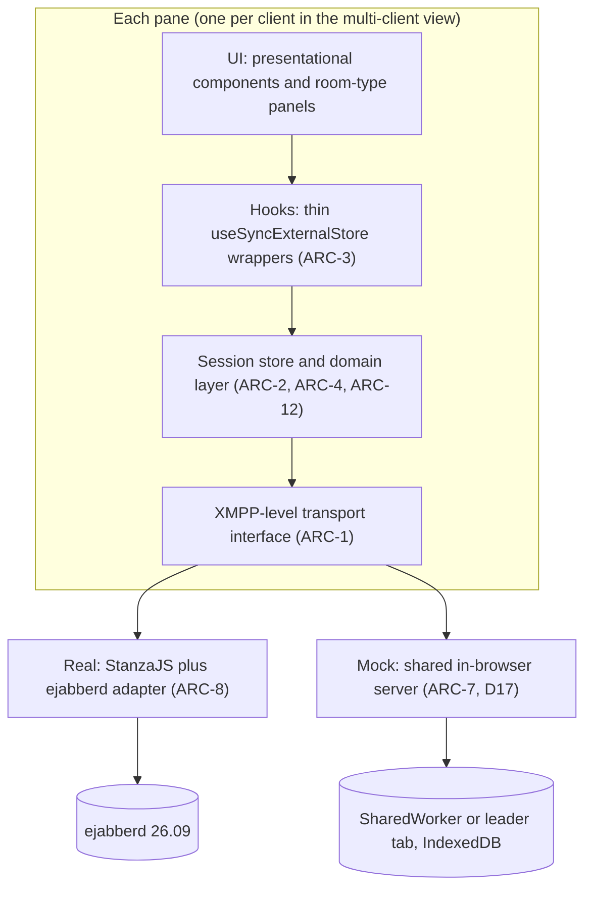

# War Rooms X1 — Software Requirements Document

Oct 20, 2026 (revised Oct 24, 2026, see §14) · @Ian Mayo

## 1. Introduction

War Rooms X1 (WRX1) is a browser-based wargaming tool whose v1 delivers admin-designed, chat-based wargames with an ejabberd XMPP server as its only backend service. It combines Serge's domain model with War Rooms X's XMPP transport, and fixes the defects both reviews identified.

**Scope (v1).** An admin backend to design and provision one wargame (forces, roles, chat rooms, themes, objectives), and a player client with a themed welcome page, a dockable chat workspace and a fixed out-of-game column. A browser-only mock backend and a 2–4 pane multi-client view support review and demos, and a public GitHub Pages site documents the project and hosts a live demo of every PR (section 13). Other room types, turns and exports are deferred but must not need re-architecture (section 8).

**Sources.** Serge v3.0.0 (`serge-web/serge`), War Rooms X (`serge-web/war-rooms-x`), and the technical summary of both.

**Requirement language.** SHALL = mandatory for v1; SHOULD = expected unless justified; MAY = optional. Requirements are numbered by area (ADM, PLY, ARC, NFR, DOC). Retired ids are not reused: ADM-32–34 (merged into ADM-18–20), PLY-7 (merged into PLY-42) and PLY-23 (merged into PLY-46).

**Definitions**

| Term | Meaning |
| --- | --- |
| Admin | The XMPP server's `admin` account; also the sole game designer and controller |
| Force | A side in the game; a PubSub document plus its roles' room and node affiliations |
| Role | A player position; one XMPP user account |
| Umpire force | A force whose roles are members of every room |
| Observer | A role that can read, but not post in, its rooms |
| Room | A channel; an XMPP MUC room plus a PubSub config document |
| Room type | A plug-in kind of room (v1: `chat` only) |

## 2. Key decisions and constraints

Twenty-four decisions frame v1; each has a consequence the requirements below depend on.

| # | Decision | Consequence |
| --- | --- | --- |
| D1 | The XMPP server (ejabberd, D16) is the sole production backend; all data lives in XMPP | No app server or database. Game metadata in PubSub; messages in MUC + MAM |
| D2 | Rules enforced by standard XMPP ACLs only; client trust accepted beyond that | No custom server module or bot. Anything ACLs cannot express is advisory (section 9) |
| D3 | The server's `admin` account is the game admin | Admin rights come from server-side authorisation, not a UI username check |
| D4 | v1 room type: chat only; others anticipated | A room-type registry is mandatory from v1 (ARC-5) |
| D5 | One XMPP account per role | Several people may log in to one role; they are indistinguishable to the server |
| D6 | Dockable workspace, layout saved in browser only | Layout is lost on a new browser or device; must survive room changes |
| D7 | No turn model in v1 | No phase-dependent permissions, so D2 covers all v1 rules |
| D8 | Umpire force (all rooms) and observers (read-only) | Umpire = MUC member of every room; observer = MUC `visitor` in moderated rooms, enforced by ejabberd's stored role (ADM-37) |
| D9 | Participants per room by force or role, mixed | Force entries expand to roles at provisioning; re-sync on change |
| D10 | Provisioning over XMPP only, with the admin's own credentials | Spike result: ejabberd needs no REST; all provisioning is XMPP using the admin's own session credentials (§10 outcome) |
| D11 | One wargame per server | No namespacing of nodes, rooms or users |
| D12 | Deploy air-gapped, internal or cloud | No runtime CDN or internet dependency |
| D13 | History: live MAM scrollback only | No export or replay in v1 |
| D14 | A browser-only JavaScript mock backend replaces the XMPP server for review and stakeholder demos; mock data is stored only in the browser | One transport interface with two implementations. The mock SHALL enforce the same ACL semantics as the server, verified by one contract-test suite run against both, or demos will misrepresent behaviour |
| D15 | A multi-client view shows 2, 3 or 4 independently logged-in client UIs on one page, against mock or real backend | No global singletons: each pane owns its own session, store and React provider. The mock runs as one in-page "server" serving several sessions |
| D16 | Server: **ejabberd 26.09**, chosen by the §10 spike over OpenFire and Prosody | No REST: every admin operation runs over XMPP with the admin's own credentials (XEP-0133, MUC owner, PubSub owner). The server adapter stays, so a later change of server remains possible |

**D17 — mock shared across browser tabs.** The mock "server" SHALL be shared by every tab of the same origin, so separate windows can act as separate players. Consequence: the server must run outside any one page's React tree — in a SharedWorker where supported, otherwise in one tab elected leader via the Web Locks API, with events relayed over BroadcastChannel and re-election when the leader closes.

**D18 — TypeScript.** All client, mock and test code SHALL be TypeScript in strict mode. Consequence: one set of shared types for domain documents, derived from the runtime schemas (ARC-6) so types and validation cannot drift.

**D19 — Themes for the game, each room and each force, edited by the admin and stored in PubSub.** The game theme styles the welcome page and app default; a room theme styles that room's panel; a force theme styles only the force/role/objectives panel. Themes hold design tokens plus logo and icon images. Consequence: image size and SVG safety must be controlled (§3 rule 12, R11), and the pre-login welcome page needs anonymous read access (D20).

**D20 — Themed welcome page before login, via anonymous read-only access.** Consequence: SASL ANONYMOUS is enabled, and anonymous sessions may read only `game-setup` and the game theme's assets. Those must hold nothing sensitive, and every other node must use a non-open access model. The mock emulates anonymous login; spike check S10 verifies the server.

**D21 — Objectives are written by the admin per force; the force reads them, and umpires may read and edit every force's objectives during play.** Consequence: one `objectives:<forceId>` node per force, whitelist read for that force's roles, umpires and admin; publish by admin and umpire-force roles (publisher affiliation). Whitelists re-sync when roles move force.

**D22 — Several people may log in to the same role at once, silently.** Consequence: multiple sessions of one account must join rooms under the same nickname (spike check S11), and each keeps its own browser layout.

**D23 — The admin may make any change to a published game while players are online; changes apply live.** Consequence: the client must handle every kind of change in place (PLY-28–31), and publishing must grant new access before revoking old to avoid transient lock-outs.

**D24 — UI component kit chosen by the dev team.** Constraints: per-panel theming via CSS custom properties (PLY-26), fully offline bundling (NFR-7), WCAG 2.2 AA (NFR-14) and first-class TypeScript types (D18).

## 3. Domain model and XMPP mapping

Every domain entity maps to one native XMPP construct for enforcement plus, where config is needed, one JSON PubSub document; nothing is stored in MUC description fields (fixing a WRX defect).

| Entity | Enforcement construct | Config / metadata | Access model |
| --- | --- | --- | --- |
| Wargame | — | PubSub leaf `game-setup` (name, description, briefing, theme, room-type defaults, `designVersion`) | Read: anyone, including anonymous (D20); publish: admin |
| Force | Room and node affiliations of its roles (no server group) | PubSub leaf `forces:<forceId>` (name, colour, icon, `isUmpire`) | Read: all game users; publish: admin |
| Role | XMPP user `<roleId>@<domain>` | PubSub leaf `roles:<roleId>` (name, `forceId`, `isObserver`) | Read: all game users; publish: admin |
| Room | MUC room `<roomId>@<mucService>` | PubSub leaf `rooms:<roomId>` (name, `roomType`, participants, type-specific config) | Read: room participants SHOULD; all users MAY; publish: admin |
| Message | MUC groupchat stanza | Body = JSON `{type, schemaVersion, content}` | MUC membership |
| History | MAM (XEP-0313); join history not relied on (PLY-49) | — | MUC membership |
| Announcement | — | PubSub leaf `announcements`, one item per announcement (text, posted time) | Read: every role; publish: admin (PLY-37) |
| Reserved | — | PubSub leaf `game-state` (created empty in v1 for the future turn model) | Publish: admin |

**Rules**

1. Entity ids SHALL be stable, URL-safe slugs generated at creation and never reused; display names are separate fields.
2. Each PubSub document SHALL carry `schemaVersion` and be validated at runtime on read (ARC-6).
3. Sender identity SHALL come from the MUC occupant JID (the stanza `from`, mapped to the real JID via members-only, non-anonymous rooms), never from the message body.
4. Room participants SHALL be stored as a list of `{kind: force|role, id, access: write|read}` entries. The effective set is the union of expanded force entries, role entries and all umpire-force roles. Precedence, weakest to strongest: a force entry, then a role entry for a role in that force (which overrides it), then umpire-force membership (write access to every room), then observer status (read only, always). An entry naming an unknown force or role grants nothing.
5. Observer status SHALL apply per role across all its rooms; a per-room read-only entry (`access: read`) SHOULD also be supported, since MUC `visitor` makes it free.
6. Display data for message authors (role name, force colour) SHALL be resolved from `roles:*` and `forces:*` documents, kept live by subscription.
7. The admin-set order of forces, roles and rooms (ADM-4–6, ADM-8) SHALL be stored as an integer `order` field in each document; ties sort by id.
8. `game-setup.designVersion` SHALL be a positive integer that publishing increments whenever the design changes; it keys saved layouts (PLY-5).
9. Role passwords SHALL NOT be stored in any PubSub document or design export (ADM-16, ADM-26, NFR-1).

**Themes and assets**

Each theme is a `theme` object inside its owner's document; images live in separate asset nodes so theme documents stay small and images can be reused.

| Theme | Stored in | Styles |
| --- | --- | --- |
| Game theme | `game-setup.theme` | Welcome page; app-wide default |
| Room theme | `rooms:<roomId>.theme` | That room's panel and tab (inherits game theme for unset tokens) |
| Force theme | `forces:<forceId>.theme` | The force/role/objectives panel only (inherits game theme) |
| Asset | PubSub leaf `assets:<assetId>` (base64, MIME type, size, hash) | Referenced by id from themes |

10. A theme SHALL contain tokens (primary, secondary, background, surface, text colours; font family from the bundled set) and optional `logoAssetId` and `iconAssetId`.
11. Unset tokens SHALL inherit from the game theme, then from the built-in default.
12. Assets SHALL be PNG, WebP or SVG, within a configurable size limit (default 100 KB) checked against the server's PubSub item limit (ejabberd: 250,000 bytes); SVG SHALL be sanitised on upload and rendered only via ``, never inlined.
13. Force colour (used for message authors) remains a separate force field, not a theme token.

14. Objectives SHALL be stored per force in `objectives:<forceId>` (Markdown text, `updatedAt`, `schemaVersion`), one item per author because a publisher cannot overwrite another publisher's item, with readers showing the newest; whitelist read for that force's roles, umpire-force roles and admin, and publish by admin and umpire-force roles.
15. `game-setup` and the game theme's assets SHALL be anonymously readable and SHALL contain nothing sensitive; every other node SHALL use whitelist access, never open. The announcements node SHALL be readable by every role and publishable only by the admin (PLY-37).

## 4. Functional requirements — admin backend

The admin backend lets the `admin` account design the wargame as a draft, then publish it, which provisions users, rooms and PubSub documents in one idempotent operation.

**Access**

- ADM-1 The admin backend SHALL be reachable only after XMPP login as `admin`; authorisation SHALL rest on server-side rights (PubSub owner, MUC owner, XEP-0133 admin commands), not a client check.
- ADM-2 The admin backend SHALL be a separate route of the same web app, sharing the transport layer and room-type registry with the player client.

**Game design**

- ADM-3 The admin SHALL edit game properties: name, description, theme colour.
- ADM-4 The admin SHALL create, edit, reorder and delete forces: name, colour, icon, umpire flag. At most one force SHOULD be the umpire force.
- ADM-5 The admin SHALL create, edit, reorder and delete roles within a force: display name, login id, password, observer flag; and move a role between forces.
- ADM-6 The admin SHALL create, edit, reorder and delete rooms: name, room type (v1: chat), participants as mixed force/role entries each with read or write access (§3 rule 4).
- ADM-7 Room-type-specific settings SHALL be edited through the editor supplied by that type's registry entry (ARC-5).
- ADM-8 Reordering of forces, roles and rooms SHALL use drag and drop with keyboard alternatives.
- ADM-9 The admin SHALL see a live effective-access matrix (rooms × roles: write / read / none) before publishing.

**Themes**

- ADM-18 The admin SHALL edit the game theme, each room's theme and each force's theme: colour tokens (a colour picker per token), bundled font, logo and icon upload.
- ADM-19 Theme editing SHALL show a live preview of the styled surface (welcome page, room panel, force panel) beside the pickers, updating as tokens change.
- ADM-20 The admin SHALL be warned when text/background token pairs fail WCAG 2.2 AA contrast, but SHALL still be able to save.
- ADM-21 The admin SHOULD be able to copy a theme from another force or room, and reset any theme to inherit.
- ADM-22 Theme changes SHALL publish live; connected clients SHALL restyle without re-login.

**Objectives and live editing**

- ADM-23 The admin SHALL write objectives for each force as Markdown, with a preview; players see them read-only (PLY-25).
- ADM-24 Publishing SHALL store objectives per §3 rule 14 and re-sync the whitelist when roles join, leave or change force.
- ADM-25 Any design change MAY be published while players are online. Publishing SHALL grant new access before revoking old, and SHALL show which online roles a change affects before it is applied.

**Provisioning**

- ADM-10 Publishing SHALL be idempotent and convergent: compute the diff between design and server state, then create, update or remove only what changed.
- ADM-11 Publishing SHALL show progress per item and report failures without leaving silent partial state; re-running SHALL complete a partial publish.
- ADM-12 Provisioning SHALL use XMPP only (MUC owner config, affiliations, PubSub owner operations, XEP-0133 user commands) with the admin's own credentials; no REST or shared secret (§10 outcome).
- ADM-13 Changing a role's force or a room's participants SHALL re-sync affected MUC affiliations and roles on publish.
- ADM-14 Deleting a role SHALL warn that its message history remains attributed to the old JID.
- ADM-15 The admin SHALL be able to reset the game (delete all provisioned users, rooms and documents) with typed confirmation.

**Design portability**

- ADM-16 The admin SHALL export and import the game design as a versioned JSON file, so designs move between mock and real backends and between servers. Passwords SHALL be excluded or replaced on export.

**Monitoring**

- ADM-17 The admin SHOULD see which roles are online (presence) and MAY join any room as owner to read it.

**Admin screen layout**

- ADM-27 The admin backend SHALL use a left-hand menu of sections (game, forces, roles, rooms, themes), each opening a list with an edit form.
- ADM-28 A header toggle SHALL switch the admin between the admin backend and the game view.
- ADM-29 During play the admin SHALL use the game view, with a text box at the bottom of the admin panel for posting out-of-game announcements.
- ADM-30 The game view SHALL offer a preview selector: the admin, or any role, seeing exactly that role's rooms, layout, themes and objectives.
- ADM-31 While previewing as a role, the admin MAY post in that role's rooms; such posts SHALL be sent from the admin account and labelled as from the admin, never impersonating the role.

**Admin rules from the server spike**

- ADM-35 Every admin operation SHALL go through a single admin-operations module that applies rules ADM-36–40 (the spike's `AdminOps`, rules R-A to R-F).
- ADM-36 Revoking a role's read access to a node SHALL remove both its whitelist affiliation and its subscriptions (R-A).
- ADM-37 Game rooms SHALL always be moderated, and the admin UI SHALL NOT offer an unmoderated game room (R-C). Observer voice revocation SHALL be re-applied after any change to an observer's room affiliation (R-B). Re-applying SHALL NOT require resetting the observer's password, which would lock out everyone sharing the role (D22). Because S13 failed (§10), voice SHALL be revoked by the admin tooling logging in as the observer, using an encrypted observer-password vault: encrypted in the admin's browser under a vault passphrase and kept in the admin account's private storage, so the server holds ciphertext only. If the passphrase is lost, passwords are reset (ADM-26). The vault SHALL be updated by password resets (ADM-26) and role deletion (ADM-39). Making an observer a room member and revoking its voice SHALL run back to back, before the room is published to the observer, so an online observer has no window in which to post.
- ADM-38 Moving a role between forces SHALL grant the new access before revoking the old (R-D).
- ADM-39 Deleting a role SHALL remove its room and node affiliations and subscriptions, then the account; `item-not-found` on account deletion SHALL be treated as already deleted (R-E).
- ADM-40 Destroying a room deletes its history (R-F). The admin UI SHALL warn, show the message count and require confirmation.
- ADM-41 The admin UI SHOULD offer an "Audit and repair" action that checks the live server against the game design (room moderation, observer voice, orphaned affiliations and subscriptions) and fixes differences.
- ADM-42 The admin UI SHALL warn that anonymous users can list node names, and MAY offer opaque node ids.

## 5. Functional requirements — player client and demo views

A player logs in as a role, sees only the rooms that role participates in, and arranges them in a dockable workspace; the same client can run 2–4 times on one page for demos.

**Login and session**

- PLY-1 The player SHALL log in with role id and password; the client SHALL show the backend in use (real server address or "MOCK") at all times.
- PLY-2 On connection loss the client SHALL show status, reconnect with back-off, rejoin rooms and fetch missed messages via MAM without duplicates.
- PLY-3 Logout SHALL leave rooms, release subscriptions and clear in-memory game data.

**Pre-login and live changes**

- PLY-27 Before login, the client SHALL fetch `game-setup` and the game theme anonymously (D20) and show the themed welcome page; if that fails it SHALL show the default theme and still allow login.
- PLY-28 Changes to game, force, role, room, objective and theme documents SHALL apply live, without re-login.
- PLY-29 If the logged-in role is deleted, the client SHALL notify the user and log out.
- PLY-30 If the role moves force, the force panel, objectives, theme and room list SHALL refresh in place; rooms losing access close with a notice, new rooms appear via PLY-6.
- PLY-31 A password change SHALL NOT end current sessions; it applies at next login.

**Workspace**

- PLY-4 Each room the role can see SHALL appear as a tab in a dockable workspace (FlexLayout or dockview) that the user can drag, split, resize and pop out.
- PLY-5 The layout SHALL be saved to browser storage keyed by server, role and game design version, and restored at login.
- PLY-6 Rooms added or removed while logged in SHALL be reconciled into the current layout via the layout library's public API, without resetting it.
- PLY-7 Retired: merged into PLY-42.
- PLY-8 Other non-room panels (game info, online roles) SHOULD be dockable; the out-of-game column (PLY-36) is fixed.

**Themes**

- PLY-23 Retired: merged into PLY-46.
- PLY-24 Each room panel SHALL apply its room theme; each pane in the multi-client view SHALL theme independently.
- PLY-25 The force/role/objectives panel SHALL apply the role's force theme and show force logo, role name and force objectives. It SHALL sit at the bottom of the out-of-game column (PLY-36).
- PLY-26 Themes SHALL be applied via scoped CSS custom properties per panel, so one panel's theme cannot leak into another.

**Chat rooms**

- PLY-9 A chat room SHALL show messages in server-timestamp order with author role name, force colour and time; history loads from MAM on join and pages back on scroll (PLY-49).
- PLY-10 Messages SHALL be de-duplicated by stanza/archive id across MAM and live delivery (PLY-49).
- PLY-11 Tabs SHALL show unread counts via the layout library's tab-render callback, never DOM manipulation.
- PLY-12 Observers and read-only participants SHALL see the composer disabled with an explanation; the server SHALL also reject their posts (ADM-37) (MUC `visitor`).
- PLY-13 A room SHOULD show which participants are online.
- PLY-14 Message text SHALL be rendered as plain text (no HTML); links MAY be auto-linked.

**Umpire**

- PLY-15 Umpire-force roles SHALL see and post in every room. A combined cross-room view is deferred to the backlog (§8).

- PLY-35 Umpire-force roles SHALL view and edit every force's objectives from the player client, with a Markdown preview; edits SHALL publish live to that force's force panel.

**Out-of-game column**

- PLY-36 The player screen SHALL have a permanently visible, fixed-width out-of-game column on the right, outside the dockable workspace. Top to bottom: a reserved area for game time and turn (empty in v1, D7), the admin panel, then the force panel (PLY-25).
- PLY-37 The admin panel SHALL show announcements from the `announcements` PubSub node, readable by every role and with publish restricted to the admin by the server (`publish_model: publishers`). It carries out-of-game announcements (breaks, delays, reminders) and SHALL NOT appear as a workspace tab.
- PLY-38 Admin messages SHALL be ordered oldest to newest, with newest at the bottom like a chat, and a newly arrived message SHALL be briefly highlighted.
- PLY-39 Write control SHALL be enforced by the server. Observer read-only uses ejabberd's stored visitor role in moderated rooms (spike S1, ADM-37); no client-only fallback is needed.

**Default workspace layout**

- PLY-40 On first login (no saved layout), rooms SHALL be distributed evenly across up to three side-by-side tabset columns; only as many columns as there are rooms SHALL be shown (one room, one column).
- PLY-41 A room added during play SHALL appear in the tabset with the fewest tabs, without disturbing the rest of the layout.
- PLY-42 The player SHALL have a "Reset layout" control that restores the three-column default for their current rooms.

**Chat room panel**

- PLY-43 Messages SHALL display as cards with a header row (sender role, force colour, time) above the text; consecutive messages from the same sender SHALL share one header.
- PLY-44 The composer SHALL sit at the bottom of the panel and grow as text is entered; Enter sends, Shift+Enter inserts a new line.
- PLY-45 Message times SHALL show local wall-clock time only, with a date divider line between messages from different days.

**Welcome page**

- PLY-46 The welcome page SHALL be styled by the game theme and show the game logo, name and short description, then an admin-written briefing in Markdown, then the login form below it.
- PLY-47 The briefing SHALL sit in a fixed-height scrolling box so the login form stays visible.
- PLY-48 The briefing is readable anonymously (D20), so the admin editor SHALL warn that it is public and must contain nothing confidential.

**Server behaviour handling (from the spike)**

- PLY-49 Room history SHALL be loaded from MAM, paging backwards from the latest message; MUC join history is not persisted across server restarts and SHALL NOT be relied on. Messages SHALL be de-duplicated by `stanza-id`.
- PLY-50 The stream errors `policy-violation` (session ended) and `conflict` (account removed) SHALL be treated as forced logout, with an explanation.
- PLY-51 Unavailable self-presence with status codes 110 and 321 (removed by an affiliation change) SHALL close the room panel with a notice (PLY-30).
- PLY-52 Access changes are not notified, so `<not-allowed/>` and `<forbidden/>` from MUC or PubSub SHALL be handled gracefully: the panel shows that access was withdrawn, and the client does not crash or retry endlessly.
- PLY-53 The client SHALL cap each outgoing message stanza at 65,536 bytes (UTF-8, after XML escaping) and keep PubSub items well under the 250 KB server limit, rejecting oversized content with a message (R15).

**Multi-client view**

- PLY-16 A multi-client view SHALL show 2, 3 or 4 client panes side by side (or in a grid), each logged in independently as a different role, against either backend.
- PLY-17 Each pane SHALL be a full player client (or the admin backend) with its own session, store and layout, with no shared in-memory state except the mock server.
- PLY-18 Each pane SHALL show a header with role, force colour and backend, and SHALL offer quick login from the game's role list (mock), or a login form (real server).
- PLY-19 The pane count and pane logins SHOULD be saved and restorable as a named demo preset.

**Mock backend for users**

- PLY-20 The login screen SHALL let the user choose real server or mock backend; the mock SHALL be selectable without any network access.
- PLY-21 The mock SHALL load seed scenarios (at least one demo wargame) and SHALL offer reset to seed and export/import of the mock database.
- PLY-22 With the mock, separate browser tabs and windows of the same origin SHALL share one game (D17), so multiple windows behave as separate players.

## 6. Client architecture requirements

The client is layered so that every pane in the multi-client view is fully independent, and swapping real XMPP for the in-browser mock changes only the transport implementation.

The same code above the transport interface runs against both backends; that is what makes the mock a fair demo.

- ARC-1 A single TypeScript transport interface SHALL cover connection, MUC, PubSub, MAM, presence and admin provisioning, with two implementations: real (StanzaJS plus server adapter) and mock. Each pane SHALL choose one at login.
- ARC-2 Each pane SHALL own a framework-agnostic session store with an explicit ready state (resolved after service discovery) and reference-counted subscriptions (`acquire(node) → release()`). Client code SHALL contain no module-level mutable state; a lint rule SHALL enforce this.
- ARC-3 Hooks SHALL be thin wrappers (`useSyncExternalStore` and/or TanStack Query) returning `{data, status, error}`, with cleanup verified under React StrictMode.
- ARC-4 Messages SHALL be normalised per room, keyed by stable id, ordered by server timestamp, and merged idempotently from MAM pages and live stanzas; MAM paging SHALL use RSM ids correctly.
- ARC-5 A room-type registry SHALL map `type → {player component, icon, config schema, admin editor, message schema}` and be shared by admin and player. v1 registers `chat` only.
- ARC-6 PubSub documents, room configs and message bodies SHALL be validated at runtime (e.g. zod), with migration by `schemaVersion`.
- ARC-7 The mock server SHALL run in a SharedWorker where available, else in a Web Locks–elected leader tab with BroadcastChannel relay; persist to IndexedDB; implement MUC affiliations and roles, PubSub access and publish models, MAM paging, presence and admin operations with the same error semantics as the real server; and support seed scenarios and a controllable clock for tests.
- ARC-8 A server adapter SHALL isolate server-specific behaviour (e.g. ejabberd error conditions and stored-role behaviour). The XMPP core SHALL use standard extensions only: XEP-0045, 0060, 0313, 0059, 0133, and SHOULD use 0198 (stream management) for resilient reconnects.
- ARC-9 The layout library SHALL be wrapped in a workspace module; persistence and room reconciliation SHALL use its public API only.

**Transport interface**

- ARC-12 The transport SHALL be layered: a domain layer (e.g. sendMessage, getHistory, publishObjectives, watchRoom) over an XMPP-level interface (MUC join/leave/send, PubSub get/publish/subscribe, MAM query, presence, admin provisioning). The mock SHALL implement the XMPP-level interface, so the domain layer runs unchanged and is exercised in mock mode. This costs more than a domain-level mock and raises mock fidelity demands (R2), accepted for test coverage.
- ARC-13 Live events SHOULD be delivered by callbacks that return an unsubscribe function, for direct use with useSyncExternalStore (recommendation; team may change).
- ARC-14 The error-reporting convention (exceptions or typed results) is left to the development team, but SHALL be consistent across both layers and identical in mock and real implementations.

- ARC-15 Package structure, state management and caching are left to the development team, within ARC-1–14 and NFR-18–20.

## 7. Non-functional requirements

Security rests on XMPP server configuration, not client code; deployment must work with no internet access.

**Security**

- NFR-1 No secret (REST key, admin password, role password) SHALL be in the client bundle or source repository.
- NFR-2 Production connections SHALL use TLS only (`wss://`, `https://`); certificates from an internal CA SHALL be supported for air-gapped use.
- NFR-3 Rooms SHALL be members-only, moderated, non-anonymous, persistent and not publicly listed; PubSub nodes SHALL use `publish_model: publishers` and the narrowest workable `access_model` (whitelist).
- NFR-4 The setup guide SHALL list the server settings WRX1 relies on, and the admin backend SHOULD verify them at publish (e.g. room config, MAM enabled).
- NFR-5 Payloads from the network SHALL be schema-validated; invalid items are logged and ignored, never crash the UI.
- NFR-6 Generated role passwords SHALL be random by default; the mock MAY use known demo passwords, clearly labelled.

- NFR-21 Anonymous login SHALL be limited to reading `game-setup` and the game theme's assets; anonymous sessions SHALL NOT join rooms or read any other node (verified by S10, and enforced identically in the mock).

**Deployment**

- NFR-7 The client SHALL be a static build with all assets (fonts, icons, libraries) bundled; no runtime CDN calls.
- NFR-8 The build SHALL support three hosting modes: served by a reverse proxy on the same origin as the XMPP WebSocket endpoint, a separate static host with a configured proxy, and file/static hosting with mock only.
- NFR-9 Backend endpoints (WebSocket URL, XMPP domain) SHALL be runtime configuration, not build-time constants.
- NFR-10 A container image (ejabberd + client + config, per NFR-22) SHOULD be provided for one-command deployment.

- NFR-22 The reference deployment SHALL be `spike/docker/ejabberd/` from the spike repo: image pinned by digest, `wss://` only, SCRAM-SHA-256, no REST `/api`, web admin or `mod_adhoc_api`, in-band registration off, per-player rate limit. CI SHALL run the contract suite on every push, and an ejabberd upgrade SHALL NOT be adopted until the R1 tests (S01, S01b, C01) pass.
- NFR-23 The air-gapped host install SHALL be verified on real hardware before first deployment (open; `ops/offline-install.sh`).

**Performance and scale**

- NFR-11 v1 SHALL support at least 50 roles, 30 rooms and 10,000 messages per room on one server, with a room tab rendering in under 1 s (virtualised list).
- NFR-12 The multi-client view with 4 panes SHALL deliver a sent message to all four panes within 1 s, with no visible typing lag, on a standard 8 GB laptop.

**Browsers and accessibility**

- NFR-13 Current Chrome, Edge and Firefox SHALL be supported; Safari SHOULD be.
- NFR-14 The UI SHOULD meet WCAG 2.2 AA, including keyboard alternatives to drag and drop.

**Testing and quality**

- NFR-15 Unit tests SHALL cover the store, hooks and mock against the in-memory transport.
- NFR-16 One transport contract-test suite SHALL run against the mock and against a containerised XMPP server in CI; CI SHALL fail, not skip, when the server is unavailable.
- NFR-17 Playwright end-to-end tests SHALL run in CI, using the multi-client view to assert cross-role send and receive.
- NFR-18 Presentational components SHALL be split from data hooks (WRX `*Core` pattern) and catalogued in Storybook.

**Language and tooling**

- NFR-19 All code SHALL be TypeScript with `strict` enabled; `any` and unchecked casts of network data SHALL be disallowed by lint.
- NFR-20 Domain types SHALL be inferred from the runtime schemas, shared by admin, player, mock and tests.

## 8. Out of scope for v1

These are deferred, but the v1 architecture SHALL accommodate each without restructuring.

| Deferred feature | v1 provision that keeps it cheap |
| --- | --- |
| Structured form rooms (JSON Schema templates, per-participant template permissions) | Room-type registry; message body `{type, schemaVersion, content}`; `templates` PubSub collection name reserved |
| Collab / RFI workflow rooms | Registry; message `type` discriminator; Serge's model as reference |
| Mapping rooms (Leaflet, GeoJSON deltas) | Registry; locally hosted tiles required by D12 |
| Turns, phases, game clock | Reserved `game-state` node; admin-only publish |
| Phase-based permissions | Would need a server plugin or bot, which D2 currently excludes |
| Admin-defined default layouts per role | Layout model is plain JSON, storable in PubSub later |
| Server-side layout persistence | Same; XEP-0049 private storage is a candidate |
| Message export and replay | MAM retains everything; export is a query-and-serialise feature |
| Multiple wargames per server | Entity ids are slugs; a namespace prefix can be added |
| Per-person accounts within a role | Role = account in v1; resource or nickname could identify individuals later |

**Backlog:** umpire combined view — one merged, filterable timeline of all rooms, each message labelled with its room, with reply into the source room. Needs no new XMPP mechanism; it reads the rooms umpires already join.

## 9. Risks, critical analysis and open issues

The largest remaining risks are a mock that drifts from real server behaviour (R2) and enforcement that depends on correct admin tooling (R14); the server spike closed the ACL questions (R1, R3, R10).

| # | Risk / finding | Impact | Mitigation |
| --- | --- | --- | --- |
| R1 | **Read-only members may not be enforceable by standard MUC.** XEP-0045 gives members voice by default in moderated rooms; voice revocation is per-session and needs an online moderator, which D2 excludes | High: PLY-12 and D8 may be client-enforced only | **Closed by spike:** ejabberd keeps a moderator's voice revocation per account in moderated rooms, across reconnects and restarts. Relies on ADM-37 and R13 |
| R2 | **Mock drift.** A demo mock that permits what the server forbids misleads stakeholders | High | Contract suite (NFR-16) as the single definition of behaviour; mock ACL logic written from that suite |
| R3 | **Per-force PubSub confidentiality.** Whitelist per node needs affiliation maintenance; `roster` access depends on server group/roster support | Medium, rising to High with R10 | **Closed by spike:** whitelist plus publishers per node; revocation must also remove subscriptions (ADM-36) |
| R4 | **Shared role accounts.** No individual attribution of who said what | Medium for post-exercise analysis | Accepted for v1 (D5); per-person accounts listed in §8 |
| R5 | **REST authentication.** OpenFire's REST plugin is designed around a shared secret; basic auth with admin credentials must be confirmed | Medium: blocks NFR-1 | **Closed by spike:** ejabberd needs no REST and no shared secret |
| R6 | **Server groups may be unnecessary.** Forces are already expressed by PubSub docs and MUC affiliations; groups add the main REST dependency | Low/positive | **Closed by spike:** groups not needed; per-user room and node affiliations suffice |
| R7 | **Cross-tab mock complexity.** Leader election, re-election and IndexedDB schema migration add failure modes | Medium | SharedWorker first; leader fallback covered by Playwright multi-tab tests |
| R8 | **Browser-only layouts.** Demo laptops lose arrangements | Low | Layout export/import MAY be added cheaply |
| R9 | **Message `type` is client-asserted.** A modified client can send arbitrary body JSON | Low in v1 (chat only) | Validate and render as plain text; never trust body for identity or permissions |
| R10 | **Force objectives are confidential but would sit in readable PubSub.** The force panel shows objectives; WRX's open nodes let any player read every force's objectives | High | **Closed by spike:** `objectives:<forceId>` with whitelist read (force, umpires, admin) and publishers (admin, umpires) is enforced; revocation per ADM-36 |
| R11 | **Theme images vs PubSub limits and SVG scripting.** Large images can exceed item limits; SVG can carry script | Medium | **Closed by spike:** ejabberd caps items at 250,000 bytes (operator-configurable); 100 KB assets work. SVG sanitised and rendered via `` only (§3 rule 12) |
| R12 | **Welcome page precedes login,** but PubSub requires an authenticated session | Medium | Decided (D20): anonymous read access limited to `game-setup` and its theme assets (NFR-21), verified by S10 |

**Risks added by the spike**

- R13 **R1 depends on ejabberd's stored-role behaviour**, which is deliberate but not an XMPP standard. Medium. Mitigation: R1 contract tests gate every ejabberd upgrade (NFR-22); fallback is Prosody with a small module, which would relax D2.
- R14 **Enforcement depends on correct admin tooling.** A missed step (subscription left in place, observer voice not re-applied, room left unmoderated) silently leaks access or voice. Medium–High. Mitigation: ADM-35 and ADM-41, contract test C01.
- R15 **No WebSocket stanza size cap.** WP 0.1 found no size limit on the WebSocket listener: room messages up to 64 MiB were delivered, `max_stanza_size` does not apply to it, and the \~885 KB connection drop seen earlier did not reproduce. Medium. Mitigation: the 64 KiB client cap (PLY-53) and the per-player rate limit. A modified client can still post large messages; accepted for v1.
- R16 **Destroying a room destroys its history.** Medium, given live editing (D23). Mitigation: ADM-40.
- R17 **Anonymous users can list PubSub node names** (not contents). Low, accepted. Mitigation: ADM-42.

**Risks added by the publishing strategy**

- R18 **Public repos already expose security detail.** The xmpp-spike findings and the future `AdminOps` code describe the admin rules and the accepted weaknesses that DOC-2 keeps off the site. Medium. Mitigation: decide repo visibility (open issue).
- R19 **Preview storage growth.** Keeping every merged preview approaches the Pages size limit after about 200–300 PRs. Low–Medium. Mitigation: DOC-14.
- R20 **Diagram updates rely on a review checklist** while human review is light, so diagrams may drift from the code. Medium. Mitigation: milestone posts include a diagram review.

- R21 **Unreviewed public posts.** Intermediate posts go public with no human review, so one could be inaccurate or reveal something sensitive. Medium. Mitigation: the deny-list check blocks auto-merge (DOC-25); posts are labelled as work in progress (DOC-26); a post can be withdrawn by reverting its PR.

**Open issues**

- [x] Read-only member enforcement: ejabberd stored visitor role (R1, S1)
- [x] Admin provisioning without a bundled secret: XMPP only, no REST (R5, S4)
- [x] Server groups: dropped, not needed (R6, S7)
- [x] Server choice: ejabberd 26.09 (D16, §10)
- [ ] Air-gapped host install verified on real hardware (S8, NFR-23)
- [x] Follow-up spike S13: failed, so ADM-37 uses the encrypted vault (§10)
- [ ] Repo visibility: should the spike and WRX1 code repos stay public, given DOC-2 keeps security detail off the site? (R18)
- [x] Welcome page: before login, via anonymous read access (D20)
- [x] Objectives: admin-written per force, force read-only, umpires may edit (D21)
- [x] Concurrent logins per role: allowed silently (D22)
- [x] Live editing: any change, applied live (D23)
- [x] UI component kit: dev team decides, within constraints (D24)

**Pre-development checks**

The server question is settled. These remaining checks come first in the development plan (Phase 0).

| # | Check | When | Owner | Decides |
| --- | --- | --- | --- | --- |
| P1 | S13 offline voice revocation, plus whether `max_stanza_size` applies to the WebSocket listener. **Done:** S13 failed (vault); no WebSocket size limit (64 KiB client cap) | Before start | Claude Code / dev | ADM-37, R15 |
| P2 | Target environment: analyst browsers and versions (SharedWorker, IndexedDB, Web Locks), approval to run ejabberd/Erlang on internal and air-gapped hosts, who verifies NFR-23 | Before start | Doc, with customer | D12, D17, NFR-23 |
| P3 | Layout library, FlexLayout vs dockview: four independent workspaces with pop-outs on one page (D15), add to the fewest-tab tabset via public API only (PLY-41), save/restore across room changes (D6) | Sprint 1 | Claude Code / dev | ARC, PLY-40–42 |
| P4 | StanzaJS health: maintenance status, typing of ad-hoc commands, MAM and RSM, and a fallback library if needed | Sprint 1 | Claude Code / dev | ARC-12 |
| P5 | JSON schemas for every PubSub document in §3 | Sprint 1, first | Dev team | Mock, contract suite, design import/export |
| P6 | Retired: the plan keeps no time estimates | After P5 | Dev team | Plan |

## 10. Server selection spike

OpenFire, ejabberd and Prosody were each evaluated against the same pass/fail criteria before the mock's ACL rules were written, and the server was chosen on evidence (see Outcome). The spike also ran S0 (browser connectivity) and S12 (live changes).

**Method.** For each server: install from a container image offline, configure by file or admin API only (no custom plugins, per D2), and run the transport contract suite plus the targeted checks below. Record configuration, results and effort. Budget: about 3 days per server.

| # | Check | Pass criterion | Linked risk |
| --- | --- | --- | --- |
| S1 | Read-only room members | A member observer cannot post, enforced by server, across reconnects, with no online moderator | R1 |
| S2 | Per-node confidentiality | A whitelist PubSub node is unreadable by roles outside the list | R10 |
| S3 | PubSub item size | A 100 KB item publishes and retrieves; limit is configurable | R11 |
| S4 | Admin without bundled secret | Users and room affiliations provisioned using only the admin's login credentials | R5 |
| S5 | MUC history | MAM paging with RSM over 10,000 messages returns complete, ordered results | ARC-4 |
| S6 | Publisher notifications | Behaviour on own publishes documented; transport can normalise it | ARC-1 |
| S7 | Groups need | Whether forces need server groups at all | R6 |
| S8 | Operations | Air-gapped install, TLS with internal CA, backup and restore, admin console usability | NFR-2, NFR-10 |
| S9 | Escape hatch | Effort to add a small server module if D2 is later relaxed (e.g. for turns) | §8 |
| S10 | Anonymous read | An anonymous session reads `game-setup` and its theme assets, and cannot join rooms or read any other node | D20, NFR-21 |
| S11 | Same-role multi-session | Two sessions of one account join a room under the same nickname and both receive all messages | D22 |

**Decision rule.** S1–S5 and S10 are mandatory: a server failing any of them is rejected unless D2 is relaxed for that server. Among passing servers, prefer fewest REST dependencies, then operational simplicity (S8), then extensibility (S9).

**Output.** A short decision record per server, and the chosen server's configuration checked in as the reference deployment and the CI integration target (NFR-16).

**Outcome (24 October 2026).** **ejabberd 26.09 is selected.** It was the only server to pass every mandatory check using standard controls. Prosody failed S1 unless a \~45-line custom module is added, which D2 rules out; OpenFire failed S1, S2, S5 and S10. ejabberd needs no REST and no server groups, and its indicative capacity is 200 players at p95 678 ms. Evidence: [serge-web/xmpp-spike, results/architect-findings.md](https://github.com/serge-web/xmpp-spike/blob/main/results/architect-findings.md). The choice rests on D2: if D2 is ever relaxed, Prosody with a small module is the alternative (R13). Requirements arising: ADM-35–42, PLY-49–53, NFR-22–23, R13–R17.

**Follow-up check S13.** Can the admin set the stored visitor role for an observer account that is offline, without logging in as it: via ejabberd's MUC admin commands over XMPP (XEP-0133), or the room's stored state? Pass: the observer's next join is as a visitor, it cannot post, and no password or REST was used. Pass selects direct revocation for ADM-37; fail selects the encrypted vault.

**S13 outcome (24 October 2026): fail.** Run by WP 0.1 against ejabberd 26.09. No documented admin feature over XMPP makes a member observer a visitor before it first joins: a MUC role change for an absent occupant is refused (`not-allowed` or `not-acceptable`); `members_by_default=false` affects only unaffiliated users, whom members-only rooms refuse; and ejabberd's admin commands over ad-hoc have no role operation. An open room with unaffiliated observers does make them visitors, but lets other forces and anonymous users read, so breaks NFR-3 and NFR-21. ADM-37 therefore uses the encrypted vault. The full record is internal (`plan/decisions/S13.md`).

## 11. Mock development process

Every interaction the mock supports SHALL be specified from the XMPP standards, verified against the chosen server, and only then reproduced in the mock, so that reviews and demos on the mock behave as the real backend will.

1. **Specify from the standards.** Define the interaction from the relevant XEP (0045, 0060, 0313, 0059, 0133), noting every point the spec leaves to the server (MAY/SHOULD).
2. **Establish and test server behaviour.** Implement the interaction in the real transport against the chosen server, and record its actual behaviour, especially at the discretionary points. Capture it as contract tests that reference the XEP section.
3. **Reproduce in the mock.** Implement the interaction in the mock JavaScript until it passes the same contract tests.
4. **Keep it matched.** Run the contract suite against both mock and server in CI; a divergence SHALL fail the build. A server upgrade or config change SHALL re-run the suite before release.

- ARC-10 No interaction SHALL be added to the mock unless it is covered by a contract test that passes against the real server.
- ARC-11 The mock SHALL return the same error conditions and event ordering as the server for every tested interaction.

**Limits of the guarantee.** The match is only as complete as the contract suite. Timing, concurrency, network failure and scale are not reproduced by default, so the mock SHALL support injected latency, reordering and disconnects, and final acceptance SHALL still be run against the real server.

## 12. User scenarios

Nine end-to-end scenarios walk each actor through v1; each traces to the requirements it exercises and doubles as the basis for a Playwright test (NFR-17). Walking them exposed four gaps, now covered by ADM-26 and PLY-32–34 at the end of this section.

### SC-1 Admin designs and publishes a game

**Actor:** admin. **Start:** empty server, or the mock.

1. Opens the app, chooses the mock backend and logs in as `admin`.
2. Sets game name, description and game theme with logo.
3. Creates forces Blue, Red and Umpire (umpire flag set), each with a theme and colour, and writes Blue's and Red's objectives.
4. Creates roles in each force with generated passwords; marks one Blue role as observer.
5. Creates rooms (Blue HQ, Red HQ, Blue–Red negotiation) with mixed force/role participants.
6. Reviews the access matrix, publishes, and watches per-item progress complete.
7. Exports the design JSON, logs in to the real server as `admin`, imports it and publishes again.
8. Exports the credentials sheet and distributes it.

**Outcome:** the same game exists on mock and server. **Traces to:** ADM-1–16, ADM-18–24, ADM-26.

### SC-2 Player arrives and gets oriented

**Actor:** Blue role. **Start:** published game, player not logged in.

1. Opens the app and sees the welcome page in the game theme, loaded anonymously.
2. Logs in with role id and password.
3. Sees one tab per permitted room, plus the force panel at the bottom of the out-of-game column showing Blue's logo, role name and objectives in the Blue theme.
4. Drags the negotiation room into a second tabset and resizes it.
5. Reloads the page and finds the layout restored.

**Outcome:** player sees exactly their rooms and objectives. **Traces to:** PLY-1, PLY-4–5, PLY-24–27, D20.

### SC-3 Cross-force chat, including a dropped connection

**Actors:** Blue and Red roles. **Start:** both logged in.

1. Blue posts in the negotiation room; Red sees it at once with Blue's role name and colour, and an unread badge if the tab is hidden.
2. Red's network drops for two minutes while Blue posts three more messages.
3. Red's client shows reconnecting, then rejoins and shows all three messages once, in order.
4. Red scrolls back and older history pages in.

**Outcome:** no lost, duplicated or misordered messages. **Traces to:** PLY-2, PLY-9–11, ARC-4, §3 rule 3.

### SC-4 Observer reads but cannot post

**Actor:** Blue observer role.

1. Logs in and sees Blue's rooms and their history.
2. Finds the composer disabled, with an explanation.
3. A modified client attempts to post; the server rejects it and no other participant sees it.

**Outcome:** read-only is enforced by the server, not just the UI. **Traces to:** PLY-12, D8, S1 (R1).

### SC-5 Umpire monitors the game

**Actor:** Umpire role.

1. Logs in and sees every room.
2. Places Red HQ and the negotiation room side by side in the workspace.
3. Posts a clarification in Red HQ, which Red sees attributed to the umpire.
4. Opens Red's objectives, amends one, and Red's force panel updates live.

**Outcome:** umpires see all play and can adjust any force's objectives. **Traces to:** PLY-15, PLY-25, PLY-35, D8, D21, §3 rule 14.

### SC-6 Admin changes the game during play

**Actors:** admin; a Blue role who is online.

1. Admin moves the Blue role to Red and adds a new room for Red.
2. Before applying, the publish view lists the online roles affected.
3. On publish, Red access is granted before Blue access is revoked.
4. The player's force panel, objectives and theme switch to Red; Blue rooms close with a notice; Red rooms and the new room appear without disturbing the rest of the layout.
5. Admin then deletes another online role; that player is notified and logged out.

**Outcome:** live changes apply cleanly with no transient lock-out. **Traces to:** ADM-13, ADM-25, PLY-6, PLY-28–30, D23.

### SC-7 Stakeholder demo on the mock, offline

**Actor:** presenter on a laptop with no network.

1. Opens the app from a static host and chooses the mock; the seed scenario loads, including message history.
2. Opens the multi-client view with three panes and quick-logs in as Blue, Red and Umpire.
3. Sends a message from Blue and shows it arrive in Red's and the Umpire's panes.
4. Opens a second browser window as a fourth role, to show the shared mock across windows.
5. After the demo, resets the mock to the seed.

**Outcome:** a convincing multi-player demo with no server. **Traces to:** PLY-16–22, PLY-34, D14–17, NFR-7.

### SC-8 Two people share one role

**Actors:** two people, both logged in as Blue CO.

1. Both join the same rooms and both receive every message.
2. A message from either appears as Blue CO in every client.

**Outcome:** works as decided, with no individual attribution. **Traces to:** D22, S11, R4.

### SC-9 Developer adds a new interaction to the mock

**Actor:** developer.

1. Specifies the interaction from the relevant XEP and notes the server's discretionary points.
2. Writes a contract test, runs it against the chosen server and records actual behaviour.
3. Implements it in the mock until the same test passes.
4. CI runs the test against both on every build.

**Outcome:** the mock stays faithful to the server. **Traces to:** §11, ARC-10–11, NFR-16.

### Gaps found and requirements added

- ADM-26 (from SC-1) Generated passwords need a route to players. The admin SHALL export a printable credentials sheet (role, force, login id, password), and SHALL be able to reset any role's password. The sheet SHALL be generated on demand and never stored in PubSub.
- PLY-32 (from SC-2) The client SHALL show clear empty states: no published game (welcome page falls back to default), and a role with no rooms.
- PLY-33 (from SC-4 and SC-6) When the server rejects a post or access is revoked mid-composition, the client SHALL show why and keep the unsent text so it can be copied.
- PLY-34 (from SC-7) Seed scenarios SHALL include message history, and SHALL be creatable by exporting a mock database after a rehearsal run (PLY-21).

## 13. Documentation and publishing

The repo publishes a public static site on GitHub Pages (the `gh-pages` branch) that explains WRX1 and hosts an interactive mock-backend demo of every PR. Security-sensitive detail stays off the site.

**Site content**

- DOC-1 The site SHALL have these sections: background, architecture, technical details, data dictionary, blog, and PR index.
- DOC-2 The site SHALL NOT publish security-sensitive detail: access-control weaknesses and their mitigations (R13–R17), admin-tooling rules (ADM-35–42, rules R-A to R-F), or server hardening configuration. CI SHOULD flag any page that matches a deny-list of such terms, for human review.
- DOC-3 The data dictionary SHALL be generated at build time from the runtime schemas (ARC-6, NFR-20). It covers every PubSub document, room config and message body: fields, types, constraints and `schemaVersion`.
- DOC-4 The architecture section SHALL have a Mermaid overview of each sub-system (its components or classes). A PR that changes a sub-system SHALL update its diagram, enforced by the PR review checklist.
- DOC-5 Blog posts SHALL be written for each notable feature or design decision (Claude Code judges which), and at each phase gate. A post about a graphical feature SHALL embed the real implementation: a frozen snapshot (DOC-24) or a merged PR preview.

**Intermediate blog posts**

- DOC-23 Posts written between gates SHALL be published through blog-only PRs to `main`, which merge automatically when CI is green. CI SHALL refuse the auto-merge if the PR changes anything outside the blog folder.
- DOC-24 A post that shows the app SHALL embed a frozen snapshot: the build from the phase-branch commit the post describes, deployed to `snapshots/<post-slug>/` and kept permanently. Snapshots run on the mock only and isolate their state (DOC-10, DOC-12), and count towards the size check (DOC-14).
- DOC-25 A post that the deny-list check flags (DOC-2) SHALL NOT auto-merge; it waits for human review.
- DOC-26 An intermediate post SHALL state that it describes work in progress that hasn't yet passed its phase gate. The gate post for each phase SHALL link that phase's intermediate posts.

**PR previews**

- DOC-6 Every PR from the main repo SHALL deploy the whole site as it would be published (documentation plus a fully interactive app build using the mock backend) to `pr/<number>/` on `gh-pages`, redeployed on each push. PRs from forks get no preview.
- DOC-7 Each PR SHALL carry one bot comment linking to its preview, updated in place on each push.
- DOC-8 Previews of merged PRs SHALL be kept; previews of PRs closed without merging SHALL be removed.
- DOC-9 The site SHALL include an automatically generated, growing index of open and merged PRs: number, title, status, merge date and preview link, newest first.
- DOC-10 Each deployment SHALL isolate its mock state. IndexedDB, SharedWorker, BroadcastChannel, Web Lock and localStorage names SHALL be prefixed with the deployment's base path, so previews on the shared origin cannot read or corrupt each other (extends ARC-7, PLY-5).
- DOC-11 The client build SHALL run under any base path, using relative asset URLs (NFR-8, third mode).
- DOC-12 Preview builds SHALL run on the mock only and SHALL contain no secrets or real-server endpoints.

**Live demo**

- DOC-16 Every push to `main` SHALL deploy a fully interactive mock-backend build to `demo/` on `gh-pages`, linked from the site's home page and the PR index. It uses the same deploy queue (DOC-13) and state isolation (DOC-10) as the previews.
- DOC-17 The live demo's mock database persists in each visitor's browser across releases. On a mock schema change the demo SHALL migrate stored data, or else reset to the seed scenario with a notice, and never fail to load.

**Site content in PRs, and screenshots**

- DOC-18 The site's source (pages, posts, diagrams) SHALL live in the main repo beside the code. A PR that changes a feature SHALL include its site changes in the same PR, so code and documentation are reviewed and merged together.
- DOC-19 CI SHALL capture screenshots of new or changed UI features and new or changed site pages, and show them in the PR's bot comment (DOC-7). The images are stored with that PR's preview and kept or removed with it (DOC-8).
- DOC-20 UI screenshots SHALL come from Playwright scenarios tagged for capture, run on a seeded mock with a fixed clock (ARC-7), so images are repeatable. Page screenshots SHALL cover the site pages the PR adds or changes.
- DOC-21 Screenshots SHOULD show before and after, against `main`, for anything changed.

**Operation**

- DOC-13 Deploys to `gh-pages` SHALL be serialised (one at a time) and retried on conflict, so parallel PRs cannot overwrite each other.
- DOC-14 CI SHALL report the site's size and warn at 70% of the GitHub Pages limit (about 1 GB). The fallback is pruning the oldest merged previews while keeping their index entries.
- DOC-15 The site generator is the development team's choice, provided it builds statically and offline, renders Mermaid, and can embed live demos in posts.

- DOC-22 The repo README SHALL open with a Mermaid flowchart of the development plan's work packages and dependencies, coloured by status (to do, active, done). Every PR SHALL update it with progress or plan changes; the plan carries no dates or durations, and CI SHALL fail if it doesn't parse.

## 14. Revision notes

Changes made on Oct 24, 2026, while the schemas (P5, WP 0.8) were being written. None changes a decision.

- §3 rules 7–9 added: an `order` field for forces, roles and rooms; `designVersion` in `game-setup`, which PLY-5 already used but didn't define; and a rule that passwords are never stored in PubSub. The theme and asset rules are now numbered 10–15, and the references to them updated.
- §3 table: an `announcements` row (PLY-37 used the node but the table didn't list it), and `briefing` added to `game-setup` (PLY-46).
- §6: the client architecture diagram, missing from the exported text, redrawn in Mermaid.
- Requirement language now lists the DOC area. Bullet and numbering formatting made consistent.

Changes made later on Oct 24, 2026, from the Phase 0 checks (WP 0.1–0.3):

- ADM-37: S13 failed, so the encrypted observer-password vault is the route, not a fallback. Added that the vault follows password resets and role deletion, and that membership and voice revocation run back to back.
- §10: S13 outcome added; the open issue is closed.
- R15 rewritten: no WebSocket size limit up to 64 MiB, and the earlier ~885 KB drop did not reproduce. PLY-53 now states a 64 KiB cap.
- NFR-22: `mod_adhoc_api` added to what the reference deployment excludes.

Changes from Phase 1 (WP 1.2 and 1.3):

- §3 rule 4: access precedence stated (force entry, role entry, umpire, observer), as built in WP 1.6 and confirmed by Doc at gate G1.
- §3 rule 14: objectives are kept as one item per author, with `updatedAt`, and readers show the newest. ejabberd refuses to let one publisher overwrite another's item, so umpires could not otherwise edit objectives the admin wrote (D21, PLY-35).

