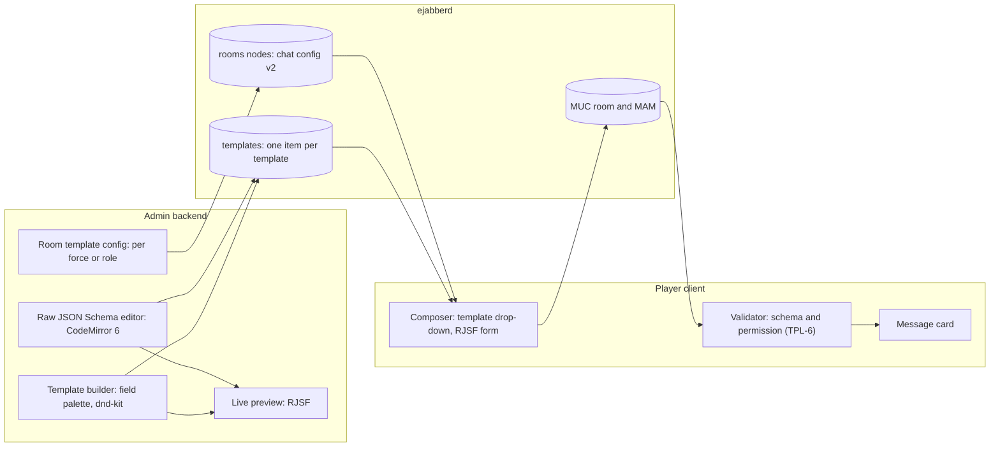

# Annexes A and B: how to build them

Nov 1, 2026. Proposal, written when the product owner's revision was merged into the SRD (`plan/reviews/srd-merge-2026-11-01.md`). Annex A (message templates) and Annex B (force assets and the map channel) are built after v1. What v1 must provide now is WP 3.5; spike S14 can run at any time. Internal: parts of this record describe access control and stay off the site (DOC-2).

## 1. v1 provisions (WP 3.5)

Checked against the code at commit 275ed4f.

| Provision | State now | Action in WP 3.5 |
| --- | --- | --- |
| GUID entity ids (§3 rule 1) | Slugs. `slugSchema` (`packages/schemas/src/common.ts`) is the id of forces, roles, rooms and assets; `nodeName` refuses anything else; the admin editor derives ids from names (`packages/admin-ui/src/draft/slug.ts`). About 100 source and test files use slug ids such as `blue-co` | An `idSchema`: a lowercase UUID, `^[0-9a-f]{8}-[0-9a-f]{4}-[0-9a-f]{4}-[0-9a-f]{4}-[0-9a-f]{12}$`. New ids from `crypto.randomUUID()`, with a `crypto.getRandomValues` fallback where there is no secure context (the file-hosting mode, NFR-8). `nodeName` and `parseNodeName` take GUIDs. `slugSchema` stays for room-type ids and login names |
| Readable login names | The role id is the login id and the XMPP localpart (`roleSchema.id`) | `roles:<guid>` gains `loginName`, which is the account name (`<loginName>@<domain>`): a player types it before login, and a GUID account would need an anonymous lookup, which NFR-21 forbids. Login names keep today's rules: slug-shaped, not `admin` or `anonymous`, not anonymous-shaped (`isReservedRoleId`), unique in the design, never reused while a `retired` record holds them. Editable until first published, then fixed (merge record N2). Message authors resolve by login name (§3 rule 6) |
| Deleted-entity records | None: a deleted role's messages show the raw JID | New singleton node `retired`: one item per deleted force or role, item id its GUID, `{schemaVersion, id, kind, name, loginName?, colour?, deletedAt}`. Read: game users (whitelist of every role); publish: admin. Publishing writes the record before removing the entity (ADM-39 order: record, affiliations, subscriptions, account). See the options below |
| Reserved `templates` name | Not reserved in code (`parseNodeName('templates:x')` is undefined, and nothing stops a later prefix of that name) | Add `templates` to a `RESERVED_NODE_NAMES` list in `packages/schemas/src/nodes.ts`. Publish never creates or deletes it in v1; audit and repair (ADM-41) ignore it. If S14 shows collections unusable, the same name serves a leaf (section 2) |
| Message body `{type, schemaVersion, content}` | Exists: `messageBodySchema` is a discriminated union on `type`, with `chat` only (`packages/schemas/src/message.ts`) | None. A `template` member joins the union in WP A1 |
| Room-type registry | Exists (ARC-5, WP 1.6), `chat` registered | None. Templates extend the `chat` room config (TD3 allows free text beside templates) rather than adding a room type |
| Objectives by the admin only (D21, §3 rule 14) | White Force non-observers have publisher affiliations; each editor writes its own item; readers pick the newest (F11) | White Force roles get read only. `objectivesMaxItems` becomes 1. Publish purges every item that is not the admin's (`admin`), after removing the publisher affiliations, so no stale editor's text survives; this needs a new AdminOps step with contract tests on both backends. Readers show the admin's item only. The game view's editor stays for the admin; the player client offers no editing to anyone else. Audit flags extra publishers and stray items |

**Where to keep last names: options**

| Option | For | Against |
| --- | --- | --- |
| A. `retired` node, one item per deleted entity (recommended) | Deleted entities are gone from every access calculation, so none can regain access by mistake. One extra node, read by all | One more subscription per client |
| B. Tombstones: keep `forces:<id>` and `roles:<id>` with `deleted: true` | No new node; author lookup unchanged | Every consumer of forces and roles (effective access, publish targets, the matrix, pickers) must filter tombstones; one miss leaks access (R14) |
| C. Keep last names in the design only | Nothing new on the server | Players cannot read the design; their clients could not show the names |

**Migration**

| What | How |
| --- | --- |
| Design files (ADM-16) | `designFileSchema` goes to `schemaVersion: 2`. Import of version 1 gives every entity a GUID, rewrites every reference (`forceId`, participant entries, objectives, theme asset ids, room-type defaults) and sets each role's `loginName` to its old id. A round-trip test covers every field that holds an id |
| The admin's local draft (`packages/admin-ui/src/draft/storage.ts`) | Migrated the same way on load, or offered for export first |
| Mock seed and demo (`packages/mock-server/src/seed.ts`, `demo.ts`) | Fixed GUIDs written into the seed, so screenshots and tests stay repeatable; login names keep today's ids (`blue-co`), so typed logins in tests and demos don't change |
| Mock database in browsers (DOC-17) | Bump the mock state format; old stored state resets to the seed with a notice. Migrating room history is not worth it |
| Saved layouts (PLY-5) and multi-client presets | Keys hold role ids, so old layouts are not found and the default layout is used once. Presets store login names, so they keep working; test it |
| Real servers | No in-place migration: export, import (converts), reset (ADM-15), publish. History is lost; no v1 game has run yet (merge record N3) |
| Tests, e2e scenarios, screenshots | Use fixtures' GUID constants and login names; the SC specs keep their "Traces to" headers |

## 2. Annex A: message templates (after v1)

### Architecture

- **Rendering (TD1):** RJSF with our own theme: field templates and widgets built on Radix and the `--wrx-*` tokens, so templates are themed per room (PLY-26) like everything else. No Bootstrap or MUI theme.
- **Validation:** RJSF's usual validator, `@rjsf/validator-ajv8`, compiles schemas with `new Function`. The client's Content-Security-Policy (`script-src 'self'`, no `'unsafe-eval'`, security review F7) refuses that, and templates are written at run time, so they cannot be precompiled at build time. So: a small RJSF `ValidatorType` adapter over an interpreting validator with no code generation. The same adapter checks forms in the composer and messages on receipt, so sender and receiver agree.
- **Builder (TD5, TPL-7):** our own, on dnd-kit, which the admin editor already uses with keyboard sorting (ADM-8, NFR-14). The palette holds the field types the templates need (text, long text, number, slider, yes/no, date, drop-down, linked drop-downs, force, role) and writes a restricted "WRX template profile" of JSON Schema plus UI schema that it can read back. The raw editor accepts any schema in that profile; anything the builder can't show opens as raw only, with a notice.

### Libraries

Licence MIT or Apache-2.0, bundled offline (NFR-7), and each version at least 14 days old when adopted (ui-stack rule). Dates checked on npm on Nov 1, 2026; re-check when the WP starts.

| Library | Version, licence, released | Verdict |
| --- | --- | --- |
| `@rjsf/core`, `@rjsf/utils` | 6.11.0, Apache-2.0, Sep 29, 2026 | **Use.** React ≥18; depends on `markdown-to-jsx` (descriptions, which must be rendered as plain text or sanitised, PLY-14) |
| `@rjsf/validator-ajv8` | 6.11.0, Apache-2.0 | **Reject:** needs `'unsafe-eval'` for run-time schemas |
| `@cfworker/json-schema` | 4.1.1, MIT, Jan 31, 2025 (4.1.3 and 4.1.4 are from Oct 30, 2026: too new) | **Use**, behind the adapter. Interprets schemas, no code generation (written for Cloudflare Workers, which forbid eval); drafts 4 to 2020-12 |
| `json-schema-library` | 11.6.16, MIT, Oct 23, 2026 | Fallback if the adapter needs more than cfworker gives (it also resolves defaults and dependencies); the latest release is too new, pick an older one |
| `@dnd-kit/core`, `@dnd-kit/sortable` | 6.3.1 and 10.0.0, MIT, Dec 2024 | **Use**: already pinned in `@wrx/admin-ui`. (`@dnd-kit/react` 0.5.3 is pre-1.0 and was released Oct 31: no) |
| `@codemirror/lang-json` with `@codemirror/view` and `@codemirror/state` | 6.0.2, MIT, Apr 2026 | **Use** for the raw editor: small, accessible, no workers |
| `@monaco-editor/react` | 4.7.0, MIT | Reject: several MB, workers, more than a schema editor needs |
| `@ginkgo-bioworks/react-json-schema-form-builder` | 4.2.0, Apache-2.0, Sep 28, 2026 | **Second choice.** A drag-and-drop builder that writes RJSF JSON Schema and UI schema, built on the same dnd-kit versions. Against: peer-depends on MUI 7 or 9 and Emotion, a second UI kit beside Radix that our tokens don't theme, and its own extension API for custom fields. Worth a one-day trial before building our own, to measure how much it saves |
| JSON Forms (`@jsonforms/react`) | 3.8.0, MIT | Reject: a different renderer from RJSF (TD1), depends on Ajv (the same CSP problem), and its editor is not maintained as a product |
| Form.io (`@formio/js`) | 5.7.0, MIT | Reject: its own form format, not JSON Schema; brings Bootstrap, Moment, Quill and more |
| `react-form-builder2` | 0.20.3, MIT, May 2025 | Reject: its own format |
| SurveyJS Creator | Commercial licence | Reject |

### Data model

| Item | Proposal |
| --- | --- |
| Template store (TPL-1) | The SRD says items in the reserved `templates` collection. Templates need no per-template access control (read: game users), so a **single leaf `templates` with one item per template** (item id the template GUID) is enough, and works whatever S14 finds. Recommended; the owner is asked to accept "leaf" for "collection" in TPL-1 |
| Template document | `{schemaVersion, id, name, description?, schema, uiSchema?, createdAt, lockedAt?}`. `schema` is JSON Schema 2020-12 in the WRX profile; WRX keywords (for example `"x-wrx-picker": "force"` with `"x-wrx-scope": "room"`) mark the special fields. Under the 250,000-byte item limit, checked like other documents (PLY-53) |
| Room config (TPL-2) | `chat` room config version 2: `{freeText: boolean, templates: [{kind: force|role, id, templateIds}]}`, entries like participants (§3 rule 4). Whether a role entry replaces or adds to its force's entry is an owner question; the admin and White Force non-observers may use every template configured in the room unless the owner says otherwise |
| Message body (TPL-3) | `{type: 'template', schemaVersion: 1, content: {templateId, values}}`. Values hold GUIDs for force, role and asset pickers (TPL-8). Under the 64 KiB stanza cap |
| Locking (TD6, TPL-4) | The admin cannot see reliably whether a template has been used: MAM has no standard search by body, and players can't write to the template node. So **lock a template once a published room makes it available** (`lockedAt` set at publish), which is stricter than "used in a message" but cannot miss a use. Editing a locked template offers "Copy to new template". Owner question: accept lock-on-publish? |

### Special fields

| Field | How |
| --- | --- |
| Force picker, role picker | RJSF widgets fed live from `forces:*` and `roles:*` through the store; scope (all, or this room's participants) and force filter from WRX keywords. Store the GUID; show the current name, or the `retired` name marked deleted (TPL-8, TPL-9). Validation accepts known or retired GUIDs only |
| Date, date and time | `format: date` or `date-time`; local display (PLY-45), ISO value |
| Numeric slider | `type: number` with `minimum`, `maximum`, `multipleOf`; `ui:widget: range` with a number field beside it for keyboard use |
| Drop-down list | `enum` with `oneOf` titles |
| Linked drop-downs | `dependencies` or `if`/`then`; raw editor first, builder support later |
| Image picker | Waits for the owner's answer (T-R2). If separate assets: reuse the theme asset path (PNG, WebP or sanitised SVG, shown via ``, §3 rule 12) with a per-message asset node; if inline: a hard size cap well inside 64 KiB |
| Asset picker | Waits for Annex B (T-R3, TPL-10) |

### Risks of client-side validation (T-R1)

The server enforces membership and voice only; template rules are advisory (D2). The receiving client checks, and each check has a failure mode:

- **Permission drift.** The room's template config can change after a message was sent. Checking against the config at display time would mark old, valid messages invalid when history is reloaded. Proposal: validate the schema always; for permission, warn only, saying the template is no longer allowed in the room, and still show the card. TPL-6 says to show such messages as plain text, so this needs the owner's agreement.
- **Validator differences.** The sender's and the receiver's checks must be the same code at the same version. One adapter, used by both, and a contract test of tricky schemas.
- **Hostile values.** A modified client can send values built to slow the receiver: very long strings, or input that makes an admin-written `pattern` backtrack. The profile caps lengths (`maxLength` required on text) and allows only patterns that pass a safe-regex check.
- **Rendering.** Values are always plain text (PLY-14); descriptions and titles from the template too. GUIDs are shown as names, never trusted for identity (§3 rule 3).
- **Size.** A message over the 64 KiB cap is refused by the sender (PLY-53); the receiver treats an over-size or invalid body as plain text (NFR-5).

### Proposed work packages (numbers given when the owner approves)

| WP | Delivers | Depends on |
| --- | --- | --- |
| A1 Template model | Template, room config v2 and message schemas; the `templates` node in publish, audit and the mock; the validator adapter; contract tests on both backends | WP 3.5 |
| A2 Composer and card | Template drop-down, RJSF theme on our tokens, special fields (force, role, date, slider, drop-downs), send, card, TPL-6 checks | A1 |
| A3 Template editor | Builder, raw editor, live preview, per-room and per-force config, matrix extension, lock and copy | A1 (in parallel with A2) |
| A4 Acceptance | A new user scenario for templates, accessibility and size checks, security review of T-R1 | A2, A3 |
| A5 Image and asset pickers | After the owner's image answer and Annex B's asset store | A2, B2 |

## 3. Annex B: force assets and the map channel (in discussion)

### Spike S14 (brief: `plan/briefs/WP-S14.md`)

A runnable spike like S13: `spike/s14/` against the pinned ejabberd 26.09 image, with results as JSON lines and an internal decision record, `plan/decisions/S14.md`. ejabberd implements collections (XEP-0248) only in its `dag` plugin, which its documentation calls experimental, and only with the `dag` node tree, which is set for the whole host. So the spike runs three configs:

| Config | `mod_pubsub` |
| --- | --- |
| V0 | The reference config: `plugins: [flat, pep]`, default node tree |
| V1 | `nodetree: dag`, `plugins: [flat, dag, pep]` |
| V2 | `nodetree: dag`, `plugins: [dag, pep]` (every node a `dag` node) |

| Check | Setup and assertion | Pass |
| --- | --- | --- |
| S14-1 Feature | `disco#info` on the PubSub service lists `pubsub#collections`, `pubsub#retrieve-items`, `pubsub#subscribe` | Listed in V1 or V2 |
| S14-2 Create and nest | Admin creates collection `c1` (`pubsub#node_type: collection`), leaf `l1` with `pubsub#collection: c1`, nested collection `c2` in `c1` with leaf `l2`, and moves an existing leaf into `c1` by config. `disco#items` on `c1` lists its children | All succeed with standard stanzas |
| S14-3 Access inheritance | `c1` is whitelist with role `blue` affiliated; leaves are created with no access config, then with `whitelist` and no affiliations. Record, per leaf config, whether `blue`, `red` (not affiliated) and an anonymous session can retrieve items | The leaf follows `c1`, or a rule-based setting makes it follow |
| S14-4 Direct read refused | `red` retrieves `l1` items directly, subscribes to `l1`, and reads `l1` via `disco#items` names | Retrieval and subscription refused (`forbidden` or `not-authorized`), not only collection subscription |
| S14-5 Collection subscription at scale | `blue` subscribes to `c1` (`subscription_type: items`, `subscription_depth: all`). Admin creates 600, then 1,200 leaves, and publishes one item to each. Record creation time, notifications received, p95 delivery latency and server memory | Every notification arrives, once, within 1 s p95 |
| S14-6 Late leaves | A leaf added to `c1` after `blue` subscribed delivers to `blue` | Delivered |
| S14-7 Revocation | Remove `blue`'s affiliation on `c1` (and its subscription, as ADM-36 does) | `blue` can read no leaf and gets no notification |
| S14-8 Overwrite by another publisher | Two publishers on a leaf; the second overwrites the first's item | Recorded either way: decides who may update an asset (below) |
| S14-9 No regressions | The v1 contract suite and the R1 tests (`pnpm test:contract`, `test:ejabberd:r1`) under V1 and V2, and V0's database started under V1 | Unchanged results; existing nodes survive the node-tree change |
| S14-10 Fallback numbers | One leaf per force with 600 items (one per asset): `max_items`, retrieval with RSM paging, publish rate, delivery latency | Recorded, for the two-nodes-per-force layout |

**Decision rule.** A node per asset is practical only if S14-2 to S14-7 pass and S14-9 shows no regression. Otherwise two nodes per force (S14-10), with AdminOps setting access by rule (R14). Either way the mock implements only what the contract tests cover (ARC-10).

### Asset store options

| Option | Layout | For | Against |
| --- | --- | --- | --- |
| 1. Node per asset under per-force collections | Collections `force-assets:<forceId>` (own) and `force-view:<forceId>` (what that force knows of others); one leaf per asset | Per-asset history as items (AD2); per-asset access possible | Needs S14 to pass, and `dag`, which ejabberd calls experimental; 600+ nodes per force to provision and audit |
| 2. Two nodes per force (the S14 fallback) | `force-assets:<forceId>` and `force-view:<forceId>`, one item per asset, item id the asset GUID (AD2) | Uses only the flat nodes v1 already relies on; access is two whitelists per force | History needs a third node per force; every reader of a force fetches all its assets |
| 3. Changes as messages in a per-force MUC room | Asset deltas posted to a members-only room; current state in a node as option 2 | MAM gives history for free; room membership is the proven access path | Current state must be rebuilt or snapshotted; a delta needs a voice |

The prefix `assets:` is taken by theme images (§3), so force assets need another one; `force-assets:` and `force-view:` are placeholders.

**Who writes asset state matters more than the layout.** ejabberd refuses to let one publisher overwrite another publisher's item (found in WP 1.2; S14-8 rechecks it on `dag`). If several roles of a force move the same asset, one item per asset does not work unless every update goes through one account (the admin, or a force "owner" role), or items are kept per author with the newest shown, the pattern objectives just dropped, with its clock problems (F11). The owner's answer to "who updates assets, and who decides what a force is aware of" decides this before any build.

### Proposed work packages

| WP | Delivers | Depends on |
| --- | --- | --- |
| S14 Spike | Section above | Contract suite (1.2); can start now |
| B1 Asset model | Asset and view schemas, node layout from S14, history choice, writer model | S14, owner answers |
| B2 Asset provisioning | AdminOps targets, publish and audit for asset nodes and views; mock; contract tests | B1 |
| B3 Map channel | A `map` room type in the registry: Leaflet with locally hosted tiles (D12), assets from the store | B2 |
| B4 Asset picker | The Annex A special field over B2's views (TPL-10) | B2, A2 |

### Order

WP 3.5 first, before the v1 security review (3.4), since it changes ids and objectives access. S14 can run beside it. After v1: A1, then A2 and A3 together, then A4; Annex B from B1 once S14 and the owner's answers are in; A5 and B4 last.

## Open questions for the owner

1. Templates: may TPL-1's `templates` be a single leaf node with one item per template, rather than a collection? (Recommended: yes.)
2. Templates: lock a template when a published room makes it available, rather than on first use? (Recommended: yes; usage cannot be seen reliably.)
3. Templates: when a room's template rules change, how should older messages that used a now-disallowed template show: as a card with a warning, or as plain text (TPL-6 as written)? (Recommended: card with a warning.)
4. Templates: does a role entry in a room's template config replace its force's entry or add to it? Which templates do the admin and White Force non-observers get? (Recommended: add; all templates in the room.)
5. Templates: are template names and fields confidential between forces? TPL-1 lets every role read every template. (Recommended: not confidential; if they are, templates move to per-force nodes.)
6. Templates: image picker storage, inline or separate assets (Annex A's open question). (Recommended: separate assets, reusing the theme asset rules.)
7. Assets: who updates a force's asset state (the force's roles, one role per force, or the admin and White Force), and who decides what a force knows about others' assets (the umpire by hand, or rules)?
8. Assets: how much history per asset, and who reads it?
9. Login names: fixed once published (merge record N2)?
10. Real servers: confirm that no provisioned game must keep its history through the GUID change (merge record N3).
