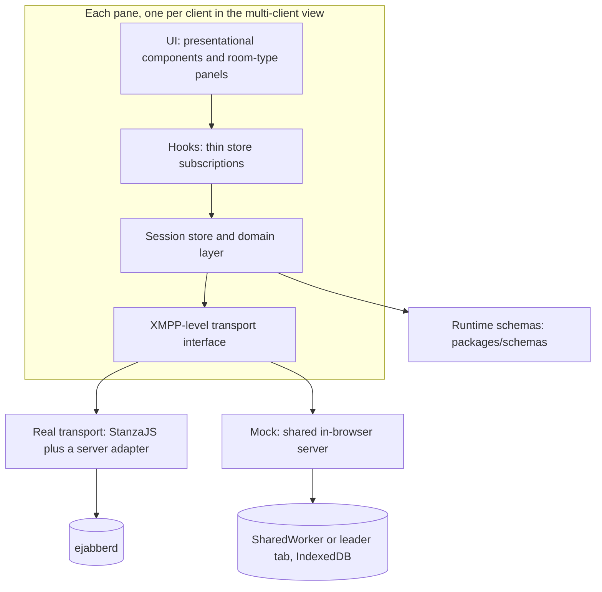
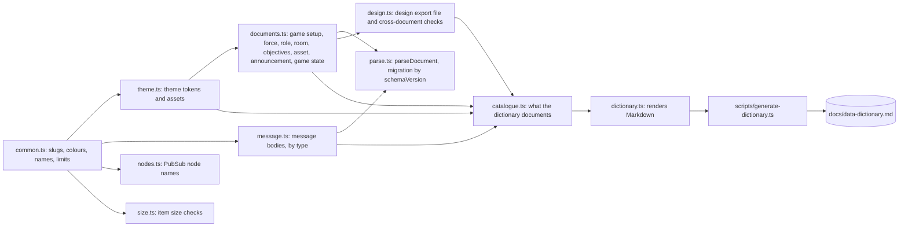
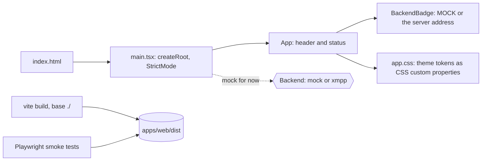
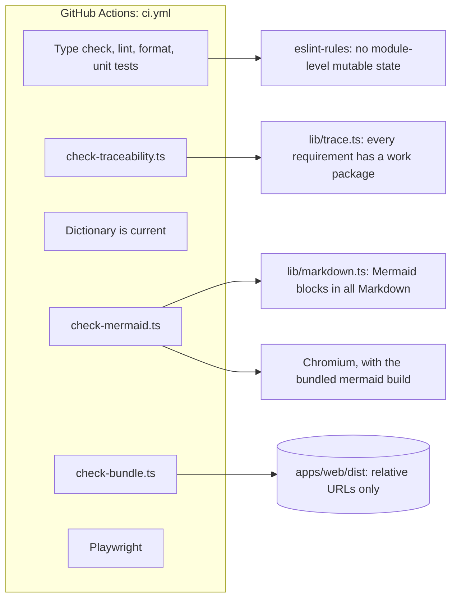
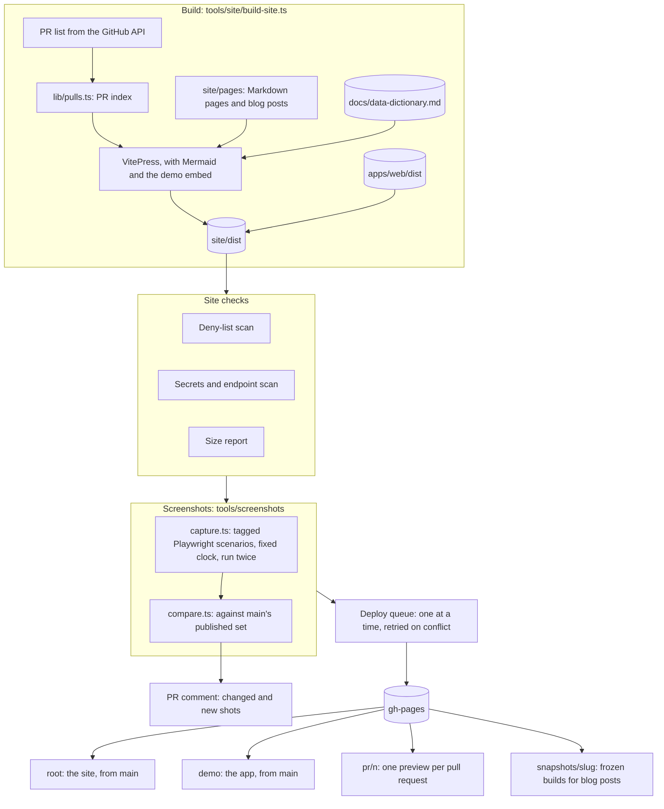

# Architecture

This page has one diagram per sub-system. A pull request that changes a sub-system updates its diagram here.

## The client, as planned

The client is layered so that every pane of the multi-client view is independent, and swapping the real XMPP server for the in-browser mock changes only the transport. Phases 1 and 2 build these layers; the sections below show what exists today.

## Schemas

`packages/schemas` holds a zod schema for every PubSub document and message body, and the TypeScript types inferred from them. The [data dictionary](./data-dictionary) is generated from the same schemas, so the documentation cannot drift from the code.

## Web app shell

`apps/web` is a Vite and React app. Today it is a shell that shows which backend it uses; the player client and admin backend are built in Phase 2. It builds with relative asset URLs, so one build runs under any base path.

## CI tools

`tools/` holds the checks that run on every pull request, and the repo's own lint rule.

## Site and previews

This site is built with VitePress from `site/`, with the app embedded at `app/`. The workflows deploy it to the `gh-pages` branch through one queue: the site root and the live demo from `main`, a preview of every pull request, and frozen snapshots for blog posts.

Each build also takes screenshots when a pull request changes the app or the site. The scenarios run on a fixed clock, and each build takes them twice and fails if the two runs differ, so an image changes only when the page does. A preview keeps only the screenshots that differ from `main`, with `main`'s version beside each changed one; the root keeps the full set, which later pull requests compare against.
