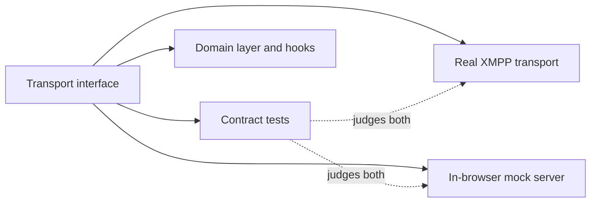

# Phase 0: foundations in place

Phase 0 is done. Nothing a player would see exists yet. What exists is everything the next three phases build on: the repo and its checks, the schemas for every document, this site with a live preview of every pull request, and answers to the open questions that could have changed the design.

## What was built

- **The repo and its checks.** A TypeScript monorepo in strict mode. Every pull request runs lint, unit tests, a production build and browser tests. CI also checks that every requirement in the specification belongs to a work package, and that every diagram parses.
- **Schemas for every document.** Each document the game stores has a runtime schema, and the TypeScript types are inferred from it. The [data dictionary](../data-dictionary) is generated from the same schemas, as the earlier post [Schemas first, and a dictionary that writes itself](./schemas-and-data-dictionary) describes.
- **This site, and a preview of every pull request.** Each pull request gets its own copy of this site with the app built in, on the mock backend. A bot comment on the pull request links to it and shows screenshots of anything that changed, beside the same page on `main`. The [PR index](../prs) lists every preview.

## What was decided

Three choices were open at the start, and each was settled by building the same small thing two ways:

| Question | Choice | Why |
| --- | --- | --- |
| Dockable layout library | FlexLayout | Smaller, fully open-source, and its layout model can be tested without a browser. dockview is the fallback |
| XMPP client library | StanzaJS | Typed support for nearly everything we need, and it passed every live test against the chosen server |
| Site generator | VitePress | Builds offline, renders diagrams from a bundled library, and can embed the app |

Neither choice is free. Each library has a single maintainer, and FlexLayout is not yet at version 1.0. Both sit behind interfaces of our own, so either can be replaced without touching the rest of the app.

A round of tests against the chosen XMPP server also settled how the admin tooling has to work in places where the standards leave room. Those findings changed one requirement and added work to Phase 2, and the specification now records them.

## What's next

Phase 1 builds the contracts and the transports:

One interface sits between the app and the backend. Two implementations sit behind it: the real XMPP server, and a mock that runs in the browser for demos. One set of contract tests runs against both, so the mock behaves like the real server or the build fails.
