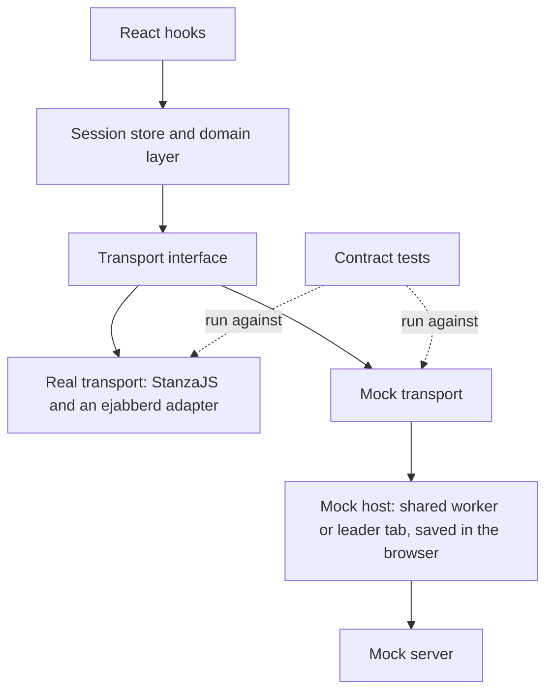

# Phase 1: one interface, two backends, one judge

Phase 1 built everything between the app and the server. There is still no player screen. What exists now is the plumbing that every screen in Phase 2 will use, and a way to prove that the demo backend tells the truth.

## The shape of it

- **The transport interface.** One TypeScript interface covers logging in, chat rooms, message history, the documents that describe the game, and server administration. Every operation returns a result rather than throwing, so a refusal from the server is ordinary data, not a crash.
- **The real transport.** It talks to ejabberd, the XMPP server WRX1 runs on, and keeps everything specific to that server in one adapter.
- **The mock.** A small XMPP-like server written in TypeScript runs in the browser. One copy is shared by every tab of a deployment, so two windows can act as two players. It is saved in the browser, and each deployment of the site keeps its own copy.
- **The domain layer.** One store per player pane turns raw server traffic into validated game documents and ordered, de-duplicated chat timelines. Thin React hooks expose it to the UI.

## Why the mock can be trusted

A demo backend that behaves differently from the real server would mislead every reviewer who used it. So the mock is not tested on its own terms. One suite of contract tests runs against both a real ejabberd server in CI and the mock, and the build fails if they disagree. The mock implements only what those tests cover, and any behaviour it needed beyond them is listed as uncovered.

The tests earned their keep immediately. They showed that the server will not let one author overwrite another author's document. That would have stopped umpires from editing objectives written by the admin, so objectives are now kept as one version per author, with the newest shown. The fix landed before any screen was built on the old assumption.

## Limits

- Only Chromium is tested so far. Firefox and Safari come in Phase 3.
- The mock saves the whole game in one browser record. That is fine for demos, but very long games will make each save slower.

## Next

Phase 2 builds the screens: the admin's game editor and publishing, the player's welcome page, login and dockable chat workspace, themes, and the multi-client view for demos. It runs in three lanes in parallel.
