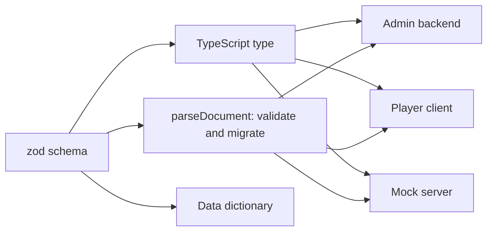

# Schemas first, and a dictionary that writes itself

Everything a WRX1 game stores lives in the XMPP server as JSON documents: the game setup, each force, role and room, objectives, theme images, announcements, and the body of every chat message. Before writing any transport, mock or UI, we wrote down the shape of every one of those documents as a runtime schema. This post explains why, and how the [data dictionary](../data-dictionary) on this site is generated from them.

## Why schemas come first

Three parts of WRX1 read and write the same documents: the admin backend that publishes a game, the player client that reads it, and the in-browser mock server used for demos. If each had its own idea of what a room looks like, they would drift apart, and a demo on the mock would stop being a fair picture of the real server.

So there is one source of truth, `packages/schemas`, built with [zod](https://zod.dev). Each schema both **validates** data at runtime and **defines** the TypeScript type, which is inferred from it. A field can't be added to the type without being added to the validation, or the other way round.

## Every document carries a version

Each document has a `schemaVersion`. When a client reads one, `parseDocument` migrates older versions forward one step at a time and then validates the result. It never throws: a document that fails validation comes back as a typed error, which the caller logs and ignores, so one bad document can't crash a player's screen. The same result type is the convention for both transport layers.

## Rules the schemas enforce

Some of the design rules are easier to enforce in a schema than to remember in code review:

- **Ids are stable slugs.** Forces, roles, rooms and assets get lower-case, URL-safe ids that never change, and display names are separate fields.
- **No passwords in documents.** Role passwords are never stored in a PubSub document, and the design export file rejects a `password` field outright, so a design that carries passwords can't be imported.
- **Sizes are checked before publishing.** Theme images default to a 100 KB limit, and every document is checked against the server's PubSub item limit before it is sent.
- **Cross-document checks.** A whole design is checked for unique ids, references that resolve, and at most one umpire force.

## A dictionary that writes itself

The schemas carry descriptions, and a small generator walks them to produce Markdown: one table per document, with every field's type, whether it is required, its constraints and its description. That file, `docs/data-dictionary.md`, is committed to the repo, and CI fails if it is out of date with the schemas.

This site doesn't copy it either. The data dictionary page includes the generated file when the site is built, so the published dictionary always matches the code it was built from.

## What's next

The schemas are a frozen interface from here on: later changes are allowed, but each one is listed at the phase gate. Phase 1 builds on them with the transport interface, the contract test suite and the mock server.
