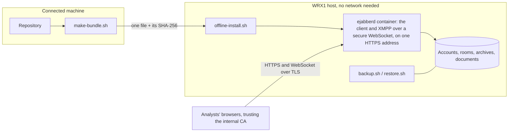

# Deployment

WRX1 runs on an internal or air-gapped network with nothing fetched from the internet. One server holds everything: the XMPP server, the client the browsers load, and the game's data. The full operator's guide is in the repository (`ops/README.md`); this page is the outline.

## One container, one origin

The reference deployment is a single container: the official ejabberd 26.09 image, pinned to an exact image digest, with the project's reference configuration. It serves the built client and its WebSocket from the same HTTPS origin, so the browser needs no other address, and it sends the client's Content-Security-Policy as a header. Only one port is published, and it speaks TLS 1.2 or later.

The same configuration file runs in CI, where every transport contract test, admin scenario and deployment check passes against it before a change is merged.

## Python scripts in the browser

After v1, the admin and White Force will be able to run Python scripts in the browser; the runner is built, and the script panel that uses it is next. The interpreter, Pyodide, and the Python packages it uses are part of the build, in its `py/` folder, about 23 MB, and load only when a script runs, never for other roles. Nothing is fetched from the internet at install or at run time.

For this the client's Content-Security-Policy allows WebAssembly (`'wasm-unsafe-eval'` in `script-src`) and workers started from `blob:` URLs (`worker-src 'self' blob:`). It still refuses `eval`. A web server must send `.wasm` files as `application/wasm`; the reference configuration does.

## Offline install

On a machine with network access, `make-bundle.sh` packs the image, the built client, the configuration and the scripts into one file, with a checksum for every file inside it. On the target host, `offline-install.sh` checks the bundle, loads the image and checks it is the pinned one, installs the files, starts the server, creates the admin account (asking for its password, which is never written down) and runs a set of checks from the outside. Running it again with a newer bundle is an upgrade: it backs up first and keeps all data.

The install is tested here inside a container with networking switched off, and the whole contract suite then runs against that installation. A container is not a host, so the first deployment is also checked on the real hardware by a person, with a checklist in the guide.

## Certificates from an internal CA

Browsers must trust the server's certificate. The scripts support both cases:

- **The organisation has a CA:** a script makes the server's key and a signing request for it.
- **It has none:** a script makes a small CA that can only vouch for the exercise's own domain, and signs the server's certificate with it.

The guide shows how to make Windows, macOS, Linux and Firefox trust the CA, by group policy or by hand.

## Backup and restore

`backup.sh` takes a consistent copy while the server runs: accounts, rooms with their settings and message archives, the game's documents and theme images, and the admin's stored data. `restore.sh` puts it back, on the same host or a new one. The test behind it publishes a game, backs up, deletes the whole installation, installs again, restores, and checks that every account, room, message, document and setting is back.

## Open questions

Which browsers analysts use, who approves running the server software on internal hosts, who checks the install on the real hardware, and how the customer distributes CA certificates are still to be answered. Each answer changes configuration, not code.
