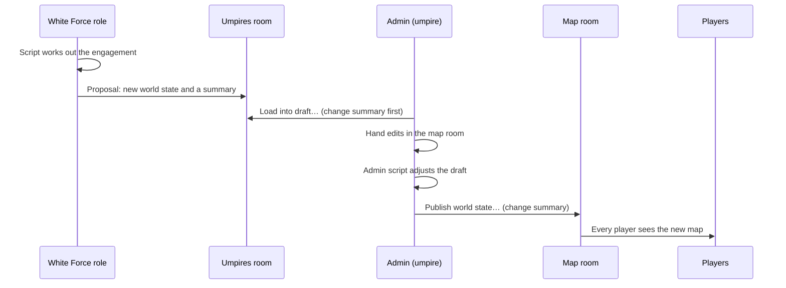

# Scripting for umpires

A practical guide for the umpire team: the admin and the White Force's roles. [Umpires and Python scripts](./umpires.md) explains what the umpires room, proposals and the Scripts panel are; this page is about using them well. Scripts are short Python programs that run in your browser tab, with exactly the rights of the role you are logged in as.

## A turn with scripts



1. A White Force role runs a script that reads the world state, works out what happened and posts a **proposal** to the umpires room.
2. The admin opens the proposal's card, chooses **Load into draft…**, reads the change summary and loads it. Nothing reaches players yet.
3. The admin corrects anything by hand in the map room's editor.
4. The admin runs a script on the draft, for example to resupply every unit in reach of a depot. Its changes land on top of the draft, so the hand edits stay.
5. The admin chooses **Publish world state…**, reads the change summary, which lists every change from all three sources, and publishes.

## Your first script

Open the **Scripts** tab in the strip at the bottom of the workspace (drag it beside the rooms for more room) and choose **New script**. It starts from a short example that prints who you are and which rooms you see. Choose **Run**: the first run in a session waits a few seconds while Python starts.

```python
import wrx

game = wrx.Game()
state = await game.world_state()
for asset in state.assets.values():
    if asset.health < 50:
        print(asset.title, asset.health)
```

Every read is `await`ed. A script can read the turn, the forces and roles, its rooms and their messages, the world state and objectives; it can send messages to rooms its role writes in; the admin's scripts can read and change the world-state draft, and the White Force's can post proposals. A script can never do what its role cannot.

## Proposing a world state (White Force)

```python
import wrx

game = wrx.Game()
state = await game.world_state()
tank = next(a for a in state.assets.values() if a.title == "Tank Company")
state.assets[tank.id] = tank.model_copy(update={"state": "damaged", "health": 40})
await game.post_proposal(state, "Tank Company hit by artillery: damaged, 40%.")
```

The summary is what the admin reads first, so say what changed and why, in a sentence or two. A proposal carries the whole world state; the admin's change summary shows what it changes against what players see now.

## Changing the draft (admin)

```python
import wrx

game = wrx.Game()
state = await game.draft()  # your draft, or the published state if you have none
for asset in state.assets.values():
    if asset.fuel < 50:
        state.assets[asset.id] = asset.model_copy(update={"fuel": 100})
await game.write_draft(state)
```

- The change lands only when the script **finishes cleanly**. If you stop it, it reaches its time limit, or it fails, your draft is as it was.
- It lands as **the script's change on top of your draft as it is then**. Start from `await game.draft()` to build on the draft, or from `await game.world_state()` to change the published state. If the script and your hand edit changed the same asset, the script's values win and the panel names the asset.
- After the run the panel says what the script changed, and how the draft now differs from what players see. Then publish from the map room as usual.

## Reacting to messages and the turn

```python
import wrx

game = wrx.Game()

@game.on_message("the room's id")
async def answer(message):
    await game.send_message(message.roomId, "Umpires acknowledge.")

@game.on_phase
def phase(state):
    print("Now turn", state.turn, state.phase)

await game.run_forever(seconds=600)
```

A script that reacts runs only while your tab is open and the run lasts. Give `run_forever` a number of seconds, or call `game.stop()` from a handler: a run that is ended by its time limit or by Stop has not finished cleanly, so an admin script's draft change is dropped. Your own messages are left out, so a handler that replies does not answer itself.

## Publishing without review

Each admin script has a **Publish without review** box, off by default. Turn it on only for a script you have run and checked several times with it off. With it on, each clean run that changes the draft publishes it to every role at once, with the checks of a manual publish but without the change summary, at any time, mid-phase included. The panel lists each such publish under **Published without review**.

- It publishes **the whole draft**, including hand edits you have not reviewed. Publish or discard your hand edits first.
- If the map room cannot find the latest world state (when it says to **Look further back**), nothing is published: find it first, then run again.
- A mistake is put right with an ordinary **Publish world state…**.

## Good practice

- **Read before you run.** A script runs with your login's rights. Run only scripts you wrote or have read, including imported ones: importing never runs anything and never turns on publishing without review.
- **Start fresh.** Runs in one panel share a Python session until you choose Stop, a run reaches its time limit or the panel closes. A script can leave things behind for the next run, so choose Stop once before running an important script after one you are not sure of.
- **Keep handlers short and bounded.** A handler that answers every message can fill a room; give it a time with `run_forever(seconds=...)` while you try it.
- **Shared logins share scripts.** Everyone using a role's login sees and can change its scripts. If two people save at once, the second is told and chooses which to keep. Agree within the team who edits which script.
- **Export your scripts** before a game, as a file you can import again: they are kept with the login on the server, but a file is a copy you control.

## Limits

| What | How much |
| --- | --: |
| Python ready, first time in a session | about 2 s |
| First script that uses the SDK | about 1 s more |
| First table with pandas | about 3 s more |
| A script over 600 assets, once Python is warm | under 0.1 s |
| Time limit per run | 30 s by default, up to 10 minutes |
| Scripts kept per login | 200,000 bytes in all |

The sample scripts in the repository's `python/examples/` folder are a bundle you can import: reading the game, a table with pandas, a notice to every room, changing the draft and posting a proposal. The full reference is `docs/python-sdk.md` in the repository.
