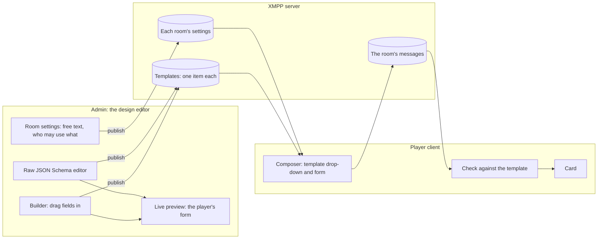

# Message templates

Some rooms take structured messages as well as, or instead of, free text: a situation report, a contact report, a request for support. The admin designs each one as a form. Players pick a template in the room's composer, fill in its form and send it, and everyone in the room sees the message as a card with a label and a value for each field.

Templates follow the specification in the SRD's Annex A, built in Phase 4. Image and asset pickers are not built yet: they wait for the decision on how images are stored, and for the force assets of the planned map channel.

## Designing a template

A template is a JSON Schema document, filled in with React JSON Schema Form, as in the earlier War Rooms. In the admin's **Templates** section, the admin either builds it from a palette of fields, dragging them into place or reordering them with the keyboard, or edits the JSON Schema directly in a code editor. Both edit the same template, and switching between them keeps it. Each field has its own settings: label, whether it is required, limits, options, and for pickers which forces or roles they offer.

The fields are:

| Field | What the player sees |
| --- | --- |
| Text, long text | A text box, with a count of characters left |
| Number, slider | A number box, or a slider with a number box beside it for the keyboard |
| Yes/no | A tick box; left unticked, it is sent as "no" |
| Date, date and time | The browser's date picker; shown in each reader's local time |
| Drop-down | A list of fixed options |
| Linked drop-downs | The choice in one list sets the options of the next |
| Force picker, role picker | A list of the game's forces or roles, or only those in this room. The message stores the force's or role's id, so each card shows its current name, and a deleted one's last name marked "(deleted)" |

Templates use a deliberately small part of JSON Schema: named fields of simple types, conditions one level deep, and a short list of display options. Anything outside it is refused, with a message saying where and why. That keeps every template something the builder can show, a card can display, and every client can check quickly.

Beside the editor, a **live preview** shows the form exactly as players will see it: the same widgets, the same theme and the same checks. Pressing **Check** shows what a player would be told before sending.

## Choosing who may use it

Each chat room's settings say whether free text is allowed, and which templates each force or role may use there. Forces in the same room can have different templates. A role's own entry adds to its force's. The umpire, and White Force roles who are not observers, may use every template the room offers; observers never post. The access table in the admin shows each role's templates in each room before anything is published.

## Publishing and locking

Templates are published with the rest of the game. Once a published room has offered a template, players may have used it, so it is locked: its fields, their labels and order, and its name are fixed. The editor shows it read only, and publishing refuses a change to any of them. To change it, the admin copies it to a new template, edits the copy and offers the copy instead. Old messages keep showing with the template they were sent with. Only a locked template's description can still change.

## Sending and reading

When a room offers templates, the composer gets a **Message type** drop-down: free text, if the room allows it, and each template the player's role may use. When Send is pressed, any field that does not fit is marked with the reason, and nothing is sent until every field fits. Values not yet sent are kept if the player switches between types or the message is refused, as unsent text is. In a room that takes only templates and offers a role none, the composer says so.

Like the plain text box, the composer can be collapsed to a slim bar at the foot of the room, for players who read a room but rarely write in it. Collapsing loses nothing: the chosen type and the form's values are kept, and the bar says **Draft not sent** while something is waiting. Each room remembers whether it was collapsed, with the rest of the player's layout.

Recipients see a card: the template's name, then each filled field's label and value, in the form's order. Everything on a card is plain text.

Every client checks every templated message against its template when it shows it:

- A message that fits, from a role the room offers the template to, is a card.
- A message whose template the room no longer offers to its sender, for example after the admin changed the room's settings, is still a card, with a note saying so. History does not change when the settings do.
- A message that does not fit its template, or names a template the game does not have, is shown as plain text, field by field, with a warning.

The check takes a few hundredths of a millisecond per message, and a room of 2,000 templated messages opens and scrolls as quickly as a plain chat room.

## Try it

In the demo below, log in as `blue-co` (Blue CO) and open the **Blue Reports** room, which takes templates only. Its three templates use every field type. Log in as `admin` and open `#/admin` to see the Templates section and the preview; the demo logins are listed on the welcome page.

<AppDemo :height="480" />
