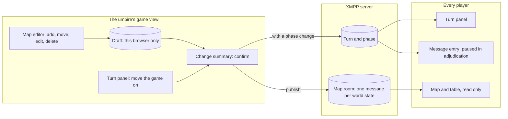

# Turns and the map

A game runs in turns, and every game has a map. The admin, who is the umpire, moves the game from turn to turn and keeps the map's picture of the world up to date. Players see both change as it happens. Both were added to version 1 in Phase 5, at the product owner's request.

## Turns

Each turn has a planning phase and then an adjudication phase. The turn panel, at the top of the out-of-game column, shows the turn number and the phase to everyone, and updates the moment it changes.

- **Only the admin moves the game on:** from the turn panel in the game view, or from the turn control in the admin backend's header. Each change asks for a confirmation first, which says what happens next.
- **During adjudication**, roles outside the White Force cannot post. Their message entry is paused with a note that says why, and anything they had typed is kept for the next planning phase. The White Force and the admin keep posting, so umpires can give rulings.
- **Advisory, not enforced.** The pause is applied by the app, not by the server: a modified client could still post during adjudication. Version 1 accepts that; the umpires see every message.

## The map room

Every game has exactly one map room, and every role can open it. It shows the **world state**: each force's units and platforms as standard military symbols (MIL-STD-2525 or APP-6), with a title, force, category, position, state, health and fuel.

- **Map or table.** Select a symbol to see its details, or switch to the table: the same assets, sorted by force, usable from the keyboard alone. The map pans with the arrow keys and zooms with plus and minus.
- **Read only for players.** Only the admin's world states count. If anyone else posts something into the map room, every client ignores it.
- **Always the latest.** A player who opens the map, or comes back after a reload, sees the newest world state the admin has published; later ones replace it as they arrive.
- **Base map.** The map draws its background from a tile server that the deployment chooses. A tile server learns which area each player looks at, so on an internal network the operator decides which one to use, or none: without one, the map shows the assets on a plain background. The demo on this site uses OpenStreetMap's tiles.

## Editing the world state

Only the admin edits the map, in the map room of the umpire's game view. Players and the admin's preview of a role never see the editing tools.

- **Add** an asset with "Add asset…", which opens a form, or with "Place on map" and a click where it goes.
- **Move** an asset by dragging its symbol, or, from the keyboard, by changing its latitude and longitude in its form.
- **Edit** any of its details in the form, which previews the symbol as its code is typed and checks every field.
- **Delete** it from its details, after a confirmation.

Edits build up as a **draft held only in this browser**. While the draft differs from what players see, the map says how many assets have unpublished changes and that clearing the browser's data or changing device loses them. If the game was reset since the draft began, the map warns that the draft may belong to the earlier game.

### Publishing

The admin publishes the draft in one of two ways:

- **With a phase change.** Starting the next phase or turn shows the change summary in the confirmation and publishes the world state with it, stamped with the new turn. A phase change with no edits publishes no world state.
- **At any time,** with "Publish world state", for example to set up the starting position before play, or to correct a mistake in the middle of a turn.

Either way the admin first sees a summary: the assets added, removed and changed, with the fields that changed and their old and new values. Every publish sends the whole world state as one message, so a player who joins late needs only the latest one. A world state may be up to 500 KB as a message: about 1,700 assets of typical size, or nearly 1,000 with every text field at its longest. The editor refuses a larger one with its size and what to do.

### Moving a game with its map

A design export carries the world state: the admin's draft if this browser holds one, otherwise the latest published state. The export says when the file holds an unpublished draft, and when it holds no world state because the published one could not be read. Importing a design makes its world state the admin's draft, which players see only once it is published.

## Python scripts for umpires

After v1 (Phase 6), umpires can automate their work with short Python scripts that run in the browser. The admin, in the umpire's game view, and every White Force role that is not an observer have a **Scripts** tab in the strip at the bottom of the workspace; players and observers do not. It can be dragged beside the rooms or popped out like any other panel.

- **Write and run.** Create, rename, duplicate and delete scripts, edit the code, and run it. Output shows as it is printed, and an error shows Python's own report of where it went wrong. Stop ends a run at once, and every run has a time limit, 30 seconds unless the script sets another (at most 10 minutes).
- **Same rights as the role.** A script reads the game as its role does: the turn, forces, roles, its rooms and their messages, the world state and objectives. It can do nothing the role cannot.
- **The admin's draft.** An admin script can work out a new world state and put it in the admin's draft. It lands only when the script finishes cleanly; a stopped, timed-out or failed run leaves the draft as it was. Nothing is published: the admin reviews the change summary in the map room and publishes as usual.
- **Kept with the login.** Scripts are stored on the server with the login, not in the browser, so they follow it to another device and to the next game, and everyone who shares a role's login shares its scripts. If two people save at once, the second is told and chooses whether to reload or keep their change.
- **Files.** Export saves all of a login's scripts as one file, and import adds scripts from such a file or from `.py` files. Importing never runs anything.

## Layouts and design changes

Players arrange their rooms in a dockable workspace, saved in their browser. A design change resets every online player's layout to the default, with a notice, only when it is **structural**: a room added or removed, or a change to which rooms a role can see or write in. Renaming, re-ordering, themes, objectives and templates never reset a layout, and nor does adding or removing a role: only the rooms of roles already in the game are compared.
