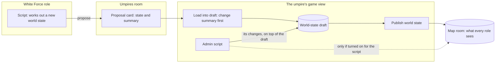

# Umpires and Python scripts

The White Force runs the game: the admin, who is the umpire, and the White Force's own roles. After version 1 (Phase 6), they can share the work through a room of their own and automate it with short Python scripts that run in the browser. Players and observers of the other forces see none of this.

## The umpires room

Every game has one umpires room, made with the map room when the game is first published. Like the map room, it cannot be deleted and its members are fixed: the admin and every White Force role. White Force roles that are not observers write in it; White Force observers can only read it. No other role sees it.

It is a chat room for the umpire team, and the place where White Force scripts send their proposed world states to the admin.

## Proposals

A White Force script can work out a new world state, for example after an engagement, and propose it with a short summary of what it changes. The proposal arrives in the umpires room as a card. The admin's card has **Load into draft…**, which first shows the change summary against the published state, and warns if the admin's draft has unpublished edits that loading would replace. Once loaded, the proposal is the admin's draft, and the admin publishes it from the map room as usual. Everyone else sees the card only. Proposals may be posted during adjudication.

## Scripts

The admin, in the umpire's game view, and every White Force role that is not an observer have a **Scripts** tab in the strip at the bottom of the workspace. It can be dragged beside the rooms or popped out like any other panel.

- **Write and run.** Create, rename, duplicate and delete scripts, edit the code, and run it. Output shows as it is printed, and an error shows Python's own report of where it went wrong. Stop ends a run at once, and every run has a time limit, 30 seconds unless the script sets another (at most 10 minutes), counted from when the script starts.
- **Same rights as the role.** A script reads the game as its role does: the turn, forces, roles, its rooms and their messages, the world state and objectives. It can send messages, plain or from a template, to rooms its role writes in, and it can do nothing the role cannot. During adjudication the White Force keeps posting, as people do.
- **Reacting.** A script can wait for new messages in a room, or for the turn or phase to change, and act on each one, for as long as it runs: for example, acknowledge every request in a room.
- **The admin's draft.** An admin script reads the world-state draft and changes it. Its changes land when the script finishes cleanly, on top of the draft as it is then, so edits the admin made by hand to other assets are kept; a stopped, timed-out or failed run leaves the draft as it was. The panel then says what the script changed and how the draft differs from what players see.
- **Publishing without review.** By default nothing a script does reaches the players' map: the admin reviews the change summary in the map room and publishes. For each admin script, the admin may turn on **Publish without review**, after a confirmation that it will change the live map without review. Each clean run of that script that changes the draft then publishes it at once, with the same checks as a manual publish, and the panel keeps a record of each such publish: which script, which turn and what changed. A mistake is put right with an ordinary publish.
- **Kept with the login.** Scripts are stored on the server with the login, not in the browser, so they follow it to another device and to the next game, and everyone who shares a role's login shares its scripts. If two people save at once, the second is told and chooses whether to reload or keep their change.
- **Files.** Export saves all of a login's scripts as one file, and import adds scripts from such a file or from `.py` files. Importing never runs anything, and an imported script never publishes without review until the admin turns it on.

[Scripting for umpires](./scripting.md) walks through a turn with scripts, with examples and good practice.

In a pull request's preview of the site, the app includes Python only when the pull request changes the Python parts; otherwise the Scripts panel says Python is not available in that build. The demo on the main site always has it.
